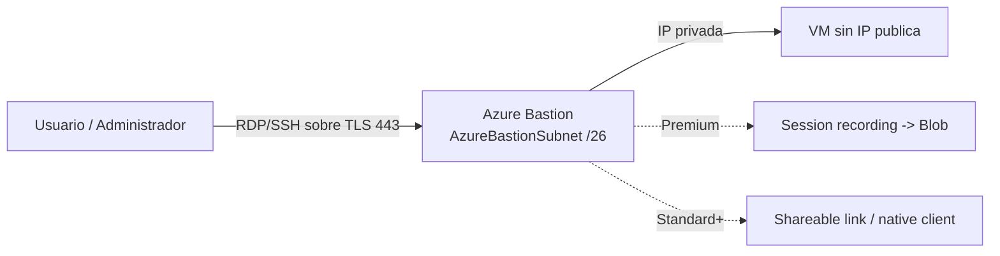

# Fase complementaria 1: Azure Bastion

> Fase complementaria (tema no cubierto por las lecciones). Fuente: documentación oficial de Microsoft Learn (Azure Bastion).

## Si solo recuerdas 3 cosas
- Azure Bastion es un servicio **PaaS totalmente administrado** que da conectividad **RDP/SSH sobre TLS (puerto 443)** a las VMs de una VNet, **sin** exponer IP pública, agente ni cliente especial en la VM.
- Se despliega en tu VNet y requiere una **subred dedicada llamada `AzureBastionSubnet`** de **/26 o mayor** (y, salvo Developer/Private-only, una **IP pública Standard estática**).
- Tiene **4 SKU (Developer, Basic, Standard, Premium)**; solo Premium añade **session recording** y despliegue **private-only**.

## Objetivo de repaso
Recordar qué es Azure Bastion, sus SKU, los requisitos de despliegue y los métodos de conexión.

## Comparaciones clave

| SKU | Capacidad | Incluye |
|---|---|---|
| Developer | Compartida (1 VM a la vez, regiones selectas) | Pruebas; sin VNet/IP pública dedicada |
| Basic | Fija (2 instancias) | Conexión por navegador; producción moderada |
| Standard | Host scaling configurable | Native client, shareable links, conexión por IP, puertos personalizados, file transfer |
| Premium | Host scaling | Todo lo de Standard + **session recording** y despliegue **private-only** |

| Arquitectura | IP pública | Notas |
|---|---|---|
| Dedicated (Basic/Standard/Premium) | Sí (Standard estática) | En tu VNet con `AzureBastionSubnet` |
| Developer | No | Infraestructura compartida; sin VNet |
| Private-only (Premium) | No | Todo el acceso por IP privada |

| Método de conexión | SKU |
|---|---|
| Navegador (HTML5) | Todos |
| Native client (RDP/SSH local, Entra ID) | Standard y Premium |
| Shareable links | Standard y Premium |

## Diagrama

## Requisitos y restricciones
- Subred **`AzureBastionSubnet`**: nombre exacto, **/26 o mayor**, en la **misma VNet y grupo de recursos** que el bastión y **sin otros recursos**.
- La IP pública debe ser **SKU Standard** y de asignación **estática**.
- Debes **desplegar una vez** por VNet; puedes dar servicio a otras redes con **VNet peering**.
- **Session recording** requiere SKU **Premium**; guarda las sesiones en un contenedor de blob mediante SAS URL.
- **Availability zones** y **IPv6 dual stack** están en **preview** (dual stack debe configurarse al crear).
- El despliegue **private-only** requiere Premium y **no** admite IPv6.

## Requisito → Consecuencia
| Si… | Entonces… | Si no… |
|---|---|---|
| Quieres conectarte a VMs sin IP pública | Despliega Azure Bastion | Tendrías que exponer IP pública o un jump box |
| Necesitas grabar sesiones para cumplimiento | Usa SKU **Premium** | No tendrás session recording |
| Necesitas escalar para más conexiones | Usa SKU **Standard** o superior (host scaling) | Basic queda fijo en 2 instancias |

## Casos de uso típicos
- Administrar VMs de forma segura sin exponer RDP/SSH a internet.
- Cumplir políticas que prohíben IP públicas en las VMs.
- Grabar sesiones para auditoría y cumplimiento (Premium).
- Compartir un único bastión entre varias VNets (peering) para reducir coste.

## Cuándo NO usar esto
- Cuando basta con una **VPN de punto a sitio** para administración desde tu equipo.
- Para acceso **automatizado/CI** entre servicios (mejor identidades gestionadas).
- Si necesitas **graficación/agent-based** más avanzada (soluciones de terceros).

## Puntos críticos para el examen
- Bastion = **PaaS administrado**, acceso **TLS 443**, **sin IP pública en las VMs**.
- Subred dedicada **`AzureBastionSubnet` /26+** con nombre exacto.
- **4 SKU**: Developer, Basic, Standard, Premium.
- IP pública **Standard estática** (salvo Developer/private-only).
- **Host scaling** en Standard/Premium; Basic = 2 instancias fijas.
- **Session recording** y **private-only** = Premium.

## Trampa típica del examen
- Creer que hay que instalar un agente/cliente en la VM (no).
- Creer que la subred de Bastion puede ser **/27** (el mínimo actual es **/26**).
- Confundir el SKU que permite **session recording** (Premium, no Standard).
- Creer que Bastion **da salida a internet** a las VMs (no; es acceso entrante de administración).
- Usar IP pública **Basic** (debe ser Standard estática).

## Mini-escenario resuelto
**Escenario:** Los administradores deben conectarse por RDP a VMs de producción, que no pueden tener IP pública, y se exige grabar las sesiones.
**Respuesta:** Desplegar **Azure Bastion con SKU Premium** en una subred `AzureBastionSubnet` /26.
**Por qué:** Bastion da RDP sobre TLS sin IP pública en las VMs y el SKU Premium habilita session recording para cumplimiento.

## Productos relacionados
Productos nuevos → `docs/referencia/glosario-productos.md`: **Azure Bastion**.
Comparativa → `docs/referencia/comparativa-productos.md`: grupo **Seguridad de red** (se añade Bastion).
Términos nuevos → `docs/referencia/glosario.md`: **AzureBastionSubnet**, **host scaling**, **shareable link**, **session recording**.

## Errores comunes / troubleshooting
- No se puede crear el bastión → la subred no se llama `AzureBastionSubnet` o es menor que /26.
- No hay conexión a la VM → revisar NSG de la subred de Bastion y de la VM.
- Falta el registro de sesión → el SKU no es Premium o el session recording no está habilitado.
