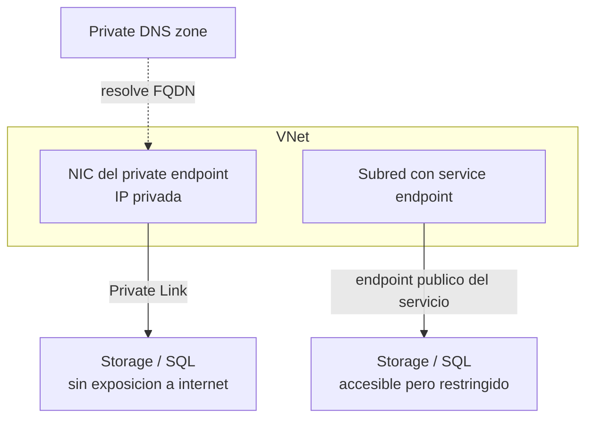

# Fase complementaria 2: Acceso a PaaS — Service endpoints vs Private endpoints

> Fase complementaria (tema no cubierto por las lecciones). Fuente: documentación oficial de Microsoft Learn (Virtual Network service endpoints, Private endpoint / Private Link).

## Si solo recuerdas 3 cosas
- Los **service endpoints** extienden la **identidad de tu VNet** a un servicio PaaS por una ruta optimizada en el **backbone de Azure**; el servicio **conserva su endpoint público** (se restringe por regla de VNet/subred).
- Los **private endpoints** crean una **interfaz de red con IP privada en tu VNet** (Azure **Private Link**), llevando el servicio **dentro** de tu red y **eliminando** la exposición a internet.
- Microsoft **recomienda Private Link / private endpoints** para acceso seguro y privado; los service endpoints son más simples y **sin coste adicional** pero el tráfico sigue usando la IP publicada del servicio en los DNS.

## Objetivo de repaso
Distinguir service endpoints de private endpoints, sus requisitos, DNS y cuándo usar cada uno.

## Comparaciones clave

| | Service endpoint | Private endpoint (Private Link) |
|---|---|---|
| Cómo funciona | Extiende la VNet al servicio; el servicio mantiene su endpoint público | NIC con IP privada en tu VNet conectada al servicio |
| Exposición | Servicio sigue accesible por su endpoint público (restringido) | Servicio **no** se expone a internet |
| Origen de las conexiones | La VNet (identidad extendida) | Clientes que se conectan a la IP privada del endpoint |
| DNS | Continúa resolviendo a la IP **pública** del servicio | Requiere **private DNS zones** que resuelvan a la IP privada |
| Coste | **Sin coste adicional** | Se factura el private endpoint |
| On-premises | **No** sirve para tráfico desde on-prem | Sí (VPN/ExpressRoute, VNets peered) |
| Aprobación | Regla de VNet en el servicio | Flujo de aprobación (auto/manual) |

| Servicio | ¿Admite service endpoint? | ¿Admite private endpoint? |
|---|---|---|
| Azure Storage | Sí | Sí (solo cuentas **GPv2**) |
| Azure SQL Database | Sí (misma región) | Sí |
| Azure Cosmos DB | Sí | Sí |
| Azure Key Vault | Sí | Sí |
| Azure App Service | Sí | Sí |

## Diagrama

## Requisitos y restricciones
- **Service endpoints**: solo VNets del **modelo ARM**; **no** para tráfico desde on-premises; para **Azure SQL** solo en la **misma región**; hasta **500** suscripciones/regiones por servicio.
- Al habilitar un service endpoint, las IP de origen del tráfico pasan de **públicas a privadas** y se **cierran las conexiones TCP abiertas** existentes.
- **Service endpoint policies**: filtran el tráfico a **recursos concretos** del servicio.
- **Private endpoint**: debe estar en la **misma región y suscripción** que la VNet; el **recurso** enlazado puede estar en **otra región**.
- Cada private endpoint es una **NIC de solo lectura** con IP privada **fija** durante su ciclo de vida.
- Métodos de aprobación: **automática** (con permisos) o **manual** (Pending → Approved/Rejected/Disconnected).
- **NSG/UDR/ASG** soportados en el private endpoint; los **NSG flow logs no** capturan el tráfico entrante al private endpoint y las effective routes no se muestran para su NIC.
- Se recomienda **un solo private endpoint** por recurso y red para evitar conflictos de DNS.

## Requisito → Consecuencia
| Si… | Entonces… | Si no… |
|---|---|---|
| Quieres aislar el servicio de internet | Usa **private endpoint** | El service endpoint deja el servicio accesible por su endpoint público |
| Necesitas acceso desde on-premises | Usa **private endpoint** (VPN/ER) | El service endpoint no cubre on-prem |
| Quieres filtrar a un recurso concreto | Usa **service endpoint policies** | Toda la red accede a todos los recursos del servicio |
| Conectas a un servicio con FQDN | Configura **private DNS zones** | El FQDN resolverá a la IP pública |

## Casos de uso típicos
- Conectar una subred a Azure Storage o SQL sin exponer el recurso a internet (service endpoint sencillo).
- Cumplir requisitos de aislamiento de red total en producción (private endpoint).
- Consumir tu propio servicio publicado tras un Standard Load Balancer (Private Link service).
- Exponer un servicio de socio de forma privada con alias.

## Cuándo NO usar esto
- Cuando el servicio no soporta service/private endpoints.
- Cuando el acceso es puramente público y controlado por firewall IP (para ello no necesitas endpoints).
- Cuando no quieres gestionar DNS privado (evita private endpoints si no puedes configurarlo).

## Puntos críticos para el examen
- Service endpoint = **ruta optimizada + identidad de VNet**, el servicio **sigue público** (restringido).
- Private endpoint = **IP privada en tu VNet**, servicio **sin exposición a internet**.
- Microsoft **recomienda Private Link** sobre service endpoints.
- Service endpoints **no** sirven para on-premises.
- Private endpoints requieren **DNS privado** para resolver el FQDN a la IP privada.
- Private endpoints solo se crean en cuentas de Storage **GPv2**.

## Trampa típica del examen
- Creer que el service endpoint **elimina** el acceso público al servicio (no; lo restringe).
- Creer que el service endpoint da **IP privada** al servicio (eso es el private endpoint).
- Olvidar el **DNS privado** al usar private endpoints.
- Usar service endpoints para tráfico **desde on-premises** (no funciona).
- Intentar crear un private endpoint a Storage en una cuenta **que no sea GPv2** (no permitido).

## Mini-escenario resuelto
**Escenario:** Una app en una VNet debe acceder a Azure SQL **sin que la base de datos sea alcanzable desde internet** y con resolución por nombre.
**Respuesta:** Crear un **private endpoint** para el servidor SQL y configurar una **private DNS zone**.
**Por qué:** El private endpoint da una IP privada dentro de la VNet y el DNS privado hace que el FQDN resuelva a esa IP privada.

## Productos relacionados
Productos nuevos → `docs/referencia/glosario-productos.md`: **Azure Private Link**, **Service Endpoint**, **Private Endpoint**, **Service Endpoint Policies**.
Comparativa → `docs/referencia/comparativa-productos.md`: grupo **Acceso a PaaS (red)**.
Términos nuevos → `docs/referencia/glosario.md`: **private-link resource**, **target subresource**, **connection approval**, **virtual network rule**.

## Errores comunes / troubleshooting
- El recurso no llega al servicio tras habilitar el endpoint → revisar regla de VNet en el servicio y NSG (incluida la salida).
- El FQDN resuelve a IP pública con private endpoint → falta la private DNS zone o el VNet link.
- Conexiones TCP caídas al habilitar service endpoint → es esperado; reintentar las conexiones.
