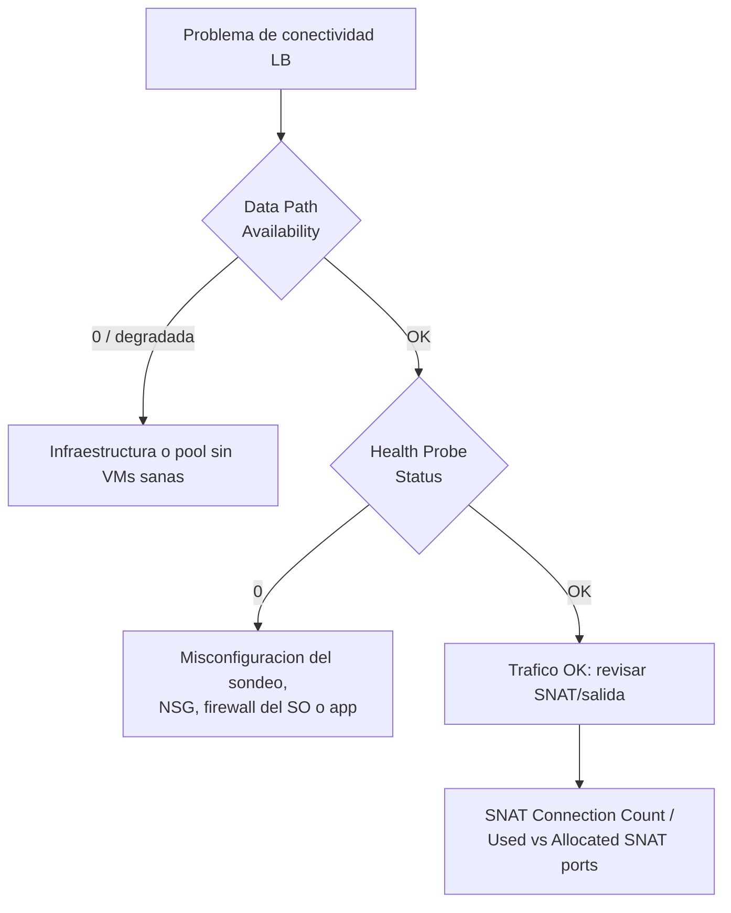

# Fase complementaria 3: Solución de problemas de Azure Load Balancer

> Fase complementaria (tema no cubierto por las lecciones). Fuente: documentación oficial de Microsoft Learn (Troubleshoot Azure Load Balancer, Standard load balancer diagnostics).

## Si solo recuerdas 3 cosas
- Standard Load Balancer expone **métricas multidimensionales y alertas** (Azure Monitor) y **Resource health**; las **métricas multidimensionales no existen en Basic**.
- Las métricas clave son **Data Path Availability** (¿la plataforma está sana?) y **Health Probe Status** (¿las instancias responden al sondeo?); combinándolas se aísla el fallo.
- Para la salida, vigila **SNAT Connection Count** (fallos > 0 = agotamiento de puertos SNAT), **Used/Allocated SNAT ports**; para más capacidad usa **Azure NAT Gateway**.

## Objetivo de repaso
Recordar las métricas de diagnóstico de Load Balancer, cómo interpretarlas y qué revisar cuando falla la conectividad.

## Comparaciones clave

| Métrica | Qué mide | Agregación |
|---|---|---|
| Data Path Availability | Salud de la ruta de datos hacia el host del backend en la región | Avg |
| Health Probe Status | Salud según el sondeo configurado (por endpoint) | Avg |
| SYN Count | Intentos de conexión TCP (paquetes SYN) | Sum |
| SNAT Connection Count | Flujos de salida enmascarados (éxitos/fallos) | Sum |
| Allocated / Used SNAT Ports | Puertos SNAT asignados / usados por instancia | Avg |
| Byte / Packet Count | Bytes y paquetes por front-end | Sum |

| Estado de Resource health | Umbral de Data Path Availability |
|---|---|
| Available | Saludable |
| Degraded | < 90 % y > 25 % durante ≥2 min |
| Unavailable | < 25 % durante ≥2 min |
| Unknown | Sin datos en los últimos 10 min |

## Diagrama

## Requisitos y restricciones
- **Métricas multidimensionales solo en Standard** (Basic no las soporta).
- **Data Path Availability** se genera solo en front-ends con **reglas de balanceo** y puede tardar hasta **10 min** en aparecer.
- Tras **desasignar** una VM, el balanceador deja de sondear y de reportar métricas de esa instancia (línea discontinua).
- Las métricas de **bandwidth** (SYN, bytes, paquetes) **no** capturan el tráfico hacia un **LB interno vía UDR**.
- Los sondeos de salud se originan desde una **dirección de infraestructura de Azure** y son visibles en el SO de la VM.
- Para **Sum/Count** usa una **agregación temporal > 1 min** (el muestreo es por minuto).

## Requisito → Consecuencia
| Si… | Entonces… | Si no… |
|---|---|---|
| La Data Path Availability cae a 0 | Revisa si hay **VMs sanas** en el backend pool y si hay incidencia de plataforma | Culparías a la app sin motivo |
| El Health Probe Status es 0 | Revisa el puerto/protocolo del sondeo y el NSG/firewall del SO | El LB no enviará tráfico nuevo a esa instancia |
| Hay fallos de SNAT | Añade capacidad con **NAT Gateway** o revisa el diseño de salida | Sufrirás fallos intermitentes de conexiones salientes |

## Casos de uso típicos
- Diagnosticar un servicio inaccesible desde internet (data path vs sondeo).
- Detectar **agotamiento de puertos SNAT** en cargas con mucha salida.
- Confirmar que una VM retirada del backend pool deja de recibir tráfico.
- Configurar alertas proactivas (data path ≤ 0, sondeo fallido, SNAT).

## Puntos críticos para el examen
- Standard: **métricas + alertas + Resource health**; Basic: **sin** métricas multidimensionales.
- **Data Path Availability** = salud de la plataforma/ruta (no confundir con el sondeo).
- **Health Probe Status** = lo que el LB cree de tus instancias.
- Combinar ambas métricas aisla **plataforma vs configuración/aplicación**.
- **Fallos de SNAT > 0** indican **agotamiento de puertos SNAT**.
- **Resource health** se evalúa cada **2 min** (Degraded <90 %, Unavailable <25 %).
- Tras **deallocated**, no hay sondeos ni métricas para esa instancia.

## Trampa típica del examen
- Buscar métricas multidimensionales en **Basic** (no existen).
- Confundir **Data Path Availability** (plataforma) con **Health Probe Status** (instancia).
- Creer que el LB **termina** conexiones TCP (no; flujos y handshakes son entre origen y VM).
- Ignorar el **agotamiento de SNAT** como causa de fallos intermitentes de salida.
- Olvidar que las métricas de bandwidth **no** ven el tráfico interno por UDR.

## Mini-escenario resuelto
**Escenario:** Un servicio detrás de un Standard LB se vuelve inaccesible; quieres saber si el problema es de Azure o de tu app.
**Respuesta:** Revisar en una sola gráfica **Data Path Availability** y **Health Probe Status**.
**Por qué:** Si el data path está al 100 % pero el sondeo al 0 %, la plataforma está sana y el fallo es de configuración del sondeo o de la aplicación/NSG.

## Productos relacionados
Productos nuevos → `docs/referencia/glosario-productos.md`: (ya registrados Azure Load Balancer, Azure NAT Gateway, Azure Monitor).
Comparativa → `docs/referencia/comparativa-productos.md`: grupo **Balanceadores** y **Monitoreo**.
Términos nuevos → `docs/referencia/glosario.md`: **Data Path Availability**, **Health Probe Status**, **SNAT**, **Resource health**.

## Errores comunes / troubleshooting
- El sondeo falla → puerto/protocolo incorrecto, NSG o firewall del SO bloqueando, o app no escuchando.
- Salida intermitente → revisar Used/Allocated SNAT ports y valorar NAT Gateway.
- Tras quitar una VM del pool sigue recibiendo tráfico → el flujo persiste hasta que finaliza la conexión.
