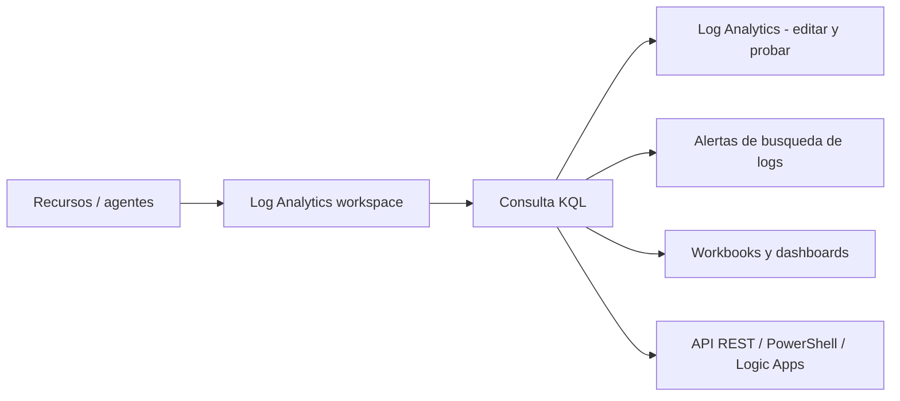

# Fase complementaria 4: Consultar y analizar logs en Azure Monitor

> Fase complementaria (tema no cubierto por las lecciones). Fuente: documentación oficial de Microsoft Learn (Log queries in Azure Monitor).

## Si solo recuerdas 3 cosas
- **Azure Monitor Logs** se basa en **Azure Data Explorer** y usa **KQL (Kusto Query Language)** para escribir consultas.
- **Log Analytics** es la herramienta principal del portal para **editar y probar** consultas; el mismo KQL se usa en **alertas de búsqueda de logs, workbooks, dashboards, Logic Apps, PowerShell y la API**.
- Escribir y probar en **Log Analytics** primero es la práctica recomendada antes de copiar la consulta a su destino final.

## Objetivo de repaso
Recordar dónde se usan las consultas de logs, cómo empezar con KQL y las diferencias frente a Azure Data Explorer.

## Comparaciones clave

| Dónde se usa la consulta | Para qué |
|---|---|
| **Log Analytics** | Editar/probar consultas e interactuar con resultados (herramienta principal) |
| Reglas de alerta de búsqueda de logs | Detección proactiva a intervalos regulares |
| Workbooks | Reportes visuales interactivos |
| Dashboards de Azure | Fijar resultados de consultas y métricas juntos |
| Logic Apps | Usar resultados en un flujo automatizado |
| PowerShell | `Invoke-AzOperationalInsightsQuery` (scripts/runbooks) |
| API de consulta de Log Analytics | Obtener datos desde cualquier cliente REST |

| Concepto | Detalle |
|---|---|
| KQL | Lenguaje de consulta legible; operadores como `where`, `summarize`, `project` |
| Operadores exclusivos de Azure Monitor | `workspace()`, `app()`, `resource()` |
| No soportado en Azure Monitor | `cluster()`, `database()`, `current_principal()`, cross-cluster join, plugin de Python, `sql_request` |
| Seguridad | Desde julio 2025, la API de consulta exige **TLS 1.2+** |

## Diagrama

## Requisitos y restricciones
- Necesitas un **workspace de Log Analytics** con datos ingeridos (vía agentes/reglas de recopilación).
- La sintaxis es KQL, la misma de Azure Data Explorer, con **algunas diferencias** (operadores/funciones no soportados).
- La API de consulta exige **TLS 1.2 o superior**.
- Los datos disponibles dependen de la **ingesta** y de la **retención** del workspace.
- Existen **bibliotecas cliente** (.NET, Go, Java, JavaScript, Python) para consultar por código.

## Requisito → Consecuencia
| Si… | Entonces… | Si no… |
|---|---|---|
| Quieres crear una alerta basada en logs | Escribe y prueba la consulta en **Log Analytics** y reutilízala en la regla | La alerta podría fallar por errores de sintaxis |
| Necesitas analizar datos de varias tablas | Usa KQL con `join`/`summarize` | Tendrías que cruzar manualmente |
| Consumes logs por código | Usa la **API de consulta** o una biblioteca cliente | No automatizarías el análisis |

## Casos de uso típicos
- Investigar errores e incidentes a partir de datos de logs.
- Crear reglas de alerta de búsqueda de logs.
- Construir dashboards y workbooks con resultados de consultas.
- Automatizar análisis con Logic Apps, PowerShell o la API.
- Explorar datos con lenguaje natural (Observability Agent / Chat with your data).

## Puntos críticos para el examen
- **Azure Monitor Logs = Azure Data Explorer + KQL**.
- **Log Analytics** es el punto de entrada para escribir/probar consultas.
- Operadores **exclusivos**: `workspace()`, `app()`, `resource()`.
- **No** soportado: `cluster()`, `database()`, cross-cluster join, plugin de Python.
- La **misma consulta** alimenta alertas, workbooks, dashboards y automatización.
- API de consulta requiere **TLS 1.2+**.

## Trampa típica del examen
- Creer que las consultas de logs usan SQL (usan **KQL**).
- Confundir el **workspace** (almacén) con **Log Analytics** (herramienta de consulta).
- Asumir que todo el KQL de Data Explorer funciona igual en Azure Monitor (hay diferencias).
- Olvidar que una regla de alerta de logs **se basa en una consulta**.

## Mini-escenario resuelto
**Escenario:** Quieres avisar cuando una VM registre más de 10 errores críticos en 15 minutos.
**Respuesta:** Escribir la consulta KQL en **Log Analytics**, validarla y crear una **regla de alerta de búsqueda de logs** que la use.
**Por qué:** Las alertas de logs se basan en consultas KQL que se ejecutan a intervalos y evalúan sus resultados.

## Productos relacionados
Productos nuevos → `docs/referencia/glosario-productos.md`: (ya registrados Azure Monitor, Log Analytics).
Comparativa → `docs/referencia/comparativa-productos.md`: grupo **Monitoreo**.
Términos nuevos → `docs/referencia/glosario.md`: **KQL**, **regla de alerta de búsqueda de logs**, **API de consulta**.

## Errores comunes / troubleshooting
- La consulta no devuelve datos → revisa el rango de tiempo, la tabla y la ingesta.
- Error de operador no soportado → usa operadores propios de Azure Monitor.
- La API falla → verifica TLS 1.2+ y la autenticación.
