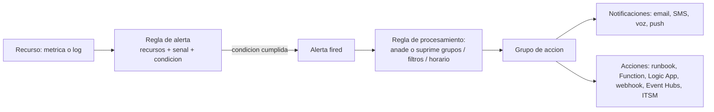

# Fase complementaria 5: Alertas, grupos de acción y reglas de procesamiento

> Fase complementaria (tema no cubierto por las lecciones). Fuente: documentación oficial de Microsoft Learn (Azure Monitor alerts, action groups, alert processing rules).

## Si solo recuerdas 3 cosas
- Una **regla de alerta** combina **recursos + señal (métrica o log) + condición**; si se cumple, **dispara** la alerta, ejecuta su **grupo de acción** y actualiza su estado.
- Un **grupo de acción** define **quién se notifica** (email, SMS, voz, push) y **qué acciones** se ejecutan (runbook, Function, Logic App, webhook, Event Hubs, ITSM); un alerta admite hasta **5**.
- Las **reglas de procesamiento (alert processing rules)** **no** generan alertas: **modifican las alertas disparadas** (añadir/suprimir grupos de acción, filtros y programación).

## Objetivo de repaso
Recordar los tipos de alerta, el estado de las alertas, los grupos de acción y las reglas de procesamiento.

## Comparaciones clave

| Tipo de alerta | Base |
|---|---|
| Métrica | Evalúa métricas de recurso a intervalos (admite umbrales dinámicos, varias condiciones) |
| Búsqueda de logs | Consulta KQL evaluada a una frecuencia |
| Búsqueda de logs simple | Evalúa cada fila por separado (casi tiempo real, a escala) |
| Registro de actividad | Un evento del activity log cumple condiciones; incluye **Resource Health** y **Service Health** |
| Detección inteligente | Anomalías en Application Insights (se migra a reglas) |
| Prometheus | Métricas Prometheus (PromQL) |

| Concepto | Qué es |
|---|---|
| Grupo de acción | Notificaciones + acciones automatizadas (reutilizable en varias reglas) |
| Condición de alerta | Estado **fired** ↔ **resolved** (sistema) |
| Respuesta del usuario | New / Acknowledged / Closed |
| Regla de procesamiento | Modifica alertas disparadas (añade/suprime grupos, filtros, horarios) |

## Diagrama

## Requisitos y restricciones
- Las alertas se almacenan **30 días**; las instancias disparadas son **de solo lectura** (los cambios aplican a alertas futuras).
- **Stateless**: se disparan cada vez que se cumple la condición (todas las de actividad son stateless).
- **Stateful**: no vuelven a disparar hasta resolverse; una métrica se resuelve tras **3 comprobaciones** sin cumplirse.
- Hasta **5 grupos de acción** por regla; los grupos se ejecutan **en paralelo** y sin orden concreto.
- Procesamiento **Global** (persistido en ≥2 regiones) o **Regional** (redundante de zona); Service Health exige región **Global**.
- Emails requieren verificación por **OTP**; se aplica **rate limiting** a email/SMS/voz/push.
- Permisos: **Monitoring Contributor** (crear) y **Monitoring Reader** (ver).

## Requisito → Consecuencia
| Si… | Entonces… | Si no… |
|---|---|---|
| Quieres evitar ruido en mantenimiento | Usa una **regla de procesamiento** que suprima grupos en ese horario | Recibirás notificaciones durante la ventana |
| Necesitas que una alerta no repita | Usa alertas **stateful** | Se dispararía en cada evaluación |
| Quieres notificar a varios equipos por los mismos criterios | Crea **un** grupo de acción y reutilízalo | Duplicarías configuración |

## Casos de uso típicos
- Alertar por CPU alta (métrica) o por errores en logs (búsqueda de logs).
- Notificar a guardia vía SMS/voz y abrir un ticket ITSM.
- Ejecutar un runbook de autocorrección al disparar una alerta.
- Suprimir notificaciones fuera de horario laboral o en mantenimientos.

## Cuándo NO usar esto
- Cuando basta una revisión manual sin necesidad de notificación.
- Para modificar el comportamiento en tiempo real de recursos (las alertas **avisan**, no actúan salvo por las acciones del grupo).

## Puntos críticos para el examen
- Regla de alerta = **recursos + señal + condición**.
- **Tipos**: métrica, búsqueda de logs, búsqueda simple, activity log, detección inteligente, Prometheus.
- **Todos** los activity log alerts son **stateless**.
- Alerta de métrica se resuelve tras **3 comprobaciones** sin cumplirse.
- Hasta **5 grupos de acción** por regla; se ejecutan **en paralelo**.
- **Reglas de procesamiento ≠ reglas de alerta**: modifican alertas disparadas.
- Tipo de recurso de las reglas de procesamiento: `Microsoft.AlertsManagement/actionRules`.

## Trampa típica del examen
- Confundir **regla de alerta** (genera alertas) con **regla de procesamiento** (modifica alertas disparadas).
- Creer que una alerta disparada se puede **editar** (es de solo lectura).
- Pensar que los grupos de acción se ejecutan **en orden** (no; en paralelo).
- Creer que se pueden usar más de **5** grupos de acción por regla.
- Olvidar que Service Health requiere un grupo de acción en región **Global**.

## Mini-escenario resuelto
**Escenario:** No quieres recibir alertas de un grupo de VMs durante una ventana de mantenimiento programada, sin desactivar las reglas.
**Respuesta:** Crear una **regla de procesamiento** con horario que **suprima** el grupo de acción en esa ventana.
**Por qué:** Las reglas de procesamiento modifican las alertas disparadas (suprimen grupos) según filtros y programación, sin tocar las reglas de alerta.

## Productos relacionados
Productos nuevos → `docs/referencia/glosario-productos.md`: **Action Groups**, **Alert Processing Rules**.
Comparativa → `docs/referencia/comparativa-productos.md`: grupo **Monitoreo**.
Términos nuevos → `docs/referencia/glosario.md`: **regla de alerta**, **grupo de acción**, **alerta stateful/stateless**, **regla de procesamiento**, **common alert schema**.

## Errores comunes / troubleshooting
- No llegan notificaciones → email sin verificar (OTP) o rate limiting aplicado.
- La alerta no cesa → usar estado **stateful** (la métrica se resuelve tras 3 comprobaciones).
- Acciones que no se ejecutan → revisar permisos del grupo de acción y conectividad del webhook (reintentos).
