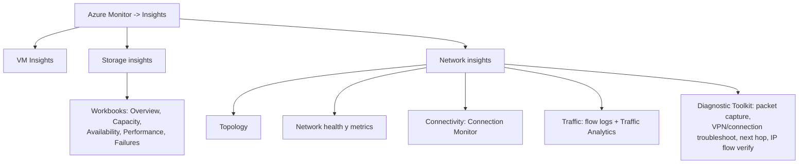

# Fase complementaria 6: Azure Monitor Insights para storage y redes

> Fase complementaria (tema no cubierto por las lecciones). Fuente: documentación oficial de Microsoft Learn (Storage insights, Network insights).

## Si solo recuerdas 3 cosas
- **Storage insights** y **Network insights** forman parte de **Azure Monitor Insights** y **no requieren configuración** previa: usan métricas recopiladas por defecto.
- **Storage insights** ofrece una vista de **rendimiento, capacidad y disponibilidad** de las cuentas de almacenamiento (desde la cuenta o desde Azure Monitor, a escala).
- **Network insights** aporta **topología, salud y métricas, conectividad (Connection Monitor), tráfico (flow logs/Traffic Analytics) y un Toolkit de diagnóstico**.

## Objetivo de repaso
Recordar qué muestran Storage insights y Network insights, sus workbooks/áreas y cuándo usarlos.

## Comparaciones clave

| Insight | Qué vigila | Áreas principales |
|---|---|---|
| **Storage insights** | Cuentas de almacenamiento (rendimiento, capacidad, disponibilidad) | Overview, Capacity, Availability, Performance, Failures |
| **Network insights** | Recursos de red | Topology, Network health, Connectivity, Traffic, Diagnostic Toolkit |
| **VM Insights** | Máquinas virtuales | Rendimiento + Map (dependencias) |

| Workbook de Storage insights | Muestra |
|---|---|
| Overview | Disponibilidad, transacciones, latencia E2E/servidor, capacidad (blob/file/table/queue) |
| Capacity | Capacidad total y por servicio |
| Availability | Estado del servicio y por objeto/servicio |
| Performance | Latencia E2E vs servidor por API |
| Failures | Errores del lado cliente, throttling y respuestas |

## Diagrama

## Requisitos y restricciones
- **No requiere configuración**: las métricas de Storage y de red se recopilan por defecto.
- Storage insights es **gratuito**; solo se factura lo que configures/actives de Azure Monitor.
- Límites de Storage insights: hasta **10 suscripciones** y hasta **200 cuentas** de almacenamiento por vista; se muestran **3 tipos de error** y el resto se agrupa como «Other».
- Umbral de disponibilidad por defecto: **Warning 99 % / Critical 90 %** (configurable).
- Network insights está **preintegrado** en Azure Monitor y **enlaza** con Connection Monitor, NSG flow logs, VNet flow logs, Traffic Analytics y Network Watcher.
- Los recursos de red **onboarded** (App Gateway, Bastion, Firewall, Front Door, NAT Gateway, ExpressRoute, Load Balancer, NSG, Private Link, route table, Traffic Manager, VNet Gateway, etc.) tienen **topología y workbook** específicos.

## Requisito → Consecuencia
| Si… | Entonces… | Si no… |
|---|---|---|
| Quieres ver capacidad y latencia de muchas cuentas | Usa **Storage insights** desde Azure Monitor | Revisarías cuenta por cuenta |
| Necesitas topología y diagnóstico de red sin configurar nada | Usa **Network insights** | Tendrías que abrir cada herramienta por separado |
| Necesitas ver dependencias de red de una conexión | Usa **Connectivity** (Connection Monitor) | No verías la topología salto a salto |

## Casos de uso típicos
- Detectar **throttling**, latencia o errores en cuentas de Storage a escala.
- Vigilar disponibilidad por API y por servicio (blob/file/table/queue).
- Visualizar la topología de VNets y recursos conectados.
- Comprobar conectividad extremo a extremo (Connection Monitor) y revisar flow logs/Traffic Analytics.
- Acceder al Toolkit de diagnóstico de red (packet capture, next hop, IP flow verify…).

## Puntos críticos para el examen
- Storage y Network insights = parte de **Azure Monitor Insights**, **sin configuración**.
- **Storage insights**: rendimiento, capacidad y disponibilidad; workbooks de Failures, Performance, Availability, Capacity.
- Umbral por defecto de disponibilidad: **Warning 99 % / Critical 90 %**.
- **Network insights**: Topology, Network health, Connectivity, Traffic, Diagnostic Toolkit.
- Network insights **integra** Connection Monitor, flow logs, Traffic Analytics y herramientas de Network Watcher.
- **VM Insights** = rendimiento + **Map** (dependencias).

## Trampa típica del examen
- Creer que hay que habilitar la recopilación para Storage/Network insights (no; usan métricas por defecto).
- Confundir **VM Insights**, **Storage insights** y **Network insights**.
- Creer que Storage insights solo funciona desde una cuenta (también desde Azure Monitor, a escala).
- Olvidar el Toolkit de diagnóstico dentro de Network insights.

## Mini-escenario resuelto
**Escenario:** Quieres ver, en una sola vista, la disponibilidad y latencia de cientos de cuentas de almacenamiento y detectar cuentas con errores.
**Respuesta:** Usar **Storage insights** desde Azure Monitor (Overview/Capacity).
**Por qué:** Storage insights agrega métricas de muchas cuentas sin configuración y permite drill-down a Failures/Performance/Availability/Capacity.

## Productos relacionados
Productos nuevos → `docs/referencia/glosario-productos.md`: **Azure Monitor Insights**, **Storage Insights**, **Network Insights**.
Comparativa → `docs/referencia/comparativa-productos.md`: grupo **Monitoreo**.
Términos nuevos → `docs/referencia/glosario.md`: **workbook (Azure Monitor)**, **heatmap (insights)**.

## Errores comunes / troubleshooting
- No veo mi cuenta → revisa el filtro de suscripción (límite de 200 cuentas / 10 suscripciones).
- Faltan tipos de error → solo se muestran 3 y el resto se agrupa como «Other».
- No encuentro un workbook guardado → cada workbook se guarda en el recurso donde se creó.
