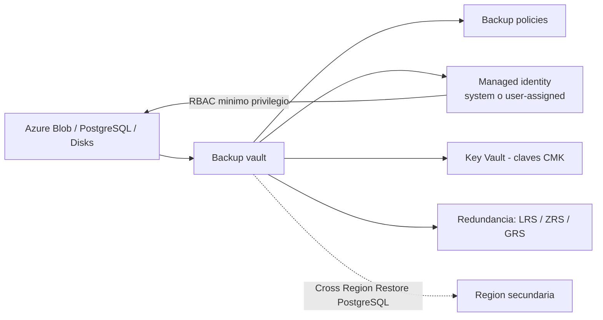

# Fase complementaria 7: Backup vault

> Fase complementaria (tema no cubierto por las lecciones). Fuente: documentación oficial de Microsoft Learn (Backup vaults overview).

## Si solo recuerdas 3 cosas
- El **Backup vault** es un almacén basado en **ARM** que guarda datos de copia de **workloads más recientes**: **Azure Blob, Azure Database for PostgreSQL, Azure Disks** y futuros.
- Ofrece **aislamiento de datos**: los datos del vault residen en una **suscripción/inquilino gestionados por Microsoft**, fuera del alcance de usuarios de la producción.
- La seguridad se gestiona con **RBAC** y **managed identities** (system-assigned o user-assigned); la **cifrado** usa claves **Microsoft-managed** o **Customer-managed (Key Vault)**.

## Objetivo de repaso
Recordar qué es un Backup vault, en qué se diferencia del Recovery Services vault y sus características de seguridad.

## Comparaciones clave

| | Recovery Services vault | Backup vault |
|---|---|---|
| Modelo | Clásico (ARM) | **Basado en ARM** (más reciente) |
| Cargas típicas | VMs, SQL/SAP en VM, Azure Files, blobs | **Azure Blob, PostgreSQL, Azure Disks**, nuevos workloads |
| RBAC | Sí | Sí (roles integrados para recovery points) |
| Managed identity | — | **System-assigned y user-assigned** |
| Cifrado | Microsoft/Customer-managed | Microsoft o **Customer-managed (Key Vault)** |
| Cross Region Restore | Según workload | Sí para **PostgreSQL** (GRS; se factura RA-GRS) |

| Identidad gestionada | Ciclo de vida |
|---|---|
| System-assigned | Se crea con el vault y está ligada a él (se puede deshabilitar) |
| User-assigned | Recurso independiente, reutilizable en varios vaults |

## Diagrama

## Requisitos y restricciones
- Debes elegir la **redundancia de almacenamiento** (LRS/ZRS/GRS) al crear el vault.
- **Azure Backup gestiona el almacenamiento** del vault automáticamente.
- La **cifrado con CMK** se configura en *Encryption settings* del vault (usa **Azure Key Vault**); por defecto, claves Microsoft-managed.
- **Cross Region Restore** de PostgreSQL accede a recovery points de la región secundaria **sin** que haya una caída declarada (para pruebas), y se factura a tarifas **RA-GRS**.
- El **RBAC** del vault se aplica mediante las **managed identities** del vault.

## Requisito → Consecuencia
| Si… | Entonces… | Si no… |
|---|---|---|
| Necesitas proteger **Azure Disks/Blobs/PostgreSQL** | Usa un **Backup vault** | El Recovery Services vault no cubre estos workloads nuevos |
| Quieres tus propias claves | Configura **CMK** con Key Vault | Se usarán claves gestionadas por Microsoft |
| Quieres probar DR regional sin corte | Usa **Cross Region Restore** (PostgreSQL) | Solo tendrías los recovery points locales |
| Necesitas control de acceso granular del workload | Aprovecha las **managed identities** del vault + RBAC | Tendrías permisos demasiado amplios |

## Casos de uso típicos
- Proteger **discos administrados** y **blobs** con el modelo más reciente.
- Copia de **Azure Database for PostgreSQL** con opción de Cross Region Restore.
- Escenarios que requieren **aislamiento de datos** frente a la producción comprometida.
- Monitorización central de workloads V2 (jobs y alertas) desde Resiliency.

## Puntos críticos para el examen
- Backup vault = almacén **ARM** para **Blob, PostgreSQL, Disks** y workloads nuevos.
- **Recovery Services vault** para VMs, SQL/SAP en VM y Azure Files.
- **Aislamiento de datos**: los datos viven en una suscripción/inquilino **gestionados por Microsoft**.
- **RBAC + managed identities** (system y user-assigned).
- Cifrado **Microsoft-managed** por defecto; **CMK** vía Key Vault.
- **Cross Region Restore** disponible para **PostgreSQL** (GRS/RA-GRS).

## Trampa típica del examen
- Usar **Recovery Services vault** para discos/blobs/PostgreSQL (corresponde al **Backup vault**).
- Creer que los datos del vault son accesibles desde producción (no; están aislados).
- Olvidar que **CMK** requiere **Key Vault**.
- Confundir **managed identity system-assigned** (ligada al vault) con **user-assigned** (reutilizable).
- Creer que Cross Region Restore está disponible para todos los workloads (destaca PostgreSQL).

## Mini-escenario resuelto
**Escenario:** Necesitas proteger **discos administrados** y **PostgreSQL**, con cifrado mediante tus propias claves.
**Respuesta:** Crear un **Backup vault**, habilitar **CMK** (Key Vault) y asignar **managed identity** con el rol adecuado.
**Por qué:** El Backup vault soporta discos y PostgreSQL, y permite cifrado con claves gestionadas por el cliente vía Key Vault.

## Productos relacionados
Productos nuevos → `docs/referencia/glosario-productos.md`: **Backup vault** (ya registrado; se amplía).
Comparativa → `docs/referencia/comparativa-productos.md`: grupo **Backup y DR (Recovery Services vault vs Backup vault)**.
Términos nuevos → `docs/referencia/glosario.md`: **identidad administrada (system/user-assigned)**, **Cross Region Restore**.

## Errores comunes / troubleshooting
- El workload no aparece para proteger → puede requerir el otro tipo de vault (RSV vs Backup vault).
- No puedo usar mis claves → falta configurar Key Vault/CMK en *Encryption settings*.
- Error de permisos del vault → revisar el RBAC de la **managed identity** del vault.
