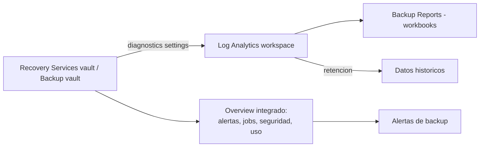

# Fase complementaria 9: Reportes y alertas de backup

> Fase complementaria (tema no cubierto por las lecciones). Fuente: documentación oficial de Microsoft Learn (Configure Azure Backup reports, Monitoring Azure Backup workloads).

## Si solo recuerdas 3 cosas
- Los **reportes de Azure Backup** usan **Azure Monitor Logs + workbooks**: hay que crear un **workspace de Log Analytics** y enviar a él los **diagnostics** de los vaults.
- Los datos **no muestran el día parcial en curso** y la primera ingesta puede tardar hasta **24 h** (se recomienda revisar a los **2 días** de configurar).
- La **monitorización integrada** (alertas, jobs, seguridad y uso) está por defecto en el **panel Overview de Resiliency**, del **Recovery Services vault** y del **Backup vault**.

## Objetivo de repaso
Recordar qué reportes ofrece Azure Backup, cómo se configuran y cómo se monitorizan alertas y trabajos.

## Comparaciones clave

| Reporte | Tipo | Contenido |
|---|---|---|
| Backup Reports | Consolidado | Jobs, instancias, uso, políticas, adherencia y optimización |
| Backup Configuration Status | Out-of-box | ¿Están todas las VMs configuradas para backup? |
| Backup Job History | Out-of-box | Jobs correctos/fallidos en un periodo |
| Backup Schedule and Retention | Out-of-box | Verifica que cumplen requisitos de negocio |
| User Triggered Operations | Out-of-box | Operaciones de usuario sobre RSV |
| ASR Job History / Replication History | Out-of-box | Jobs y replicación de Site Recovery |

| Elemento de monitorización integrada | Dónde |
|---|---|
| Overview de alertas, jobs, seguridad y uso | Resiliency, Recovery Services vault, Backup vault |
| Protected / protectable items | Resiliency |
| Backup Instances / Backup Jobs | Recovery Services vault y Backup vault |

## Diagrama

## Requisitos y restricciones
- Crear/usar un **workspace de Log Analytics** (su ubicación y suscripción son independientes de las del vault).
- **Retención por defecto del workspace: 30 días**; ajustar para horizontes mayores.
- Configurar **diagnostics settings** en cada vault hacia Log Analytics (existe una **Azure Policy integrada** para hacerlo a escala).
- Primera ingesta: hasta **24 h**; recomendado revisar los reportes **2 días** después.
- Convenciones: los filtros aplican **de izquierda a derecha y de arriba abajo**; no se muestra el **día parcial**; **Cloud Storage** y **Protected Instances** son valores al final del rango.
- Agregación: **diaria** ≤30 días, **semanal** 30–90 días, **mensual** >90 días.
- Los **reportes Power BI** están en **desuso** (migrar a Log Analytics; esquema V1 → V2).

## Requisito → Consecuencia
| Si… | Entonces… | Si no… |
|---|---|---|
| Quieres reportes de backup | Crea un **workspace de Log Analytics** y envía los diagnostics | No habrá datos para los workbooks |
| Necesitas histórico largo | Ajusta la **retención** del workspace | Los datos caducarán a los 30 días |
| No ves datos del día actual | Es esperado (no se muestra el día parcial) | Esperarías en vano |
| Quieres configurar diagnostics en muchos vaults | Usa la **Azure Policy integrada** | Lo harías vault por vault |

## Casos de uso típicos
- Auditar backups y restauraciones y detectar tendencias.
- Verificar que **todas** las VMs están configuradas para backup.
- Revisar adherencia a políticas y oportunidades de optimización (coste).
- Supervisar jobs y alertas de backup desde el Overview del vault.

## Puntos críticos para el examen
- Reportes = **Azure Monitor Logs + workbooks**; requieren **workspace de Log Analytics**.
- Enviar datos = **diagnostics settings** del vault (automatizable con **Azure Policy**).
- **No** se muestra el día parcial; primera ingesta hasta **24 h**; revisar a los **2 días**.
- Retención por defecto del workspace: **30 días**.
- Reportes destacados: **Backup Reports** (consolidado), **Configuration Status**, **Job History**, **Schedule and Retention**, **User Triggered Operations**.
- Monitorización integrada en **Resiliency** y en los **vaults** (alertas, jobs, seguridad, uso).

## Trampa típica del examen
- Creer que los reportes de backup funcionan **sin** Log Analytics (no; lo requieren).
- Esperar datos del **día en curso** (no se muestran hasta que el día cierra).
- Olvidar que hay que configurar **diagnostics settings** en el vault.
- Creer que los reportes **Power BI** siguen siendo el método recomendado (están en desuso).
- Confundir reportes (workbooks en Log Analytics) con la **monitorización integrada** del vault.

## Mini-escenario resuelto
**Escenario:** Necesitas informes históricos de jobs de backup de varias suscripciones y verificar que no falte ninguna VM por proteger.
**Respuesta:** Crear un **workspace de Log Analytics**, enviar los **diagnostics** de los vaults y usar los reportes **Backup Reports** y **Configuration Status**.
**Por qué:** Los reportes se apoyan en Log Analytics + workbooks y ofrecen vistas consolidadas de jobs y de configuración de protección.

## Productos relacionados
Productos nuevos → `docs/referencia/glosario-productos.md`: (ya registrados Azure Backup, Log Analytics, Recovery Services vault, Backup vault).
Comparativa → `docs/referencia/comparativa-productos.md`: grupo **Backup y DR** y **Monitoreo**.
Términos nuevos → `docs/referencia/glosario.md`: **diagnostics settings**, **Backup Reports**.

## Errores comunes / troubleshooting
- No hay datos en el reporte → diagnostics settings no configurados o todavía dentro de las 24 h iniciales.
- Datos incompletos → el día actual no se muestra (esperar al cierre).
- Falta histórico → aumentar la **retención** del workspace de Log Analytics.
