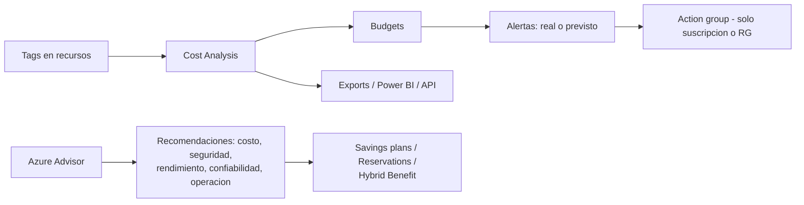

# Fase complementaria 10: Costos, presupuestos y Azure Advisor

> Fase complementaria (hueco del temario oficial no cubierto por las lecciones). Fuente: Microsoft Learn — Microsoft Cost Management, tutorial de presupuestos y Azure Advisor.

## Si solo recuerdas 3 cosas
- **Microsoft Cost Management** es la suite FinOps para **analizar, monitorear y optimizar** costos; está disponible en suscripción, grupo de recursos, grupo de administración y cuenta de facturación.
- Un **presupuesto (budget)** compara el gasto **real o previsto** con un umbral y envía **alertas por email**; **no detiene** el consumo ni afecta a los recursos.
- **Azure Advisor** genera recomendaciones en **5 categorías** (confiabilidad, seguridad, rendimiento, costo y excelencia operativa); las de **costo** son el primer lugar donde mirar para optimizar.

## Objetivo de repaso
Recordar cómo se analizan y controlan costos, qué tipos de alerta existen, cómo funciona un presupuesto y qué aporta Azure Advisor.

## Comparaciones clave

| Herramienta | Para qué | Nota |
|---|---|---|
| **Cost Analysis** | Exploración ad-hoc de costos | Insights rápidos; base de presupuestos y alertas |
| **Budgets** | Fijar límite y alertar | Real o previsto; no bloquea recursos |
| **Azure Advisor** | Recomendaciones de mejores prácticas | 5 categorías; se actualiza a diario |
| **Pricing calculator** | Estimar antes de desplegar | Gratuita y no requiere autenticación |
| **Power BI / Exports / Cost Details API** | Reportes avanzados e integración | Para dashboards y sistemas externos |

| Tipo de alerta de costo | Qué avisa |
|---|---|
| **Budget alert** | Gasto real o previsto supera un % del presupuesto |
| **Anomaly alert** | Cambio inesperado (pico o caída) del uso diario; solo suscripciones |
| **Scheduled alert** | Envío diario/semanal/mensual de una vista guardada de Cost Analysis |
| **EA commitment balance** | Saldo de compromiso EA al 90 % o 100 % |
| **Invoice alert** | Factura disponible (MCA/MOSP) |

| Categoría de Advisor | Qué mejora |
|---|---|
| Reliability | Continuidad de aplicaciones críticas |
| Security | Amenazas y vulnerabilidades |
| Performance | Velocidad de las aplicaciones |
| Cost | Reducción del gasto |
| Operational excellence | Procesos, gestión y despliegue |

## Diagrama

## Requisitos y restricciones
- Los **datos de costo** suelen tardar **8–24 h** en estar disponibles; los presupuestos se evalúan **cada 24 h** y el email llega normalmente **en 1 h** tras la evaluación.
- Un presupuesto admite **1 a 5 umbrales** y **hasta 5 emails**; el umbral va de **0.01 % a 1000 %**.
- Los **action groups** en presupuestos solo se soportan en **suscripción y grupo de recursos**.
- El presupuesto se **reinicia** al final del periodo (mensual, trimestral o anual) y, si tiene fecha de expiración, **se elimina** al expirar.
- Todos los ámbitos de un presupuesto deben usar **una sola moneda**; no hay evaluación multimoneda.
- Permisos: **Owner** crea/modifica/elimina; **Contributor** y **Cost Management Contributor** crean/editan los suyos; **Reader** y **Cost Management Reader** solo ven.
- **Cost Management no incluye** créditos, impuestos ni algunos cargos (soporte en cuentas no MCA); **CSP clásico y sponsorship** no están soportados.
- Advisor requiere ser **Owner, Contributor o Reader** del ámbito; las recomendaciones pueden tardar **hasta 1 día** en reflejar una acción.

## Requisito → Consecuencia
| Si… | Entonces… | Si no… |
|---|---|---|
| Quieres avisar antes de pasarte del gasto | Crea un **budget** con alerta real y otra prevista | Te enterarías al ver la factura |
| Quieres automatizar una acción al superar el umbral | Asocia un **action group** (solo suscripción/RG) | Solo recibirías email |
| Quieres reducir el gasto actual | Revisa primero las recomendaciones de **costo de Advisor** | Perderías la vía más directa de optimización |
| Necesitas reportes históricos y dashboards | Usa **Exports / Power BI** | Cost Analysis sería solo exploración puntual |

## Casos de uso típicos
- Poner un presupuesto mensual por suscripción o grupo de recursos y avisar al 80 % y 100 %.
- Detectar picos anómalos de gasto diario (anomaly alerts).
- Recibir un informe semanal programado de la evolución del gasto.
- Optimizar con recomendaciones de Advisor y compromisos (reservations/savings plans).
- Agrupar costos por centro de costo o entorno usando **tags**.

## Cuándo NO usar esto
- Para **detener** el consumo automáticamente: los presupuestos **solo alertan** (las action groups pueden ejecutar acciones, pero el presupuesto no bloquea por sí mismo).
- Para estimar precios antes de desplegar: usa la **pricing calculator**, no Cost Management.
- Para multas o facturación exacta con impuestos y créditos: usa la experiencia de **Billing**.

## Puntos críticos para el examen
- **Budgets alertan, no bloquean** recursos ni consumo.
- Alertas: **budget, anomaly (solo suscripciones), scheduled, EA commitment balance, invoice**.
- Presupuesto: **1–5 umbrales**, **hasta 5 emails**, evaluación **cada 24 h**.
- **Action groups** en budgets: solo **suscripción y grupo de recursos**.
- Advisor: **5 categorías**; estados **Active, Postponed, Dismissed, Completed**.
- **Tag inheritance** copia tags al dato de costo, **no** se guarda en los recursos ni lo ve Azure Policy.
- **Cost allocation** reparte costos compartidos, **no cambia la factura**.
- Optimización: **Advisor**, **savings plans (hasta 65 %)**, **reservations (hasta 72 %)**, **Hybrid Benefit**.

## Trampa típica del examen
- Creer que un budget **apaga** recursos o **bloquea** el gasto (no; solo alerta).
- Confundir **anomaly alerts** (solo suscripciones) con **budget alerts** (cualquier ámbito soportado).
- Creer que los **action groups** funcionan en budgets de grupo de administración (solo suscripción/RG).
- Pensar que **tag inheritance** modifica los tags reales del recurso (solo el dato de costo).
- Olvidar que **Cost Management no incluye créditos ni impuestos**.
- Usar un **read-only lock** en la suscripción y esperar que Advisor funcione (el lock lo rompe).

## Mini-escenario resuelto
**Escenario:** Dirección quiere un aviso al 80 % y otro al 100 % del gasto mensual de un grupo de recursos, y que se avise también si la previsión supera el presupuesto.
**Respuesta:** Crear un **budget** en el grupo de recursos con umbrales **80 % y 100 %**, alertas de **costo real y previsto**, y emails de destino.
**Por qué:** El budget compara gasto real y forecast con los umbrales, y envía email en ~1 h tras la evaluación diaria.

## Productos relacionados
Productos nuevos → `docs/referencia/glosario-productos.md`: **Microsoft Cost Management**, **Azure Advisor**, **Azure Pricing Calculator**.
Comparativa → `docs/referencia/comparativa-productos.md`: grupo **Gobierno y costos**.
Términos nuevos → `docs/referencia/glosario.md`: **budget**, **anomaly alert**, **scheduled alert**, **tag inheritance**, **cost allocation**, **savings plan**, **reservation**.

## Errores comunes / troubleshooting
- No llega el email del budget → revisar destinatarios, carpeta de spam y que el umbral esté bien configurado.
- El presupuesto no cuadra → recordar el desfase de **8–24 h** de los datos y que se evalúa cada 24 h.
- No se puede crear el budget → suscripción nueva (hasta 48 h), moneda múltiple o permisos insuficientes.
- Advisor no muestra recomendaciones → el ámbito no tiene permisos o hay un **read-only lock** que impide guardar resultados.
