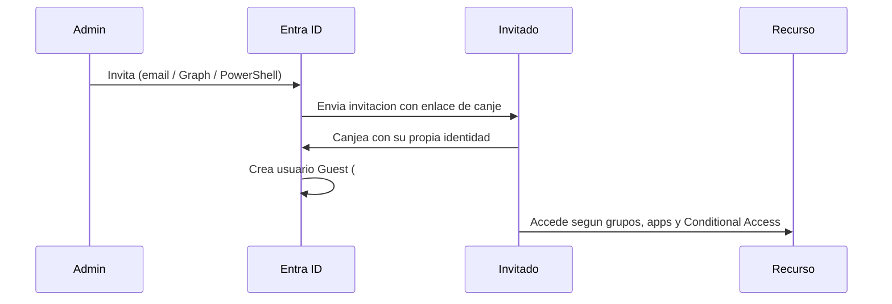

# Fase complementaria 11: Usuarios externos y colaboración B2B

> Fase complementaria (hueco del temario oficial no cubierto por las lecciones). Fuente: Microsoft Learn — Microsoft Entra External ID y B2B collaboration.

## Si solo recuerdas 3 cosas
- **Microsoft Entra External ID** cubre dos escenarios: **B2B collaboration** en tu tenant de trabajo (invitados de empresas) y **external tenants** para apps de consumidores/clientes (CIAM).
- En **B2B collaboration** el invitado usa **sus propias credenciales**; en tu directorio se crea un **objeto de usuario tipo Guest** con UPN que contiene **`#EXT#`**, sin contraseña gestionada por ti.
- **B2B direct connect** es distinto: crea una **confianza bidireccional** (p. ej. canales compartidos de Teams) y **no** añade al usuario como invitado a tu directorio.

## Objetivo de repaso
Distinguir B2B collaboration, B2B direct connect y external tenants, y recordar cómo se invita y controla a un usuario externo.

## Comparaciones clave

| | B2B collaboration | B2B direct connect | External tenant (CIAM) |
|---|---|---|---|
| Escenario | Socios y invitados acceden a tus apps | Confianza bidireccional (Teams shared channels) | Apps para consumidores/clientes |
| ¿Crea usuario Guest? | **Sí** (`#EXT#`) | **No** | Usuarios en un tenant externo aparte |
| Credenciales | Las de su organización/IdP | Las de su organización | Email/OTP, sociales, etc. |
| Tenant | Tu tenant de trabajo | Tu tenant de trabajo | Tenant externo separado |
| Uso típico | M365, SaaS, LOB apps | Canales compartidos de Teams | App móvil/web para clientes |

| Concepto | Detalle |
|---|---|
| Invitación | El admin invita desde el centro de administración, PowerShell o Graph; el invitado **canjea** la invitación |
| Self-service sign-up | El invitado se registra solo mediante un **user flow** |
| Entitlement management | Paquetes de acceso, aprobaciones, revisiones y expiración a escala |
| Email OTP | Método de autenticación **activado por defecto** para nuevos tenants |
| Cross-tenant access | Controla colaboración **entrante y saliente** con otras organizaciones Entra |
| External collaboration settings | Controla **quién puede invitar** y qué dominios se permiten/bloquean |
| Conditional Access | Puede exigir **MFA** o dispositivo compliant también a invitados |

## Diagrama

## Requisitos y restricciones
- El **tenant de trabajo** contiene empleados y recursos; el **tenant externo** es independiente y se usa para apps de consumidores.
- **B2B collaboration está habilitado por defecto**; se puede restringir quién invita (todos, roles concretos o nadie) y bloquear dominios.
- **Cross-tenant access settings** y **external collaboration settings** se combinan: aplica la configuración **más restrictiva**.
- El invitado **no tiene credenciales en tu tenant**; autentica con su organización o IdP (Microsoft, Google, Facebook, federación).
- El **email OTP** está activado por defecto; si se desactiva, el fallback es crear una **cuenta Microsoft**.
- **B2B direct connect** no crea objetos Guest; se gestiona con **cross-tenant access** y se factura por **MAU**.
- **Azure AD B2C** es legado: no está disponible para nuevos clientes desde el **1 de mayo de 2025**; el reemplazo es **External ID en tenant externo**.
- Los invitados se pueden añadir a **grupos** y recibir permisos como cualquier usuario.

## Requisito → Consecuencia
| Si… | Entonces… | Si no… |
|---|---|---|
| Un socio necesita acceder a tus apps | Invítalo con **B2B collaboration** (queda como Guest) | No tendría identidad en tu directorio |
| Necesitas canales compartidos de Teams sin crear invitados | Usa **B2B direct connect** | Tendrías que invitar y gestionar Guests |
| Publicas una app para consumidores | Crea un **external tenant** | Mezclarías clientes con empleados |
| Quieres limitar quién invita | Ajusta **external collaboration settings** | Cualquier usuario (incluidos Guests) podría invitar |
| Quieres exigir MFA a invitados | Configura **Conditional Access** | Solo tendrías la autenticación de su origen |

## Casos de uso típicos
- Dar acceso a un proveedor a una app SaaS o a Teams.
- Colaborar en canales compartidos de Teams con otra empresa (direct connect).
- Publicar una app móvil con registro self-service y branding propio (external tenant).
- Automatizar altas/bajas de externos con **entitlement management**.
- Compartir SharePoint/OneDrive con personas externas mediante B2B.

## Cuándo NO usar esto
- Para empleados de tu propia organización: son **members**, no guests.
- Para dar acceso a una app pública sin autenticación: no necesitas B2B.
- Para sincronizar cuentas de otra organización: B2B no sincroniza; usa **cross-tenant synchronization** si aplica.

## Puntos críticos para el examen
- **B2B collaboration** → usuario **Guest** en tu directorio, UPN con **`#EXT#`**, sin contraseña local.
- **B2B direct connect** → **no** crea Guest; confianza bidireccional para Teams shared channels.
- **External tenant** → CIAM para consumidores, separado del directorio de empleados.
- **Invitación + canje** es el flujo clásico; también hay **self-service sign-up**.
- **Cross-tenant access** controla autenticación entrante/saliente; **external collaboration settings** controla quién invita.
- Aplica la configuración **más restrictiva** entre ambas.
- **Email OTP** es el método por defecto para invitados.
- **Azure AD B2C** ya no se vende a nuevos clientes (desde 1-may-2025).

## Trampa típica del examen
- Confundir **B2B collaboration** (crea Guest) con **B2B direct connect** (no crea Guest).
- Creer que el invitado tiene una **contraseña en tu tenant** (no; usa su IdP).
- Pensar que **B2B** sirve para publicar apps de consumidores (eso es **external tenant**).
- Creer que los tags/recursos se comparten entre tenants (no).
- Olvidar que **ambas** configuraciones (cross-tenant y external collaboration) aplican y gana la más restrictiva.
- Asumir que **Azure AD B2C** sigue disponible para nuevos clientes (no).

## Mini-escenario resuelto
**Escenario:** Un proveedor debe acceder a una app corporativa con su propia cuenta, y quieres que quede registrado como invitado en tu directorio.
**Respuesta:** Invitarlo mediante **B2B collaboration**; canjeará la invitación y quedará como usuario **Guest** con UPN `#EXT#`.
**Por qué:** B2B collaboration crea un objeto Guest en tu tenant y permite asignarle grupos/apps sin gestionar su contraseña.

## Productos relacionados
Productos nuevos → `docs/referencia/glosario-productos.md`: **Microsoft Entra External ID**, **B2B collaboration**, **B2B direct connect**, **Entitlement Management**.
Comparativa → `docs/referencia/comparativa-productos.md`: grupo **Identidad externa**.
Términos nuevos → `docs/referencia/glosario.md`: **guest user**, **redemption**, **cross-tenant access**, **external collaboration settings**, **self-service sign-up**, **CIAM**.

## Errores comunes / troubleshooting
- El invitado no puede entrar → no canjeó la invitación, dominio bloqueado o falta MFA.
- No aparece como Guest → se usó **direct connect** (no crea objeto) o se invitó a otro tenant.
- No se puede invitar → **external collaboration settings** restringe quién invita.
- El acceso funciona pero no a la app → revisar asignación a grupo/app y Conditional Access.
