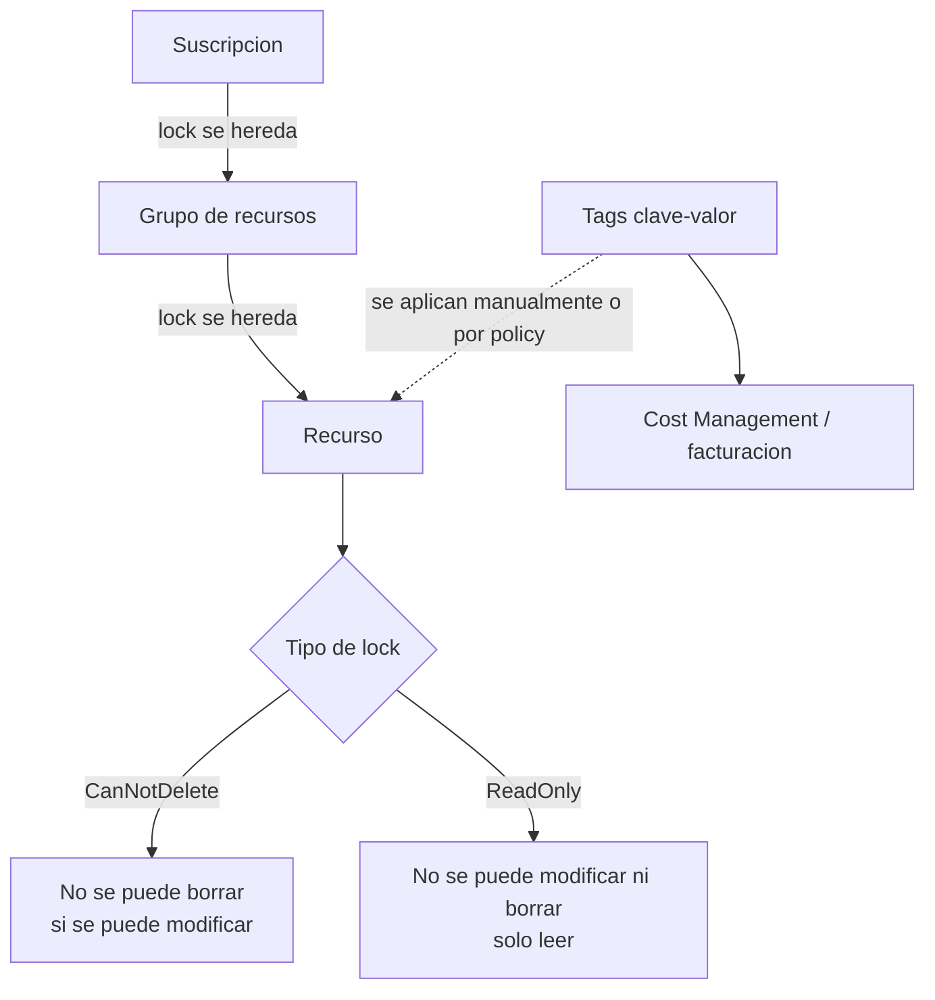

# Fase complementaria 12: Resource locks y tags

> Fase complementaria (hueco del temario oficial no cubierto por las lecciones). Fuente: Microsoft Learn — Lock your resources y Use tags to organize your Azure resources.

## Si solo recuerdas 3 cosas
- Un **resource lock** protege una suscripción, grupo de recursos o recurso de **borrados o cambios accidentales**, y **anula** los permisos de cualquier usuario (incluso Owner).
- Hay dos niveles: **CanNotDelete** (permite leer y modificar, no borrar) y **ReadOnly** (solo leer; equivale a Reader).
- Los **tags** son pares **clave-valor** para organizar y facturar; **no se heredan** automáticamente del grupo de recursos o suscripción.

## Objetivo de repaso
Recordar los tipos de lock, su herencia y alcance, y las reglas y límites de los tags.

## Comparaciones clave

| | CanNotDelete (Delete lock) | ReadOnly (Read-only lock) |
|---|---|---|
| Leer | Sí | Sí |
| Modificar | Sí | **No** |
| Borrar | **No** | **No** |
| Equivalencia | — | Similar al rol **Reader** |
| Uso típico | Proteger producción de borrados | Bloquear cambios por completo |

| | RBAC | Resource lock |
|---|---|---|
| Qué controla | Quién puede hacer qué | Restringe operaciones a **todos** |
| ¿Se puede saltar? | Según rol/asignación | **No** por permisos |
| Alcance | MG, suscripción, RG, recurso | Suscripción, RG, recurso (**no MG**) |
| Plano | Control y datos según rol | **Solo control plane** |

| Regla de tags | Valor |
|---|---|
| Pares por recurso/RG/suscripción | **50** |
| Longitud del nombre | **512** (128 en Storage) |
| Longitud del valor | **256** |
| ¿Se heredan? | **No** (usar Azure Policy) |
| Case sensitivity | Nombre **insensible**; valor **sensible** |

## Diagrama

## Requisitos y restricciones
- Los locks **no se pueden aplicar a grupos de administración**.
- La herencia va de padre a hijo y **gana el lock más restrictivo**; los **extension resources** heredan el lock del recurso al que se aplican.
- Los locks aplican **solo al control plane** (`management.azure.com`), **no** al data plane (por ejemplo, borrar un blob no queda bloqueado por el lock de la cuenta).
- Operaciones que parecen de lectura usan **POST** y quedan bloqueadas por ReadOnly: listar claves de Storage, iniciar/reiniciar una VM, escalar un App Service plan, ver backend health de Application Gateway, etc.
- Un **ReadOnly** en el grupo de recursos impide **mover** recursos dentro/fuera, pero un recurso con lock propio **sí** se puede mover a otro RG.
- **CanNotDelete** en el RG que crea Azure Backup **hace fallar los backups** (no puede limpiar restore points).
- **ReadOnly** en la suscripción **rompe Azure Advisor** (no puede guardar resultados).
- Para crear/borrar locks: acciones `Microsoft.Authorization/*` o `Microsoft.Authorization/locks/*`; roles **Owner** y **User Access Administrator**.
- Tags: se aplican a **recursos, RG y suscripciones**, **no** a grupos de administración; no todos los tipos de recurso los soportan.
- Tags son **texto plano**: no guardes valores sensibles.
- Algunos recursos solo admiten **15 tags** (Automation, CDN, DNS público/privado, búsqueda guardada de Log Analytics).
- Nombres de tag no admiten `< > % & \ ? /`; hay restricciones adicionales en DNS, Traffic Manager y Front Door.
- Roles para tags: **Tag Contributor** (solo `Microsoft.Resources/tags`) o **Contributor** (sobre el recurso).

## Requisito → Consecuencia
| Si… | Entonces… | Si no… |
|---|---|---|
| Quieres evitar borrados accidentales pero permitir cambios | Usa **CanNotDelete** | Un ReadOnly bloquearía también los cambios |
| Quieres bloquear cualquier modificación | Usa **ReadOnly** | CanNotDelete permitiría modificar |
| Quieres que los tags del RG lleguen a los recursos | Crea una **Azure Policy** de tags | Los recursos no heredan tags |
| Necesitas que un tag no se pueda modificar | Usa una policy **Deny/Modify** sobre el tag | Cualquiera con permisos podría cambiarlo |

## Casos de uso típicos
- Proteger el grupo de recursos de producción de un borrado accidental.
- Bloquear un recurso crítico durante una auditoría o congelación de cambios.
- Etiquetar por **centro de costo, entorno, propietario o aplicación** para facturación.
- Forzar tags obligatorios con Azure Policy (por ejemplo, `Environment`).
- Agrupar costos con el tag **`cm-resource-parent`**.

## Cuándo NO usar esto
- Para controlar **quién** puede hacer algo: usa **RBAC**, no locks.
- Para proteger **datos** dentro de Storage: el lock no cubre el data plane; usa SAS, RBAC de datos, soft delete, etc.
- Para bloquear un **grupo de administración**: no se puede.

## Puntos críticos para el examen
- **CanNotDelete** = no borrar; **ReadOnly** = no modificar ni borrar.
- El lock **anula permisos**, incluso de Owner.
- Herencia padre→hijo; **gana el más restrictivo**; los extension resources heredan.
- Locks **solo control plane**; **no** en management groups.
- **ReadOnly** bloquea POST: listar claves, arrancar VM, escalar plan, backend health.
- **CanNotDelete** en el RG de Backup **rompe los backups**.
- **ReadOnly** en la suscripción **rompe Advisor**.
- Tags: **50** pares; nombre **512** (128 Storage); valor **256**; **no se heredan**.
- Nombre de tag **case-insensitive**; valor **case-sensitive**.

## Trampa típica del examen
- Creer que un lock impide borrar **datos** de Storage (no; solo control plane).
- Creer que ReadOnly permite modificar (no) o que CanNotDelete impide modificar (sí permite).
- Pensar que los tags se **heredan** del RG (no; hace falta policy).
- Intentar aplicar un lock a un **grupo de administración** (no se puede).
- Olvidar que **ReadOnly en la suscripción rompe Advisor**.
- Confundir el **nombre** del tag (insensible) con el **valor** (sensible).

## Mini-escenario resuelto
**Escenario:** El grupo de recursos de producción no debe borrarse nunca, pero el equipo sigue necesitando cambiar tamaños y configuraciones.
**Respuesta:** Aplicar un lock **CanNotDelete** en el grupo de recursos.
**Por qué:** CanNotDelete impide el borrado (y bloquea el borrado completo del RG si se intenta) pero permite leer y modificar recursos.

## Productos relacionados
Productos nuevos → `docs/referencia/glosario-productos.md`: (ya registrados Azure Policy, Microsoft Cost Management).
Comparativa → `docs/referencia/comparativa-productos.md`: grupo **Gobierno y costos**.
Términos nuevos → `docs/referencia/glosario.md`: **CanNotDelete**, **ReadOnly**, **control plane / data plane**, **tag inheritance (policy)**, **cm-resource-parent**.

## Errores comunes / troubleshooting
- No puedo borrar un recurso → revisar locks heredados del RG o suscripción.
- No puedo iniciar una VM → un **ReadOnly** en el RG bloquea el POST de arranque.
- Los backups fallan → **CanNotDelete** en el RG creado por Azure Backup.
- Un tag no aparece en los recursos → no se hereda; usa policy o aplícalo manualmente.
- No puedo crear un tag → límite de 50, caracteres inválidos o tipo de recurso no soportado.
