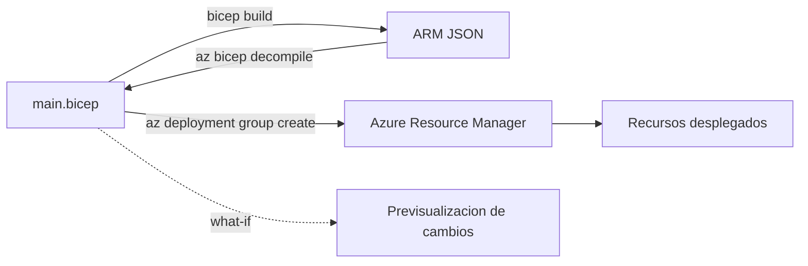

# Fase complementaria 13: Bicep

> Fase complementaria (hueco del temario oficial no cubierto por las lecciones). Fuente: Microsoft Learn — What is Bicep y Decompile a JSON ARM template to Bicep.

## Si solo recuerdas 3 cosas
- **Bicep** es un **DSL declarativo** para desplegar recursos de Azure; en el despliegue, la **Bicep CLI lo convierte a una plantilla ARM JSON**.
- Es **idempotente**, **no tiene archivos de estado**, admite **módulos**, **what-if** y **todos los tipos/versiones de API** en cuanto salen.
- Para convertir una plantilla ARM existente: **`az bicep decompile --file main.json`** genera `main.bicep` (usa `--force` para sobrescribir).

## Objetivo de repaso
Recordar qué es Bicep, sus ventajas frente a ARM JSON y cómo leer, modificar, convertir y desplegar un archivo Bicep.

## Comparaciones clave

| | ARM JSON | Bicep |
|---|---|---|
| Sintaxis | Verbosa, expresiones `[...]` | Concisa, funciones directas |
| Referencias | `resourceId()` / `dependsOn` manual | **Nombre simbólico** y dependencias automáticas |
| Tipado/IntelliSense | Limitado | **Type safety** con extensión de VS Code |
| Estado | Sin estado | **Sin estado** |
| Módulos | Anidados/vinculados | **`module`** reutilizable |
| Salida | JSON | JSON (compilado) |

| Operación | Comando |
|---|---|
| Compilar a ARM JSON | `bicep build main.bicep` |
| Descompilar ARM → Bicep | `az bicep decompile --file main.json` |
| Sobrescribir destino | `--force` |
| Desplegar en RG | `az deployment group create -g <rg> --template-file main.bicep` |
| Previsualizar cambios | `what-if` |

## Diagrama

## Requisitos y restricciones
- Necesitas la **Bicep CLI** (o la extensión de **VS Code**); el despliegue requiere Azure CLI/PowerShell autenticado.
- Bicep **no es un lenguaje de programación general**: declara recursos y propiedades.
- La estructura es flexible: **parámetros, variables y outputs** pueden declararse en cualquier parte del archivo.
- Los **nombres simbólicos** permiten referenciar recursos y evitan `dependsOn` manual.
- **`targetScope`** define el ámbito: `resourceGroup` (por defecto), `subscription`, `managementGroup` o `tenant`.
- La **descompilación no es perfecta**: hay que corregir warnings/errores; puede fallar si no hay conversión exacta.
- Nombres de parámetros con **puntos** en ARM se convierten a **guiones bajos** en Bicep (los identificadores Bicep solo admiten letras, dígitos y `_`).
- Convertir JSON→Bicep→JSON puede cambiar la sintaxis, pero el **resultado desplegado es equivalente**.

## Requisito → Consecuencia
| Si… | Entonces… | Si no… |
|---|---|---|
| Tienes una plantilla ARM y quieres Bicep | Ejecuta **`az bicep decompile`** | Tendrías que reescribirla a mano |
| El archivo `main.bicep` ya existe | Añade **`--force`** | La descompilación falla o no sobrescribe |
| Quieres evitar errores antes de desplegar | Usa **`what-if`** | Desplegarías sin previsualizar |
| Quieres reutilizar infraestructura | Usa **módulos** | Duplicarías código |

## Casos de uso típicos
- Desplegar una storage account, una VNet o una VM de forma repetible.
- Convertir plantillas ARM heredadas a Bicep para mantenerlas mejor.
- Modularizar infraestructura por entorno (dev/test/prod).
- Previsualizar cambios con `what-if` antes de aplicar.
- Integrar Bicep en pipelines CI/CD.

## Cuándo NO usar esto
- Si el equipo ya usa **Terraform** y necesita su estado y ecosistema multi-nube.
- Para automatizaciones imperativas (scripts que crean recursos paso a paso): usa CLI/PowerShell.
- Si necesitas una función que Bicep aún no soporta (experimental), valora ARM o scripts.

## Puntos críticos para el examen
- Bicep **compila a ARM JSON**; no es un runtime distinto.
- **No tiene estado** (a diferencia de Terraform).
- Es **idempotente**: desplegar el mismo archivo no cambia lo que ya está igual.
- **Dependencias automáticas** por nombre simbólico; `dependsOn` casi nunca es necesario.
- **`module`** para reutilizar; **`targetScope`** para el ámbito.
- **`decompile`** convierte ARM → Bicep; **`build`** convierte Bicep → ARM.
- **`--force`** sobrescribe el `.bicep` existente.
- Puntos en nombres de parámetros ARM → **guiones bajos** en Bicep.

## Trampa típica del examen
- Creer que Bicep **guarda estado** (no).
- Confundir **`build`** (Bicep→JSON) con **`decompile`** (JSON→Bicep).
- Creer que la descompilación es **perfecta** (hay que corregir warnings).
- Olvidar **`--force`** al descompilar sobre un archivo existente.
- Pensar que Bicep es un lenguaje de programación general (es declarativo).
- Creer que hay que escribir `dependsOn` siempre (se infiere del nombre simbólico).

## Mini-escenario resuelto
**Escenario:** Tienes `main.json` (ARM) y quieres migrarlo a Bicep para seguir editándolo, desplegando en un grupo de recursos.
**Respuesta:** Ejecutar `az bicep decompile --file main.json`, corregir warnings y desplegar con `az deployment group create -g <rg> --template-file main.bicep`.
**Por qué:** `decompile` genera `main.bicep` equivalente y el despliegue compila Bicep a ARM JSON antes de aplicarlo.

## Productos relacionados
Productos nuevos → `docs/referencia/glosario-productos.md`: **Bicep** (y **Bicep CLI**).
Comparativa → `docs/referencia/comparativa-productos.md`: grupo **Infraestructura como código**.
Términos nuevos → `docs/referencia/glosario.md`: **DSL**, **idempotencia**, **nombre simbólico**, **módulo Bicep**, **targetScope**, **what-if**, **decompile**.

## Errores comunes / troubleshooting
- `decompile` falla → la plantilla usa construcciones sin conversión exacta; revisa warnings y ajusta a mano.
- El despliegue no encuentra el archivo → ruta incorrecta o falta `--template-file`.
- Error de tipo → revisa el tipado del parámetro y la versión de API.
- El recurso no se actualiza → Bicep es idempotente; verifica que el cambio esté en el archivo.
