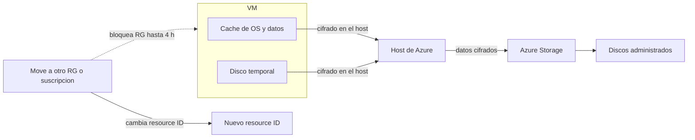

# Fase complementaria 14: Encryption at host y mover una VM

> Fase complementaria (hueco del temario oficial no cubierto por las lecciones). Fuente: Microsoft Learn — Server-side encryption of Azure Disk Storage y Move Azure resources.

## Si solo recuerdas 3 cosas
- **Encryption at host** cifra en el **host de la VM**: disco temporal y cachés de OS/datos se cifran en reposo y **fluyen cifrados** hasta Storage; es cifrado **extremo a extremo** y **no usa CPU** de la VM.
- **No se puede** habilitar encryption at host en una VM/VMSS que **alguna vez tuvo Azure Disk Encryption (ADE)**, ni habilitar ADE sobre discos con encryption at host.
- Mover una VM a otro **RG o suscripción** (mismo tenant Entra) **no cambia su región**; durante el move ambos RG quedan **bloqueados hasta 4 h**, pero la VM **sigue funcionando**.

## Objetivo de repaso
Distinguir los tipos de cifrado de discos y recordar las reglas y límites para mover una VM.

## Comparaciones clave

| | SSE (predeterminado) | Encryption at host | Azure Disk Encryption (ADE) |
|---|---|---|---|
| Dónde cifra | Storage (servidor) | **Host de la VM** | Dentro del guest (BitLocker/dm-crypt) |
| Cifra disco temporal | No (salvo host) | **Sí** | No aplica |
| Usa CPU de la VM | No | **No** | Sí (impacto) |
| Claves | PMK o CMK | PMK/CMK según disco | CMK |
| Convive con las otras | Sí | **No con ADE** | **No con encryption at host** |

| Operación | ¿Cambia la región? | Notas |
|---|---|---|
| Mover a otro **RG** (misma suscripción) | **No** | RG origen y destino bloqueados |
| Mover a otra **suscripción** | **No** | Mismo tenant Entra obligatorio |
| Cambiar de **región** | **Sí** | Requiere recrear/Resource Mover, no el move de RG |

## Diagrama

## Requisitos y restricciones
- **Encryption at host**: el soporte de tamaño de VM **varía por región y generación**; los discos temporales/ephemeral OS usan **PMK** y las cachés usan **CMK o PMK** según el tipo de cifrado del disco.
- **No** se puede habilitar en VMs/VMSS que **actual o anteriormente** tuvieron **ADE**; **ADE no** se puede habilitar en discos con encryption at host.
- En **VMSS existentes** se puede habilitar, pero **solo las VM nuevas** quedan cifradas.
- En **VMs existentes** hay que **desasignar y reasignar** para que se cifren.
- **Ultra Disk / Premium SSD v2**: discos con sector **512e** deben haberse creado después del **13-may-2023**.
- **Mover recursos**: suscripciones **activas** y en el **mismo tenant Entra**; el tipo de recurso debe **soportar move**; el **resource provider** del destino debe estar **registrado**; revisar **cuota**; permisos `Microsoft.Resources/subscriptions/resourceGroups/moveResources/action` (origen) y `.../resourceGroups/write` (destino).
- Solo se especifican **recursos de nivel superior**; los hijos se mueven automáticamente y **no** se pueden mover solos.
- Un **read-only lock** en el RG/suscripción de origen o destino **bloquea** el move.
- Con **CMK**, un disco solo se puede mover de RG si la **VM está desasignada**, y **no** se puede mover entre suscripciones.
- El move **cambia el resource ID**: hay que actualizar scripts, plantillas y dashboards.

## Requisito → Consecuencia
| Si… | Entonces… | Si no… |
|---|---|---|
| Quieres cifrado extremo a extremo sin impacto de CPU | Habilita **encryption at host** | El disco temporal quedaría sin cifrar por el host |
| La VM tuvo ADE alguna vez | **No** puedes usar encryption at host | El despliegue fallará |
| Necesitas mover una VM de RG | Usa el **move** (mismo tenant) | Tendrías que recrearla |
| Necesitas cambiar de **región** | Recrea o usa **Azure Resource Mover** | El move de RG no cambia la región |

## Casos de uso típicos
- Cumplir requisitos de cifrado extremo a extremo en VMs de producción.
- Cifrar el disco temporal en cargas sensibles.
- Reorganizar recursos entre RG o suscripciones tras una fusión/adquisición.
- Separar dev/test de producción moviendo VMs entre suscripciones.
- Migrar una VM a otra región con Resource Mover (operación distinta).

## Cuándo NO usar esto
- Si la VM usa **ADE**: no puedes activar encryption at host sin migrar antes el cifrado.
- Si necesitas **cambiar de región**: el move de RG/suscripción no lo hace.
- Para mover **recursos hijos** por separado: no se puede.
- Si hay un **read-only lock**: el move falla hasta quitarlo.

## Puntos críticos para el examen
- **Encryption at host** = cifrado en el **host**, extremo a extremo, **sin CPU** de la VM.
- **Excluyente con ADE**: no conviven en la misma VM/disco.
- VM existente → **desasignar y reasignar** para cifrar; VMSS → solo VM nuevas.
- Mover a otro RG/suscripción **no cambia la región**.
- Durante el move, **ambos RG quedan bloqueados hasta 4 h**; los recursos siguen operativos.
- Solo **recursos de nivel superior**; los hijos van con el padre.
- El move **cambia el resource ID**.
- **Read-only lock** bloquea el move.
- Con **CMK**: mover RG exige VM **desasignada**; no se mueve entre suscripciones.

## Trampa típica del examen
- Confundir **encryption at host** con **ADE** (host vs guest; sin CPU vs con CPU).
- Creer que se puede activar encryption at host **después de haber usado ADE** (no).
- Pensar que mover a otro RG **cambia la región** (no).
- Creer que el move **apaga** la VM (sigue funcionando; solo bloquea cambios en los RG).
- Intentar mover un **recurso hijo** solo (no).
- Olvidar que un **read-only lock** impide el move.

## Mini-escenario resuelto
**Escenario:** Una VM de producción debe cifrarse de extremo a extremo, incluido el disco temporal, sin penalizar la CPU, y nunca usó ADE.
**Respuesta:** Habilitar **encryption at host**; si la VM ya existe, **desasignarla y reasignarla**.
**Por qué:** El cifrado se hace en el host (sin CPU de la VM) y cubre disco temporal y cachés; la reasignación es necesaria para cifrar una VM existente.

## Productos relacionados
Productos nuevos → `docs/referencia/glosario-productos.md`: **Azure Disk Encryption (ADE)**, **Azure Resource Mover**.
Comparativa → `docs/referencia/comparativa-productos.md`: grupo **Cifrado de discos**.
Términos nuevos → `docs/referencia/glosario.md`: **encryption at host**, **SSE**, **DEK/KEK**, **double encryption**, **resource ID**, **move operation**.

## Errores comunes / troubleshooting
- No se puede habilitar encryption at host → la VM tuvo ADE o el tamaño no está soportado en la región.
- La VM no arranca tras cifrar → revisar el estado de la clave CMK y la identidad.
- El move falla → read-only lock, tenant distinto, RP no registrado o cuota insuficiente.
- El move se queda “colgado” → esperar hasta 4 h; los RG están bloqueados.
- Scripts fallan tras el move → actualizar el **resource ID**.
