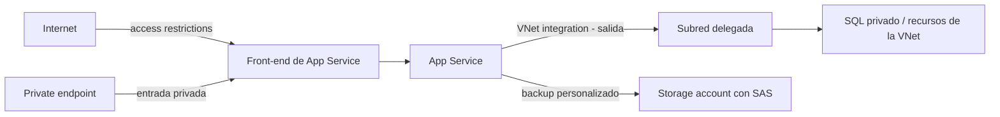

# Fase complementaria 15: Networking y backup de Azure App Service

> Fase complementaria (hueco del temario oficial no cubierto por las lecciones). Fuente: Microsoft Learn — App Service networking features, VNet integration, access restrictions y Back up and restore your app.

## Si solo recuerdas 3 cosas
- **VNet integration** da a la app **salida** hacia una VNet; **no** da acceso **entrante** privado (para eso, **private endpoint**).
- **Access restrictions** es una lista **allow/deny por prioridad** (IP, subred con service endpoint o service tag) para el tráfico **entrante**; si hay reglas, existe un **deny implícito** al final.
- En backups de App Service hay **automáticos** (sin configurar, 30 GB, cada hora, 30 días) y **personalizados** (requieren storage account, hasta 10 GB, programables y descargables).

## Objetivo de repaso
Distinguir las opciones de red de App Service (salida vs entrada vs aislamiento) y las reglas del backup automático vs personalizado.

## Comparaciones clave

| Necesidad | Feature |
|---|---|
| Salida a recursos de la VNet | **VNet integration** |
| Entrada privada a la app | **Private endpoint** |
| Entrada restringida por IP/subred | **Access restrictions** |
| Salida a red on-prem no conectada a Azure | **Hybrid Connections** |
| Aislamiento dedicado en tu VNet | **App Service Environment (ASE)** |

| | Backup automático | Backup personalizado |
|---|---|---|
| Configuración | No requiere | **Sí** (storage account) |
| Tamaño máximo | **30 GB** | **10 GB** (4 GB BD vinculada) |
| Base de datos vinculada | **No** | Sí (SQL, MySQL, PostgreSQL, MySQL in-app) |
| Storage account | No | **Sí** (SAS; **no** managed identity) |
| Frecuencia | **Cada hora**, no configurable | Cada **2 h** mínimo; hasta **12/día** |
| Retención | **30 días** fija | **0–30 días** o indefinida |
| Descargable | No | **Sí** (blobs) |
| Parcial | No | **Sí** (`_backup.filter`) |
| Sobre VNet | No | **Sí** |

| | VNet integration | Private endpoint | ASE |
|---|---|---|---|
| Dirección | **Salida** | **Entrada** | Ambas / aislamiento |
| SKU | Basic+ / Elastic Premium | Según App Service | **Isolated** |
| Subred | Delegada, dedicada | — | VNet dedicada |

## Diagrama

## Requisitos y restricciones
- **VNet integration** requiere tier **Basic, Standard, Premium, Premium v2/v3/v4 o Elastic Premium**; soporta **TCP/UDP**; sirve para App Service, Functions y Logic Apps.
- **No** soporta montar unidades, **domain join** de Windows Server AD ni **NetBIOS**.
- La integración es **same-region**; llega a VNets **peeradas** (incluido global peering), **ExpressRoute**, servicios con **service endpoint** y con **private endpoint**.
- La **subred de integración** es dedicada: consume **5 IPs** al crearse y **1 IP por instancia** del plan; el escalado duplica temporalmente; se recomienda **/26** para el máximo de un plan; el portal exige **/27** (nueva) o **/28** (existente); **MPSJ** exige **/26**.
- **Dos interfaces por worker** → dos integraciones por plan; una app solo puede tener **una integración** a la vez.
- Con **all traffic routing** todo sale por la VNet; sin él, solo tráfico privado (RFC1918) y service endpoints.
- **Access restrictions**: hasta **512 reglas**; si no hay regla “unmatched”, aplica **deny implícito**; responde **HTTP 403**; se implementa en el **front-end** (ACL).
- Los **service endpoints** de access restrictions **no** aplican a ASE; en ASE se usan reglas **IP**.
- El backup **personalizado** requiere storage con **SAS**; **managed identity no está soportada** para backup/restore.
- **Basic** solo puede backup/restore del **slot de producción**.
- El backup personalizado **no** incluye **Flexible Server** de MySQL/PostgreSQL como BD vinculada.
- Restaurar **detiene** la app/slot destino; para minimizar downtime, restaura a un **slot** y luego haz **swap**.
- Los backups automáticos solo se restauran **dentro del mismo ASE**; los personalizados pueden ir a **otro ASE**.
- BD vinculadas en backup personalizado: retirada de nuevas configuraciones **nov-2025** (MySQL/PostgreSQL) y **abr-2026** (Azure SQL/SQL Server); fin **31-mar-2028**.

## Requisito → Consecuencia
| Si… | Entonces… | Si no… |
|---|---|---|
| La app debe llamar a un SQL privado | Configura **VNet integration** | La salida iría por internet |
| La app debe ser accesible solo desde la VNet | Configura **private endpoint** | VNet integration no da entrada |
| Quieres restringir por IP o subred | Usa **access restrictions** | La app quedaría expuesta |
| Necesitas backup programable y descargable | Usa **backup personalizado** con storage SAS | Solo tendrías el automático |
| Quieres backup sobre VNet | App con **VNet integration** + storage que permita la VNet | El backup fallaría por red |

## Casos de uso típicos
- App que consume una base de datos privada o un recurso con private endpoint.
- Exponer una API interna solo a la VNet (private endpoint).
- Permitir solo las IPs de una oficina o de Application Gateway (access restrictions).
- Backup diario a un storage account y restauración a un slot de staging.
- Aislar la app con ASE para requisitos de cumplimiento.

## Cuándo NO usar esto
- Para dar **entrada** privada con VNet integration (no; usa private endpoint).
- Para backup de bases **Flexible Server** con el backup de App Service (usa el backup nativo).
- Para usar **managed identity** como autenticación del storage de backup (no soportado).
- Si la app es **Free/Shared**: no hay VNet integration ni backups.

## Puntos críticos para el examen
- **VNet integration = salida**; **private endpoint = entrada**; **ASE = aislamiento**.
- VNet integration requiere **Basic+**; no soporta domain join ni montar unidades.
- Subred dedicada: **/26** recomendado; **/27** mínimo en portal para nueva; **5 IPs** + 1 por instancia.
- **Access restrictions**: prioridad ascendente, **deny implícito**, **403**, **512** reglas.
- Backup **automático**: **30 GB**, **cada hora**, **30 días**, sin configurar, sin BD.
- Backup **personalizado**: **10 GB** (4 GB BD), **storage SAS**, cada **2 h**, hasta **12/día**, descargable.
- **Basic** solo backup del **slot de producción**.
- Restaurar **detiene** el destino; restaurar a slot y **swap**.

## Trampa típica del examen
- Creer que **VNet integration** da acceso **entrante** (no; es salida).
- Confundir **access restrictions** (entrada) con **NSG** (filtro de subred, salida en integración).
- Creer que el backup automático incluye **base de datos** (no).
- Pensar que se puede usar **managed identity** para el storage de backup (no; SAS).
- Creer que el backup personalizado sirve para **Flexible Server** (no).
- Olvidar que **Basic** solo permite backup del slot de producción.

## Mini-escenario resuelto
**Escenario:** Una app debe llamar a un SQL privado dentro de una VNet y, además, necesitas backups programados y descargables en un storage account.
**Respuesta:** Configurar **VNet integration** en una subred delegada y **backup personalizado** con un storage account autenticado por **SAS**.
**Por qué:** VNet integration habilita la salida hacia el SQL privado y el backup personalizado permite programación, descarga y retención configurable usando SAS.

## Productos relacionados
Productos nuevos → `docs/referencia/glosario-productos.md`: **App Service Environment (ASE)**, **Hybrid Connections**.
Comparativa → `docs/referencia/comparativa-productos.md`: grupo **App Service networking**.
Términos nuevos → `docs/referencia/glosario.md`: **VNet integration**, **access restrictions**, **delegated subnet**, **MPSJ**, **all traffic routing**, **custom backup**, **linked database**.

## Errores comunes / troubleshooting
- La app no llega al recurso privado → VNet integration mal configurada, NSG de la subred o DNS.
- El recurso privado no llega a la app → falta **private endpoint**.
- 403 inesperado → access restrictions con deny implícito o regla mal priorizada.
- El backup falla → storage sin SAS, tamaño >10 GB, BD no soportada o red.
- El restore es lento/indisponible → restaura a un slot y haz swap.
