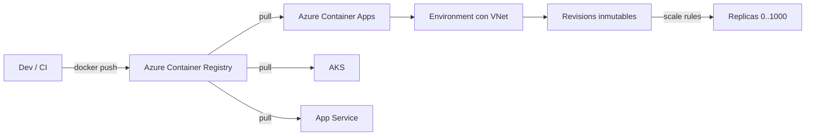

# Fase complementaria 16: Azure Container Registry y Azure Container Apps

> Fase complementaria (hueco del temario oficial no cubierto por las lecciones). Fuente: Microsoft Learn — Introduction to Azure Container Registry, Azure Container Apps overview y Set scaling rules.

## Si solo recuerdas 3 cosas
- **Azure Container Registry (ACR)** es un registro **administrado** basado en Docker para almacenar imágenes y artefactos; tiene **3 SKU: Basic, Standard y Premium**, y solo **Premium** añade **geo-replicación**, **content trust** y **private endpoints**.
- **Azure Container Apps (ACA)** es una plataforma **serverless** para contenedores: escala con **HTTP, eventos, CPU/memoria o KEDA** y la mayoría de apps pueden **escalar a cero**.
- En ACA, **minReplicas por defecto es 0** y **maxReplicas por defecto es 10** (hasta **1000**); las apps que escalan por **CPU/memoria no pueden ir a cero**.

## Objetivo de repaso
Recordar los SKU de ACR y cuándo usar ACI, Container Apps o AKS, además de las reglas de escalado de Container Apps.

## Comparaciones clave

| SKU de ACR | Geo-replicación | Content trust | Private endpoints | Uso |
|---|---|---|---|---|
| **Basic** | No | No | No | Dev/test, bajo volumen |
| **Standard** | No | No | No | Producción moderada |
| **Premium** | **Sí** | **Sí** | **Sí (preview)** | Escala, seguridad, multirregión |

| | ACI | Container Apps | AKS |
|---|---|---|---|
| Modelo | Contenedores simples/efímeros | **Serverless** para apps y jobs | Kubernetes completo |
| Escalado | Manual | **KEDA**, HTTP, eventos, CPU/mem | Control total (HPA/KEDA) |
| Scale to zero | No | **Sí** (salvo CPU/mem) | Posible con nodos/scale sets |
| Complejidad | Baja | Media | Alta |
| Caso típico | Tareas aisladas, batch | Microservicios, APIs, jobs | Plataformas Kubernetes |

| Regla de escalado ACA | Base |
|---|---|
| **HTTP** | Peticiones concurrentes (por defecto **10**) |
| **TCP** | Conexiones concurrentes |
| **Custom** | CPU, memoria, Service Bus, Event Hubs, Kafka, Redis (KEDA) |

## Diagrama

## Requisitos y restricciones
- **ACR**: autenticación con **Entra ID**, **service principal** o **admin account**; RBAC para permisos; HTTPS/TLS; imágenes **Windows y Linux**; soporta **Helm** y formato **OCI**.
- **ACR Tasks**: builds on-demand o automatizados por **commit** o actualización de **imagen base**; tareas multi-step.
- **ACR** se integra con **AKS, App Service, Batch, Service Fabric**, Kubernetes, DC/OS y Docker Swarm.
- **Container Apps**: usa **KEDA** para autoscaling; cada cambio de reglas crea una **nueva revisión** (inmutable).
- Límites de réplicas: **mínimo 0**, **máximo 10 por defecto**, configurable hasta **1000**.
- Si defines varias reglas, escala cuando se cumple **la primera condición** de cualquiera.
- Si la app escala por **CPU o memoria**, **no** puede llegar a **0**.
- Para garantizar una instancia siempre viva, pon **minReplicas ≥ 1**.
- Escalar a cero **no genera cargos de uso**; réplicas en memoria pueden facturarse a tarifa **idle**.
- Los **jobs** de Container Apps **no** soportan reglas HTTP.
- Con reglas **no HTTP**, ajusta `activeRevisionsMode` a **single**.
- Container Apps puede usar **cualquier registro** (Docker Hub o ACR), **VNet** en el environment, **secrets**, **Dapr**, **ingress interno** y **traffic splitting**.
- Los logs se envían a **Log Analytics**.

## Requisito → Consecuencia
| Si… | Entonces… | Si no… |
|---|---|---|
| Necesitas un registro privado de imágenes | Crea un **ACR** | Usarías Docker Hub público |
| Necesitas geo-replicación y private endpoints | Usa **ACR Premium** | Basic/Standard no lo ofrecen |
| Quieres microservicios con scale to zero | Usa **Container Apps** | ACI no escala solo |
| Necesitas control total de Kubernetes | Usa **AKS** | Container Apps abstrae el clúster |
| Quieres una instancia siempre disponible | Pon **minReplicas ≥ 1** | Podría escalar a cero |

## Casos de uso típicos
- Almacenar y versionar imágenes de contenedor para AKS, App Service o ACA.
- Construir imágenes automáticamente al cambiar el código (ACR Tasks).
- Desplegar APIs y microservicios con escalado por HTTP o eventos.
- Ejecutar jobs programados o por eventos en Container Apps.
- Hacer blue/green o A/B testing con **traffic splitting** y revisiones.
- Exponer un servicio interno con ingress interno y DNS service discovery.

## Cuándo NO usar esto
- Para una tarea aislada y efímera: **ACI** es más simple.
- Para control total del clúster y ecosistema Kubernetes: **AKS**.
- Para una app tradicional sin contenedores: **App Service**.
- Para imágenes con requisitos de multirregión sin Premium: ACR Basic/Standard no tienen geo-replicación.

## Puntos críticos para el examen
- **ACR**: 3 SKU; **Premium** = geo-replicación + content trust + private endpoints.
- ACR almacena imágenes **Docker/OCI** y **Helm**; autenticación con **Entra ID** o service principal.
- **Container Apps** = **serverless**, **KEDA**, **scale to zero**.
- Límites de réplica: **0** mínimo, **10** por defecto, **1000** máximo.
- Reglas: **HTTP, TCP, custom**; con varias reglas gana la **primera condición** que se cumpla.
- **CPU/memoria no escalan a cero**.
- **minReplicas ≥ 1** para instancia siempre viva.
- Cada cambio de escala crea una **nueva revisión inmutable**.
- **Jobs** no usan reglas HTTP.

## Trampa típica del examen
- Confundir **ACI** (simple/efímero) con **Container Apps** (serverless con escalado) y **AKS** (Kubernetes completo).
- Creer que **Container Apps** siempre escala a cero (CPU/memoria no).
- Pensar que **ACR Basic** tiene geo-replicación (solo Premium).
- Creer que los **jobs** de Container Apps usan reglas HTTP (no).
- Olvidar que las **revisiones** son inmutables y que cambiar escala crea una nueva.
- Creer que Container Apps solo acepta imágenes de ACR (acepta cualquier registro).

## Mini-escenario resuelto
**Escenario:** Quieres desplegar microservicios event-driven que escalen a cero y consuman imágenes privadas de un registro con geo-replicación.
**Respuesta:** Usar **Azure Container Apps** con un **ACR Premium** como registro de imágenes.
**Por qué:** Container Apps escala con KEDA y a cero, y ACR Premium ofrece geo-replicación para distribuir las imágenes.

## Productos relacionados
Productos nuevos → `docs/referencia/glosario-productos.md`: **Azure Container Registry (ACR)** (ya registrado; se amplía), **Azure Container Apps** (ya registrado; se amplía).
Comparativa → `docs/referencia/comparativa-productos.md`: grupo **Contenedores**.
Términos nuevos → `docs/referencia/glosario.md`: **revisión (Container Apps)**, **KEDA**, **scale to zero**, **traffic splitting**, **content trust**, **ACR Tasks**.

## Errores comunes / troubleshooting
- No se puede hacer pull de la imagen → credenciales/rol en ACR o imagen mal etiquetada.
- La app no escala → regla mal configurada, límites de réplica o falta KEDA scaler.
- No baja a cero → la regla usa **CPU/memoria** o `minReplicas` ≥ 1.
- El job no se ejecuta → revisar trigger/evento y que no dependa de regla HTTP.
- No hay logs → falta integración con **Log Analytics**.
