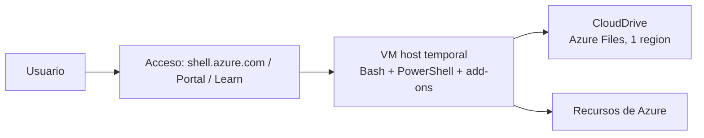

# Fase 1: Azure Cloud Shell

## Si solo recuerdas 3 cosas
- Azure Cloud Shell es un entorno de línea de comandos **basado en navegador** y **gestionado por Microsoft**, que siempre ofrece las versiones más recientes de Azure CLI y PowerShell.
- Al abrir una sesión se asigna una **VM temporal** preconfigurada con Bash y PowerShell; la sesión se desconecta tras **20 minutos de inactividad**.
- Los archivos se conservan en **CloudDrive** (respaldado por Azure Files, en **una sola región**); solo se permite **una sesión a la vez**.

## Objetivo de repaso
Recordar qué es Cloud Shell, cómo se accede, qué se conserva entre sesiones y cuándo no conviene usarlo.

## Comparaciones clave

| Vía de acceso | Cómo se accede |
|---|---|
| Enlace directo | `https://shell.azure.com` |
| Portal de Azure | Botón de Cloud Shell dentro del portal |
| Fragmentos de código de Microsoft Learn | Se abre Cloud Shell desde el bloque de código |

| Elemento | ¿Persiste entre sesiones? |
|---|---|
| Archivos en CloudDrive | Sí (entre sesiones y entre dispositivos) |
| Estado/configuración de la sesión | No |
| Versiones de CLI/PowerShell | Gestionadas por Microsoft (siempre actualizadas) |

## Diagrama

## Requisitos y restricciones
- Requiere iniciar sesión con una cuenta de Azure; hereda los permisos y recursos del usuario.
- La sesión se cierra tras **20 min de inactividad** (sin aviso) y se pierde el estado de la sesión.
- No ofrece permisos de administrador (**sudo**).
- Solo admite **una sesión simultánea**; no sirve para trabajo concurrente entre suscripciones o inquilinos.
- El almacenamiento de CloudDrive está en **una sola región**.
- Solo permite herramientas soportadas en el entorno limitado (no se instalan/actualizan libremente).
- Doble cifrado en reposo por defecto.

## Requisito → Consecuencia
| Si… | Entonces… | Si no… |
|---|---|---|
| Guardas archivos en CloudDrive | Persisten entre sesiones y dispositivos | Se pierden al terminar la sesión |
| Necesitas `sudo` o instalar herramientas no soportadas | Usa una VM o contenedor propios | Cloud Shell no puede hacerlo |
| Necesitas más de 20 min de ejecución continua | Usa otra herramienta | La sesión se desconecta y pierdes el estado |

## Casos de uso típicos
- Administrar recursos de Azure desde cualquier dispositivo con navegador.
- Ejecutar comandos de Azure CLI o PowerShell sin instalar nada localmente.
- Recuperar scripts propios guardados en CloudDrive desde otro equipo.
- Editar scripts con el editor de Cloud Shell.
- Usar herramientas preinstaladas (Docker, kubectl, Helm, Terraform, Ansible, etc.).

## Cuándo NO usar esto
- Scripts o actividades de más de 20 minutos.
- Cuando se requieren permisos de administrador (sudo).
- Cuando se necesitan herramientas que exigen una VM o contenedor propios.
- Cuando se necesita almacenamiento de varias regiones.
- Cuando se necesitan varias sesiones simultáneas.

## Puntos críticos para el examen
- Es **gestionado por Microsoft**: no hay que instalar ni mantener módulos.
- Se accede desde el navegador (shell.azure.com, portal o Learn), no desde el escritorio.
- Cada sesión usa una **VM host temporal** reciclable.
- **20 minutos** de inactividad → desconexión sin aviso.
- La persistencia es **CloudDrive** (Azure Files), ligada a **una región**.
- **Una** sesión a la vez.
- El editor se abre con el icono `{}` o con el comando `code` (solo en **modo Clásico**).

## Trampa típica del examen
- Creer que los archivos se pierden al cerrar: **los archivos sí persisten** en CloudDrive; lo que se pierde es el estado de la sesión.
- Suponer que admite varias sesiones simultáneas (no).
- Suponer que se puede usar `sudo` (no).
- Suponer que el almacenamiento puede estar en cualquier región (una sola).
- Suponer que hay que instalar o actualizar la CLI (no; siempre la última versión).

## Mini-escenario resuelto
**Escenario:** Un administrador está de viaje, solo tiene una laptop con navegador y necesita ejecutar sus scripts de diagnóstico guardados.
**Respuesta:** Abrir Azure Cloud Shell y usar los scripts del CloudDrive.
**Por qué:** Cloud Shell opera desde cualquier navegador sin instalar complementos y CloudDrive persiste archivos entre sesiones y dispositivos.

## Productos relacionados
Productos nuevos de esta lección → registrados en `docs/referencia/glosario-productos.md`: **Azure Cloud Shell**, **CloudDrive** y **Azure Files**.
No hay aún un grupo de productos similares; se anotará en `docs/referencia/comparativa-productos.md` cuando aparezca.

## Errores comunes / troubleshooting
- La sesión se cierra sola → 20 minutos de inactividad.
- El comando `code` no responde → activar **modo Clásico** (More > Settings > Go to Classic version).
- No puede instalar una herramienta → el entorno es limitado; usar una VM o contenedor.
- No encuentra un archivo de una sesión anterior → debe estar en CloudDrive; el estado de la sesión no se conserva.

## Checklist de configuración
- [ ] Elegir la experiencia: **Bash** o **PowerShell**.
- [ ] Confirmar/montar **CloudDrive** (y su región).
- [ ] Subir los scripts/archivos que deban persistir.
- [ ] Activar **modo Clásico** si se usará el comando `code`.
