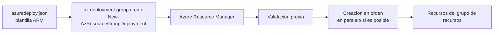

# Fase 2: Crear plantillas ARM con VS Code

## Si solo recuerdas 3 cosas
- Una plantilla ARM es un archivo **JSON declarativo** que define la infraestructura y configuración de un despliegue; es **idempotente** (repetir el despliegue no cambia nada si no cambia la plantilla).
- Secciones **obligatorias**: `schema`, `contentVersion` y `resources`; `parameters`, `variables`, `functions`, `outputs` y `apiProfile` son opcionales.
- Los **parámetros** personalizan el despliegue (máx. **256**); para secretos usa `secureString`/`secureObject` y **nunca** los dejes fijos en la plantilla.

## Objetivo de repaso
Recordar qué es IaC/ARM, las secciones de la plantilla, cómo se despliega y las reglas de parámetros y salidas.

## Comparaciones clave

| Sección | ¿Obligatoria? | Para qué |
|---|---|---|
| `schema` | Sí | Ubicación del esquema JSON que describe la plantilla |
| `contentVersion` | Sí | Versión de la plantilla (ej. 1.0.0.0) |
| `resources` | Sí | Recursos que se despliegan o actualizan |
| `apiProfile` | No | Colección de versiones de API para tipos de recurso |
| `parameters` | No | Valores que se proporcionan al desplegar |
| `variables` | No | Valores para simplificar expresiones |
| `functions` | No | Funciones definidas por el usuario |
| `outputs` | No | Valores devueltos al final del despliegue |

| Tipo de parámetro | Uso |
|---|---|
| `string` / `int` / `bool` / `object` / `array` | Valores normales |
| `secureString` / `secureObject` | Secretos (no se pueden leer tras el despliegue) |

## Diagrama

## Requisitos y restricciones
- Necesitas **Azure CLI o Azure PowerShell** instalados (o VS Code con las extensiones).
- El grupo de recursos debe existir (o crearlo con `az group create` / `New-AzResourceGroup`).
- Máximo **256 parámetros** por plantilla.
- Los secretos se definen como parámetros (`secureString`/`secureObject`); nunca hardcodeados ni con valor por defecto.
- Algunos nombres deben ser únicos (ej. cuentas de almacenamiento: 3–24 caracteres, minúsculas, números y guiones).
- Las plantillas ARM admiten comentarios `//` y `/* */`.

## Requisito → Consecuencia
| Si… | Entonces… | Si no… |
|---|---|---|
| Defines `allowedValues` | El despliegue falla con valores no permitidos | Se acepta cualquier valor del tipo |
| Marca un parámetro como `secureString`/`secureObject` | No se puede leer tras el despliegue | El secreto podría quedar expuesto |
| Repites el despliegue sin cambios | Nada se recrea (idempotente) | Si la plantilla cambia, solo se aplica el cambio |

## Casos de uso típicos
- Automatizar despliegues de infraestructura (IaC) y versionarlos en un repositorio.
- Reutilizar una plantilla para dev/test/prod cambiando parámetros.
- Desplegar soluciones complejas enlazando subplantillas (linked templates).
- Integrar plantillas en CI/CD (Azure Pipelines o GitHub Actions).
- Devolver endpoints u otros valores con `outputs` para usarlos después.

## Cuándo NO usar esto
- Cambios manuales únicos y pequeños donde no buscas repetibilidad.
- Cuando no quieres mantener código JSON versionado.

## Puntos críticos para el examen
- ARM = **JSON declarativo** (dice qué, no cómo); distinto de un script imperativo.
- Secciones requeridas: **schema, contentVersion, resources**.
- **Idempotente**: re-desplegar no duplica recursos.
- **256** parámetros como máximo.
- Referencias: `[parameters('nombre')]` para parámetros y `[reference(...)]` para el estado en tiempo de ejecución de un recurso.
- Despliegue local: `az deployment group create` o `New-AzResourceGroupDeployment`.
- `az group deployment create` está **en desuso**; usa `az deployment group create`.
- Los secretos van en `parameters` (`secureString`/`secureObject`).

## Trampa típica del examen
- Confundir `az group deployment create` (obsoleto) con `az deployment group create` (recomendado).
- Creer que `parameters`/`outputs` son obligatorios (no lo son; sí lo son `schema`, `contentVersion`, `resources`).
- Poner contraseñas en `variables` o darles `defaultValue` (deben ser parámetros seguros).
- Confundir declarativo (ARM) con imperativo (scripts).
- Creer que `allowedValues` solo avisa: en realidad **hace fallar** el despliegue.

## Mini-escenario resuelto
**Escenario:** Necesitas desplegar la misma cuenta de almacenamiento en dev y prod cambiando solo el SKU, y proteger una contraseña.
**Respuesta:** Hacer el SKU un parámetro con `allowedValues` y la contraseña un parámetro `secureString`.
**Por qué:** Los parámetros permiten reutilizar la plantilla con valores por entorno, y `secureString` evita exponer secretos.

## Productos relacionados
Productos nuevos → `docs/referencia/glosario-productos.md`: **Azure Resource Manager (ARM)**.
Término nuevo → `docs/referencia/glosario.md`: **plantilla ARM**. Sin grupo comparativo nuevo.

## Errores comunes / troubleshooting
- El despliegue falla por valor no permitido → revisa `allowedValues`.
- No se encuentra el grupo de recursos → créalo o indica `--resource-group`.
- Falla por nombre no único → ajusta el nombre globalmente único.

## Checklist de configuración
- [ ] Definir el grupo de recursos y la ubicación.
- [ ] Decidir qué valores serán **parámetros** (SKU, nombres) y cuáles fijos.
- [ ] Marcar los secretos como `secureString`/`secureObject`.
- [ ] Definir `allowedValues` donde corresponda.
- [ ] Decidir las **salidas** (`outputs`) útiles.
- [ ] Elegir despliegue local, plantilla enlazada o pipeline CI/CD.
