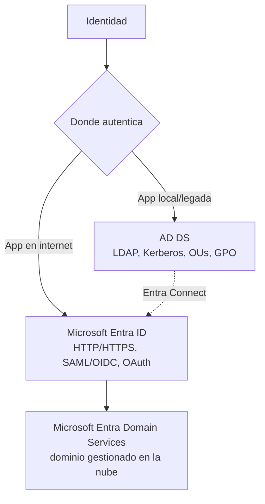

# Fase 3: Microsoft Entra ID (introducción)

## Si solo recuerdas 3 cosas
- Microsoft Entra ID es un servicio de directorio **PaaS multiinquilino gestionado por Microsoft**; **no** es AD DS en una VM.
- Entra ID usa **HTTP/HTTPS** (SAML, WS-Federation, OpenID Connect, OAuth), estructura **plana** (sin OUs ni GPO) y se consulta por **REST API** (no LDAP); AD DS usa **LDAP, Kerberos, OUs y GPO**.
- **P2** = P1 + **Entra ID Protection** + **Privileged Identity Management**; **Entra Domain Services** (dominio gestionado: unión a dominio, GPO, Kerberos) requiere **P1/P2**.

## Objetivo de repaso
Distinguir Entra ID de AD DS, entender tenants y esquema, y las diferencias entre planes Free/P1/P2 y Domain Services.

## Comparaciones clave

| Característica | AD DS | Microsoft Entra ID |
|---|---|---|
| Tipo | Directorio en Windows Server (IaaS) | Directorio gestionado en la nube (PaaS) |
| Estructura | Jerárquica X.500, OUs | Plana (sin OUs ni GPO) |
| Consulta | LDAP | API REST sobre HTTP/HTTPS |
| Autenticación | Kerberos | SAML, WS-Federation, OpenID Connect |
| Autorización | — | OAuth |
| Objetos | Incluye clase computer | Dispositivos y usuarios; **sin** clase computer |
| Multiinquilino | No | Sí, por diseño |

| Plan | Incluye |
|---|---|
| Free | Funciones básicas (incluido en cada suscripción; tenant «Default Directory») |
| P1 | MFA completo, SSPR con writeback, Conditional Access por dispositivo/grupo/ubicación, autoservicio de grupos, informes/alertas avanzados, MIM, Cloud App Discovery, Entra Connect Health, SLA 99.9% |
| P2 | Todo P1 + **Entra ID Protection** (riesgo de usuario/inicio de sesión) + **PIM** (privilegios temporales) |

## Diagrama

## Requisitos y restricciones
- Cada **suscripción** de Azure está asociada a **un solo** tenant de Entra ID; un tenant puede asociarse a **varias** suscripciones.
- Cada tenant tiene un dominio `onmicrosoft.com` (más dominios personalizados opcionales).
- No hay OUs ni GPO; el esquema es más simple que AD DS y es **extensible y reversible**.
- El MFA completo de P1 **no** funciona con apps de escritorio de terceros (ej. Outlook).
- **Entra Domain Services** limita: solo el objeto computer base, esquema no extensible, OUs planas (sin anidar), una GPO integrada (sin filtrado por OU/GPO de grupo/WMI); se cobra por hora según el tamaño del directorio.

## Requisito → Consecuencia
| Si… | Entonces… | Si no… |
|---|---|---|
| Necesitas domain join, GPO o Kerberos en la nube | Usa Entra Domain Services (requiere P1/P2) | Entra ID por sí solo no los ofrece |
| Necesitas PIM o ID Protection | Necesitas licencia **P2** | P1 no las incluye |
| Quieres gestionar varias suscripciones con los mismos usuarios | Asocia el mismo tenant a esas suscripciones | Cada suscripción necesitaría su propio tenant |

## Casos de uso típicos
- Autenticación y autorización centralizadas para apps web y SaaS.
- SSO a aplicaciones (incluidas de terceros como Facebook o Google).
- Administrar usuarios, grupos y licencias.
- Detectar inicios de sesión irregulares y habilitar MFA.
- Extender identidad local (AD DS) a la nube y migrar apps que usan LDAP/NTLM/Kerberos.

## Cuándo NO usar esto
- Cuando necesitas control de dominio local completo con OUs/GPO gestionadas por ti → AD DS.
- Cuando el escenario es puramente on-premises sin nube.

## Puntos críticos para el examen
- Entra ID es **PaaS** multiinquilino y **no** equivale a AD DS.
- Estructura **plana**: sin OUs ni GPO; los objetos se organizan por grupo.
- Consulta por **REST API**; autenticación SAML/WS-Fed/OIDC; autorización **OAuth**.
- Una suscripción → un tenant; un tenant → varias suscripciones.
- **P2** = P1 + ID Protection + PIM.
- **Domain Services** = dominio gestionado (domain join, GPO, Kerberos) dentro de P1/P2, sin administrar controladores de dominio.
- Tenant por defecto al crear suscripción: **Default Directory**.

## Trampa típica del examen
- Creer que Entra ID es AD DS en una VM (no).
- Buscar OUs o GPO en Entra ID (no existen).
- Creer que se consulta con LDAP (es REST API).
- Confundir qué plan trae PIM/ID Protection (P2).
- Creer que Domain Services permite esquema extendido u OUs anidadas (no).

## Mini-escenario resuelto
**Escenario:** Migrar a Azure una app heredada que usa LDAP y Kerberos, sin desplegar controladores de dominio.
**Respuesta:** Habilitar Microsoft Entra Domain Services (con plan P1/P2).
**Por qué:** Domain Services ofrece LDAP/Kerberos/NTLM y unión a dominio gestionados, sin administrar controladores de dominio.

## Productos relacionados
Productos nuevos → `docs/referencia/glosario-productos.md`: **Microsoft Entra ID**, **Microsoft Entra Domain Services**, **Microsoft Entra Connect**.
Nuevo grupo comparativo → `docs/referencia/comparativa-productos.md`: *Directorio/Identidad (AD DS vs Entra ID vs Entra Domain Services)*.

## Errores comunes / troubleshooting
- App heredada no autentica contra Entra ID → probablemente requiere Domain Services.
- No aparece MFA completo para apps no navegador → limitación de P1.
- No se pueden anidar OUs ni filtrar GPO por OU → limitación de Domain Services.
