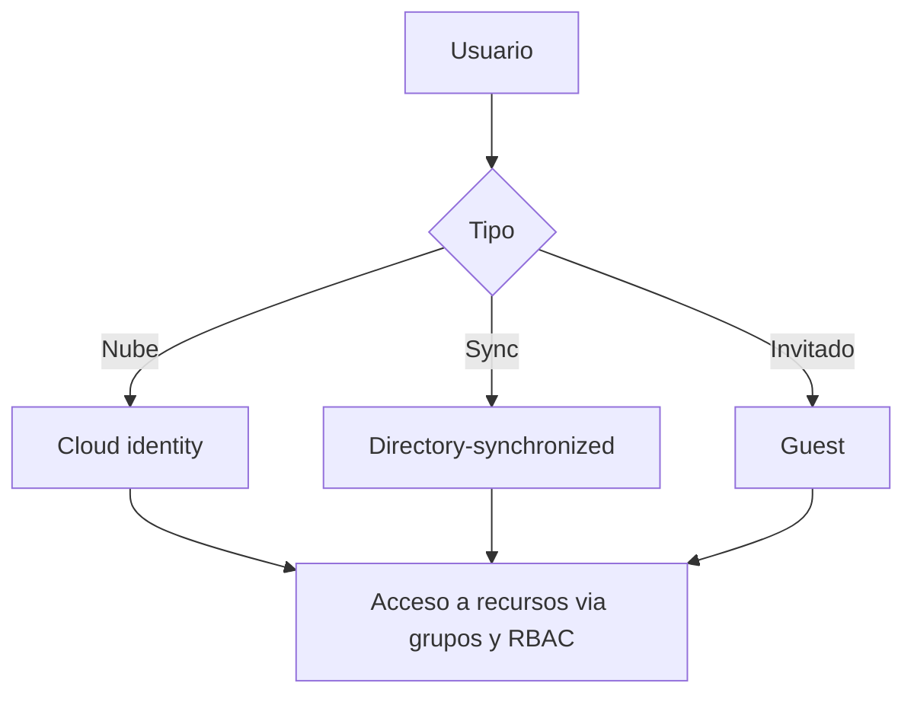

# Fase 4: Crear y administrar identidades

## Si solo recuerdas 3 cosas
- Hay **tres tipos de usuario**: **cloud identity** (solo en Entra ID), **directory-synchronized** (viene de AD on-premises) y **guest** (externo/invitado).
- Los grupos son **security** (acceso a recursos) o **Microsoft 365** (colaboración); la pertenencia puede ser **assigned**, **dynamic user** o **dynamic device** (dynamic requiere **P1**).
- El **licenciamiento basado en grupos** exige **Entra ID P1+** (o Office 365 E3+) y una licencia por **miembro único**.

## Objetivo de repaso
Recordar tipos de usuario/grupo, tipos de unión de dispositivo, licenciamiento por grupos y automatización (atributos, SCIM).

## Comparaciones clave

| Tipo de usuario | Origen | Nota |
|---|---|---|
| Cloud identity | Entra ID | Cuentas creadas y administradas en la nube |
| Directory-synchronized | Windows Server AD | Sincronizado (Cloud Sync recomendado; Connect Sync para escenarios complejos) |
| Guest | Usuario invitado | Externos (otros clouds, cuentas Microsoft); se elimina al terminar |

| Tipo de dispositivo | Definición | Público objetivo |
|---|---|---|
| Entra registered | Registrado sin cuenta organizacional para iniciar sesión | BYOD / móviles; propiedad del usuario u organización |
| Entra joined | Solo unido a Entra ID (requiere cuenta organizacional) | Cloud-only o híbrido; propiedad de la organización |
| Hybrid Entra joined | Unido a AD on-prem **y** registrado en Entra | Organizaciones híbridas con AD existente |

| Tipo de grupo | Uso |
|---|---|
| Security | Acceso a recursos compartidos (usuarios, dispositivos, service principals) |
| Microsoft 365 | Colaboración (buzón, calendario, archivos, sitio SharePoint); admite invitados |

## Diagrama

## Requisitos y restricciones
- La pertenencia **dynamic** (user/device) requiere licencia **Entra ID P1** (o Intune for Education para dispositivos).
- Los grupos **Microsoft 365** no admiten **dynamic device** (sí dynamic user).
- El licenciamiento basado en grupos requiere **Entra ID P1+** u **Office 365 E3+** y se administra desde el **centro de administración de Microsoft 365**.
- Debe haber licencias para **todos los miembros únicos** de los grupos con licencia.
- Define **usage location** en el perfil; sin ella se hereda la ubicación del directorio.
- Los **custom security attributes** no se admiten en Entra Domain Services ni en claims SAML/JWT.
- Tipos de atributo personalizado: Boolean, integer, string; uno o varios valores; libres o predefinidos.

## Requisito → Consecuencia
| Si… | Entonces… | Si no… |
|---|---|---|
| Necesitas grupos dinámicos | Requiere Entra ID P1 | Solo hay pertenencia asignada |
| Asignas licencias a un grupo | Los miembros reciben/quitan licencias automáticamente | Hay que asignarlas usuario por usuario |
| Un usuario no tiene usage location | Hereda la del directorio | Podría recibir servicios no permitidos en su ubicación |

## Casos de uso típicos
- Dar acceso a contratistas o vendedores con cuentas **guest** y revocarlo después.
- Agrupar usuarios por departamento con reglas **dynamic**.
- Registrar dispositivos BYOD (registered) u organizacionales (joined / hybrid).
- Asignar licencias por grupo y quitarlas al salir del grupo.
- Categorizar apps o usuarios con **custom security attributes** para auditoría.
- Automatizar altas/bajas con **SCIM** desde el sistema de RR. HH.

## Puntos críticos para el examen
- Tres tipos de usuario: **cloud**, **directory-synchronized**, **guest**.
- Dos tipos de grupo: **security** y **Microsoft 365**.
- Tres tipos de pertenencia: **assigned**, **dynamic user**, **dynamic device**; dynamic = P1.
- Dynamic device solo en **security groups**.
- Tres tipos de dispositivo: **registered**, **joined**, **hybrid joined**.
- Licenciamiento por grupos: **P1+** u **O365 E3+**; una licencia por miembro único; se gestiona en el **M365 admin center**.
- **SCIM 2.0** para aprovisionamiento automático; **API-driven inbound provisioning** cuando el origen no expone SCIM (Workday, SuccessFactors, HR propio).
- El device **writeback** ya no se admite; se sustituye por **Cloud Kerberos Trust**.

## Trampa típica del examen
- Confundir grupo **security** (recursos) con **Microsoft 365** (colaboración).
- Creer que dynamic funciona en cualquier plan (requiere P1).
- Creer que Microsoft 365 groups admiten dynamic device (no).
- Olvidar la **usage location** al asignar licencias.
- Confundir **Entra registered** (BYOD) con **Entra joined** (organizacional).
- Creer que device writeback sigue soportado (no).

## Mini-escenario resuelto
**Escenario:** Quieres que los empleados de Marketing reciban automáticamente sus licencias al cambiar de puesto.
**Respuesta:** Crear un grupo **security** con pertenencia **dynamic user** (regla por Department = Marketing) y asignarle la licencia (licenciamiento basado en grupos).
**Por qué:** La pertenencia dinámica (P1) ajusta los miembros automáticamente y el licenciamiento por grupo asigna o retira licencias con esos cambios.

## Productos relacionados
Productos nuevos → `docs/referencia/glosario-productos.md`: **Microsoft Entra ID P1/P2** (planes), **Microsoft Intune**, **Microsoft 365 groups**, **Microsoft Entra Cloud Sync / Connect Sync**.
Término nuevo → `docs/referencia/glosario.md`: **SCIM**. Sin grupo comparativo nuevo (la comparativa de dispositivos va dentro de esta fase).

## Errores comunes / troubleshooting
- Licencia no asignada → faltan licencias disponibles, falta usage location o hay servicios en conflicto.
- Grupo dinámico no se actualiza → falta licencia P1 o la regla no evalúa atributos.
- El atributo personalizado no aparece en el token → no se admite en claims SAML/JWT.

## Checklist de configuración
- [ ] Definir tipo de usuario (cloud / synchronized / guest).
- [ ] Elegir tipo de grupo (security / M365) y pertenencia (assigned / dynamic).
- [ ] Definir **usage location**.
- [ ] Asignar licencias por grupo (y sus servicios).
- [ ] Definir dispositivos como registered / joined / hybrid.
- [ ] (Opcional) Configurar SCIM o API-driven provisioning.
