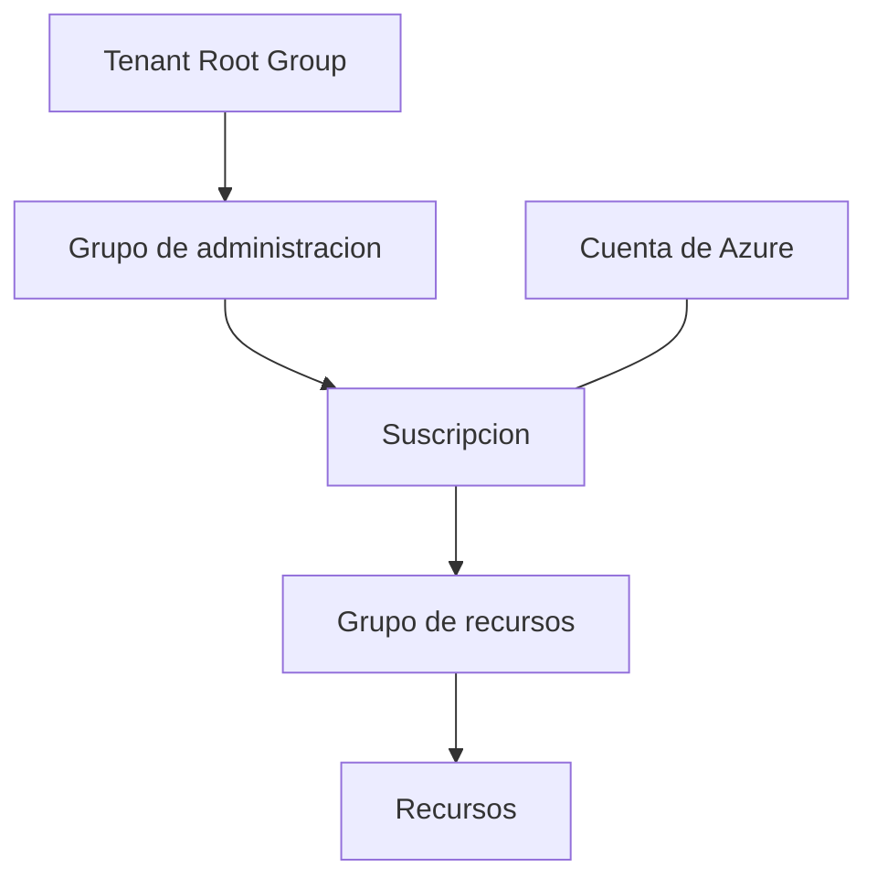

# Fase 5: Componentes arquitectónicos de Azure

## Si solo recuerdas 3 cosas
- Jerarquía de administración: **grupo de administración → suscripción → grupo de recursos → recurso**; los grupos de administración se anidan hasta **6 niveles** y admiten **10,000** por directorio.
- Infraestructura física: **regiones** (≥1 datacenter) y **zonas de disponibilidad** (datacenters separados; **mínimo 3** en regiones habilitadas); **pares de regiones** a ≥**300 millas** en la misma geografía.
- Una **suscripción** es la unidad de facturación y de control de acceso; una **cuenta** puede tener varias suscripciones.

## Objetivo de repaso
Recordar la jerarquía física y de administración de Azure, sus límites y cómo dan resiliencia y gobernanza.

## Comparaciones clave

| Elemento | Qué es | Detalle clave |
|---|---|---|
| Recurso | Unidad básica de Azure | Todo lo que se crea, aprovisiona o despliega |
| Grupo de recursos | Agrupación de recursos | Cada recurso en **un** grupo; no se anidan ni renombran |
| Suscripción | Unidad de administración, facturación y escala | Límites de facturación y de control de acceso |
| Grupo de administración | Contenedor sobre las suscripciones | Anidación hasta 6 niveles; herencia de políticas y RBAC |

| Servicio de zona | Cómo funciona | Ejemplo |
|---|---|---|
| Zonal | Fijas el recurso a una zona concreta | VMs, discos administrados, direcciones IP |
| Con redundancia de zona | La plataforma replica automáticamente entre zonas | Almacenamiento con redundancia de zona, SQL Database |
| No regional | Siempre disponible en la geografía | Resiliente a caídas de zona y de región |

## Diagrama

## Requisitos y restricciones
- Jerarquía: cuenta → suscripciones → grupos de recursos → recursos; los grupos de administración van por encima.
- Grupos de administración: hasta **10,000** por directorio; **6 niveles** de anidación (sin contar raíz ni suscripción); **un solo padre** por grupo/suscripción.
- Grupos de recursos: **no** se anidan ni se renombran; borrar el grupo borra todo su contenido; aplicar acciones al grupo afecta a todos sus recursos.
- Zonas de disponibilidad: **mínimo 3** en regiones habilitadas; **no todas** las regiones las soportan.
- Pares de regiones: ≥**300 millas**, misma geografía; **no** todas replican automáticamente.
- Servicios **globales** que no requieren elegir región: Entra ID, Traffic Manager, Azure DNS.

## Requisito → Consecuencia
| Si… | Entonces… | Si no… |
|---|---|---|
| Aplicas una política a un grupo de administración | Se hereda a suscripciones y recursos bajo él | Hay que aplicarla suscripción por suscripción |
| Necesitas residencia de datos por cumplimiento | Usa pares de regiones de la misma geografía | La replicación puede salir de la geografía |
| Necesitas resistir la caída de una zona | Distribuye recursos entre zonas (≥3) | Una sola zona es un punto único de fallo |

## Casos de uso típicos
- Separar entornos (dev/test/prod) por suscripción.
- Aplicar gobernanza global desde grupos de administración.
- Diseñar alta disponibilidad con zonas de disponibilidad y pares de región.
- Facturar por equipo o proyecto con suscripciones separadas.

## Puntos críticos para el examen
- Jerarquía: **grupo de administración → suscripción → grupo de recursos → recurso**.
- Grupos de administración: **10,000** por directorio, **6** niveles de anidación, **un** padre.
- Un recurso pertenece a **exactamente un** grupo de recursos; los grupos no se anidan ni renombran.
- Región = ≥1 datacenter; **mínimo 3** zonas de disponibilidad en regiones habilitadas (no todas las soportan).
- Pares de regiones ≥300 millas, misma geografía; **no** todas replican automáticamente.
- Servicios globales: Entra ID, Traffic Manager, Azure DNS.
- Cuenta ↔ suscripciones (una a muchas); suscripción = facturación + control de acceso.
- Regiones soberanas: US Gov (p. ej. DoD Central, Gov Virginia, Gov Arizona) y China (21Vianet).

## Trampa típica del examen
- Creer que los grupos de recursos se pueden anidar (no).
- Creer que todas las regiones tienen zonas de disponibilidad (no).
- Creer que todos los pares de regiones replican automáticamente (no).
- Confundir **grupo de administración** (sobre suscripciones) con **grupo de recursos**.
- Creer que un recurso puede estar en varios grupos de recursos (no).

## Mini-escenario resuelto
**Escenario:** Una empresa quiere aplicar una política de ubicación de VM a todas sus suscripciones de producción de una sola vez.
**Respuesta:** Colocar esas suscripciones en un grupo de administración y aplicar la política allí.
**Por qué:** Las políticas se heredan del grupo de administración hacia todas las suscripciones y recursos que contiene.

## Productos relacionados
Conceptos/entidades nuevas → `docs/referencia/glosario-productos.md`: **Regiones de Azure**, **Zonas de disponibilidad**, **Pares de región**, **Grupos de administración**.
Sin grupo comparativo nuevo.

## Errores comunes / troubleshooting
- No puedes mover un recurso a otro grupo si el tipo no lo permite (algunos no son movibles).
- Esperas replicación automática entre regiones y no ocurre → hay que configurarla.
- No puedes renombrar un grupo de recursos → hay que recrearlo.
