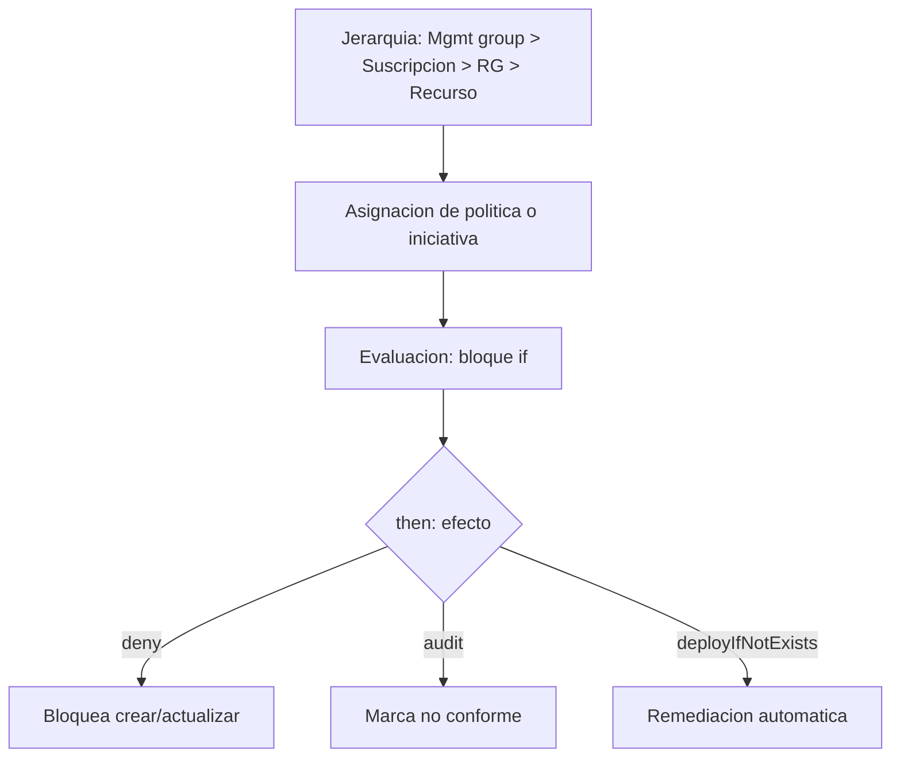

# Fase 6: Azure Policy y gobernanza en la nube

## Si solo recuerdas 3 cosas
- **Azure Policy** es la herramienta principal de gobernanza: compara los recursos con reglas (**definiciones**) y aplica un **efecto**. Una definición es `if` (condición) + `then` (efecto).
- Una **iniciativa** (policy set) agrupa definiciones para asignarlas como una sola; una **asignación** define qué se evalúa y con qué `enforcementMode` (Enabled / Disabled).
- Las reglas se **heredan** por la jerarquía (**grupo de administración → suscripción → grupo de recursos**) y el escaneo automático de cumplimiento ocurre cada **24 horas**.

## Objetivo de repaso
Recordar el modelo de Azure Policy (definición, iniciativa, asignación, exención, atestación, remediación), los efectos y la evaluación.

## Comparaciones clave

| Recurso de Azure Policy | Qué es |
|---|---|
| Definición | Condición de cumplimiento + efecto (`if`/`then`) |
| Iniciativa (policy set) | Grupo de definiciones que se asigna como una unidad |
| Asignación | Aplica una definición/iniciativa a un ámbito |
| Exención (exemption) | Exceptúa recursos (categorías **Mitigated** o **Waiver**) |
| Atestación (attestation) | Fija el estado de cumplimiento de políticas **manual** |
| Remediación | Tarea que pone recursos no conformes en conformidad |

| Efecto | Qué hace | Evaluación |
|---|---|---|
| Deny | Bloquea la solicitud no conforme | Sincrónica |
| Audit | Registra advertencia, no bloquea | Asincrónica |
| Append | Agrega campos a la solicitud | Sincrónica |
| Modify | Agrega/actualiza/elimina propiedades o etiquetas | Sincrónica |
| DenyAction | Bloquea acciones (solo DELETE) | Sincrónica |
| AuditIfNotExists | Audita recursos relacionados | Asincrónica |
| DeployIfNotExists | Despliega una plantilla si el recurso no existe | Asincrónica |
| Disabled | Desactiva la política | — |
| Manual | Autoevaluación por atestación | Manual |

## Diagrama

## Requisitos y restricciones
- Ámbitos: grupo de administración, suscripción, grupo de recursos (y recursos); la definición se guarda en un grupo de administración o una suscripción.
- La jerarquía soporta hasta **6 niveles** bajo el tenant root; los niveles inferiores heredan.
- Escaneo automático de cumplimiento **cada 24 horas**; también manual (`az policy state trigger-scan`).
- Una asignación nueva puede tardar hasta **30 minutos** (caché de Azure Resource Manager); cerrar/abrir sesión refresca la caché.
- `enforcementMode`: **Default** (aplica) o **DoNotEnforce** (what-if: evalúa sin aplicar ni registrar en el activity log).
- Ante varias políticas, el resultado es **el más restrictivo**.
- Azure Policy opera en el **plano de control** (vía ARM); el plano de datos se cubre con modos específicos (Kubernetes, Key Vault, Network, ManagedHSM, DataFactory, MachineLearning).
- Usa definiciones **personalizadas** solo cuando ninguna **integrada** (Built in) sirva.

## Requisito → Consecuencia
| Si… | Entonces… | Si no… |
|---|---|---|
| Asignas una política a un grupo de administración | Todas las suscripciones y recursos heredan | Hay que asignarla en cada ámbito |
| Defines `enforcementMode = DoNotEnforce` | Evalúa sin aplicar el efecto (what-if) | El efecto (deny/modify) se aplica |
| Necesitas ver cumplimiento en recursos existentes | Escaneo automático (24 h) o manual | Solo se evalúa al crear/actualizar |

## Casos de uso típicos
- Restringir las regiones donde se pueden desplegar recursos.
- Imponer etiquetas (tags) y su taxonomía.
- Permitir solo ciertos tamaños de VM.
- Requerir logs de diagnóstico hacia un workspace de Azure Monitor.
- Auditar o remediar configuraciones existentes.

## Puntos críticos para el examen
- Definición = **JSON** con `if` (condición) y `then` (efecto); usa **alias** para acceder a propiedades.
- Operadores lógicos: `not`, `allOf` (AND), `anyOf` (OR); se pueden anidar.
- Condiciones por **field**, **value** o **count** (con `current()`).
- `policyType`: **Built in**, **Custom**, **Static**.
- Iniciativa = **policy set**.
- Exenciones: **Mitigated** y **Waiver**.
- Escaneo automático **cada 24 h**; asignación puede tardar hasta **30 min**.
- Estados: Non-compliant, Compliant, Error, Conflicting, Protected, Exempted/Unknown.
- `Deny` bloquea; `Audit` solo advierte; `Modify`/`Append` cambian; `DeployIfNotExists` despliega.

## Trampa típica del examen
- Confundir **enforcementMode Disabled** con el efecto **Disabled**: el primero evalúa sin aplicar; el segundo evita la evaluación por completo.
- Creer que una política nueva borra recursos no conformes existentes (no; los marca).
- Confundir **definición** (qué regla) con **asignación** (dónde y con qué opciones).
- Creer que `Audit` bloquea (no).
- Confundir **exención** (se crea después de la asignación) con un **scope excluido**.

## Mini-escenario resuelto
**Escenario:** Quieres medir el impacto de una política `deny` en producción sin bloquear despliegues todavía.
**Respuesta:** Asignarla con `enforcementMode = DoNotEnforce` (escenario "what-if").
**Por qué:** DoNotEnforce evalúa y muestra el cumplimiento sin aplicar el efecto ni bloquear.

## Productos relacionados
Productos nuevos → `docs/referencia/glosario-productos.md`: **Azure Policy**, **Microsoft Cloud Adoption Framework (CAF)**.
Sin grupo comparativo nuevo (la comparativa de efectos va dentro de esta fase).

## Errores comunes / troubleshooting
- La política no surte efecto de inmediato → caché de ARM (hasta 30 min) o hay que reiniciar sesión.
- Recursos no conformes que siguen existiendo → hay que remediar o excluir.
