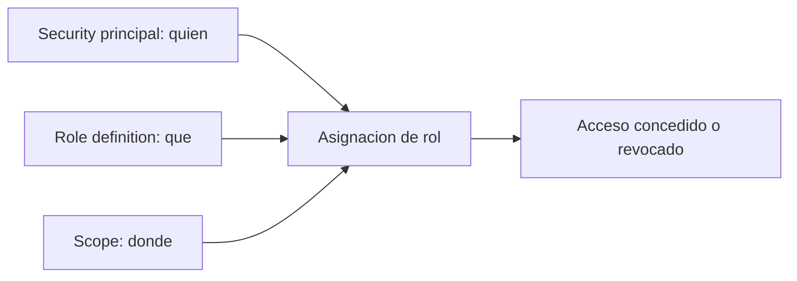

# Fase 7: Azure RBAC (control de acceso por roles)

## Si solo recuerdas 3 cosas
- Una **asignación de rol** combina **security principal (quién) + role definition (qué) + scope (dónde)**.
- Azure RBAC es un **modelo de permitir (allow)**; los **NotActions** se restan de las Actions para calcular los permisos efectivos.
- El **scope** es jerárquico (grupo de administración → suscripción → grupo de recursos → recurso) y los hijos **heredan** del padre.

## Objetivo de repaso
Recordar cómo funciona RBAC, sus roles integrados, el modelo allow y la herencia de scopes.

## Comparaciones clave

| Rol integrado fundamental | Puede |
|---|---|
| Owner | Acceso total, incluido delegar acceso a otros |
| Contributor | Crear y administrar todo tipo de recurso, pero **no** conceder acceso |
| Reader | Ver recursos existentes |
| User Access Administrator | Administrar el acceso de usuarios a los recursos |

| Elemento | Pregunta |
|---|---|
| Security principal | ¿Quién? (usuario, grupo, aplicación) |
| Role definition | ¿Qué? (colección de permisos) |
| Scope | ¿Dónde? (grupo de administración / suscripción / grupo de recursos / recurso) |

## Diagrama

## Requisitos y restricciones
- Cada suscripción se asocia a **un** directorio de Entra.
- Scope: grupo de administración, suscripción, grupo de recursos o recurso.
- Más de **70 roles integrados**; puedes crear **roles personalizados**.
- RBAC se basa en Azure Resource Manager (autorización); es distinto de los **roles de Microsoft Entra** (identidad).
- Para asignar roles necesitas permisos (Owner o User Access Administrator).
- Un recurso pertenece a un solo grupo de recursos; un grupo a una sola suscripción.

## Requisito → Consecuencia
| Si… | Entonces… | Si no… |
|---|---|---|
| Asignas un rol en un scope padre | Los scopes hijos lo heredan | Hay que asignarlo en cada scope |
| El rol define `NotActions` | Permisos efectivos = Actions − NotActions | Se aplican todas las Actions |
| Combinas varias asignaciones | Los permisos se **suman** (allow) | No existe una denegación explícita |

## Casos de uso típicos
- Dar permiso para administrar VMs dentro de un grupo de recursos (Virtual Machine Contributor).
- Separar quién administra VMs y quién administra VNets.
- Permitir a un grupo de administradores de bases de datos administrar SQL de una suscripción.
- Permitir a una aplicación acceder a todos los recursos de un grupo de recursos.
- Auditar cambios de roles en el **activity log**.

## Puntos críticos para el examen
- Role assignment = **principal + role + scope**.
- Cuatro roles fundamentales: **Owner, Contributor, Reader, User Access Administrator**.
- Modelo **allow** (los permisos se suman); **NotActions** se restan.
- Herencia: se asigna en un scope padre y se hereda hacia los hijos.
- **Access control (IAM)** en el portal permite ver, conceder y quitar acceso.
- Los cambios de RBAC quedan en el **activity log** (`roleAssignments`, `roleDefinitions`).
- No confundir **roles de Azure** (recursos) con **roles de Microsoft Entra** (identidad).

## Trampa típica del examen
- Creer que RBAC puede **denegar** explícitamente (el modelo es allow; NotActions solo resta dentro de un rol).
- Confundir **Contributor** (no concede acceso) con **Owner** (sí delega).
- Creer que los roles se heredan "hacia arriba" (es hacia abajo).
- Confundir roles de Azure con roles de Entra.

## Mini-escenario resuelto
**Escenario:** Alain necesita crear y administrar VMs solo en un grupo de recursos, con el mínimo privilegio.
**Respuesta:** Asignarle **Virtual Machine Contributor** en el scope de ese grupo de recursos.
**Por qué:** El rol permite administrar VMs y el scope limita el permiso al grupo de recursos indicado (mínimo privilegio).

## Productos relacionados
Producto nuevo → `docs/referencia/glosario-productos.md`: **Azure RBAC**.
Términos nuevos → `docs/referencia/glosario.md`: **asignación de rol**, **scope**, **NotActions**.
Sin grupo comparativo nuevo.

## Errores comunes / troubleshooting
- «No puedo asignar roles» → falta Owner o User Access Administrator.
- «El usuario tiene acceso de más» → rol asignado en un scope demasiado amplio.

## Checklist de configuración
- [ ] Definir el security principal.
- [ ] Elegir el rol (integrado o personalizado).
- [ ] Definir el scope (grupo de administración / suscripción / RG / recurso).
- [ ] Asignar en Access control (IAM).
- [ ] Revisar los cambios en el activity log.
