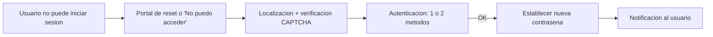

# Fase 8: Autoservicio de restablecimiento de contraseña (SSPR)

## Si solo recuerdas 3 cosas
- **SSPR** permite a los usuarios restablecer su contraseña sin ayuda del soporte técnico cuando no pueden iniciar sesión.
- Hay **6 métodos de autenticación** (app: notificación/código, email, teléfono móvil, teléfono de oficina, preguntas de seguridad); se recomienda habilitar **2 o más**.
- Las cuentas con **rol de administrador** siempre usan **2 métodos** y **no** pueden usar preguntas de seguridad; SSPR requiere licencia **P1/P2** (o Microsoft 365).

## Objetivo de repaso
Recordar cómo funciona SSPR, sus métodos, requisitos, alcance y despliegue.

## Comparaciones clave

| Método de autenticación | Cómo se registra | Cómo se autentica |
|---|---|---|
| Notificación de app móvil | Microsoft Authenticator | Se verifica o deniega en la app |
| Código de app móvil | Microsoft Authenticator | Se introduce el código |
| Email | Dirección externa a Azure/M365 | Código enviado por email |
| Teléfono móvil | Número de móvil | Código SMS o llamada |
| Teléfono de oficina | Número fijo | Llamada automática, pulsar `#` |
| Preguntas de seguridad | Elegir preguntas y respuestas | Responder las preguntas |

| Setting «SSPR enabled» | Alcance |
|---|---|
| None | Nadie (valor predeterminado) |
| Selected | Solo los miembros de un grupo de seguridad |
| All | Todos los usuarios de la organización |

## Diagrama

## Requisitos y restricciones
- Requiere **Entra ID P1 o P2** (o Microsoft 365 Apps for business / Microsoft 365). Un usuario con sesión iniciada puede cambiar su contraseña en cualquier edición.
- **Writeback** de contraseñas (para AD on-premises) disponible en **P1/P2** (o M365 Apps for business).
- Mínimo de métodos: **uno o dos** (recomendado 2+).
- Las cuentas **administradoras** siempre requieren **dos** métodos y **no** pueden usar preguntas de seguridad.
- En organizaciones de prueba **no** hay opciones de llamada telefónica.
- Para configurar SSPR se requiere el rol **Authentication Policy Administrator**.
- Recomendados: app móvil (primario) + email o teléfono de oficina. **SMS** y **preguntas de seguridad** son los menos recomendados.

## Requisito → Consecuencia
| Si… | Entonces… | Si no… |
|---|---|---|
| Habilitas SSPR = Selected | Solo el grupo de seguridad puede usarlo | None = nadie; All = todos |
| Hay AD on-prem y quieres SSPR en la nube | Necesitas writeback (P1/P2) | La contraseña no se sincroniza con AD on-prem |
| La cuenta tiene rol de administrador | Exige 2 métodos y sin preguntas de seguridad | Los usuarios normales pueden configurarse con menos |

## Casos de uso típicos
- Reducir llamadas al help desk por contraseñas olvidadas.
- Permitir restablecer desde el navegador o la pantalla de inicio de Windows.
- Desplegar por fases a un grupo piloto antes de habilitarlo para todos.
- Personalizar la página de inicio con la marca de la organización.

## Puntos críticos para el examen
- 6 métodos; habilita **2 o más**.
- El método menos recomendado son las **preguntas de seguridad**; el **SMS** tampoco es recomendado.
- Admins: **siempre 2 métodos**, sin preguntas de seguridad.
- Requiere **P1/P2**; writeback también en **P1/P2**.
- Alcance: **None / Selected / All**.
- Notificaciones: al usuario que resetea y a los admins cuando otro admin resetea.
- Despliegue con **Entra Connect** o **cloud sync** (pueden coexistir por dominios).
- Branding: fondo 1920x1080 (<300 KB) y logo 32x32 (<5 KB), PNG/JPG.

## Trampa típica del examen
- Creer que SSPR no requiere licencia (requiere P1/P2 o M365).
- Creer que los admins pueden usar preguntas de seguridad (no).
- Creer que SSPR funciona sin writeback cuando hay AD on-prem (no).
- Confundir «usuario registrado para SSPR» con haber completado todos los métodos (basta el mínimo exigido).

## Mini-escenario resuelto
**Escenario:** Quieres probar SSPR con 20 usuarios de marketing antes de habilitarlo para toda la organización.
**Respuesta:** Configurar «SSPR enabled» = **Selected** con un grupo de seguridad que contenga a esos 20 usuarios.
**Por qué:** Selected limita SSPR al grupo de seguridad, ideal para un despliegue piloto.

## Productos relacionados
Producto nuevo → `docs/referencia/glosario-productos.md`: **Microsoft Entra SSPR**.
Términos nuevos → `docs/referencia/glosario.md`: **writeback**, **método de autenticación**.
Sin grupo comparativo nuevo.

## Errores comunes / troubleshooting
- El usuario no puede registrarse → faltan métodos mínimos o no tiene licencia.
- No hay writeback → revisar Entra Connect o cloud sync.
