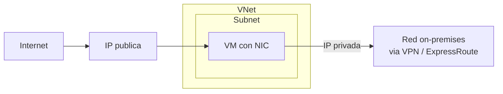

# Fase 9: Redes virtuales y direccionamiento IP

## Si solo recuerdas 3 cosas
- Una VNet es un **aislamiento lógico** con su propio bloque **CIDR**; las subredes deben ser rangos únicos y **no solaparse** dentro de la VNet.
- Cada subred **reserva 5 direcciones**: la primera (red), la 2.ª (gateway), la 3.ª y 4.ª (DNS) y la **última** (broadcast).
- Los **IP privados** comunican dentro de Azure y con on-premises; los **IP públicos** permiten comunicación con internet. La asignación puede ser **dinámica** (predeterminada) o **estática**.

## Objetivo de repaso
Recordar la planificación de VNets y subredes, las direcciones reservadas y la asignación de IP públicas y privadas.

## Comparaciones clave

| IP privada | IP pública |
|---|---|
| Comunicación dentro de la VNet y con on-premises (VPN/ExpressRoute) | Comunicación con internet |
| Se asigna desde el rango de la subred | Es un recurso, asociable a NIC/LB/Bastion/etc. |
| Dinámica (predeterminada) o estática | SKU Standard: **estática** |

| Recurso | Configuración de IP pública |
|---|---|
| Máquina virtual | Configuración de la interfaz de red (NIC) |
| VPN/ER Gateway, NAT Gateway | Configuración de IP del gateway |
| Load Balancer público, Application Gateway, Azure Firewall, Route Server, API Management | Configuración de front-end |
| Bastion host | Configuración de IP pública |

## Diagrama

## Requisitos y restricciones
- Cada VNet tiene su propio bloque **CIDR**; puede enlazarse a otras VNets y a on-prem **si los CIDR no se solapan**.
- Subredes: rango **único** dentro de la VNet, sin solape, en notación **CIDR**.
- Cada subred **reserva 5 IP**: primera (red), 2.ª (gateway), 3.ª y 4.ª (DNS) y última (broadcast).
- Se puede asociar **0 o 1 NSG** por subred (y 0 o 1 por NIC).
- Algunos servicios requieren su **propia subred** (ej. VPN Gateway).
- El **SKU** de la IP pública debe coincidir con el del Load Balancer, y el **tier** también.
- La IP pública de SKU **Standard** es **estática**, **segura por defecto** y admite zonas (no zonal, zonal o con redundancia de zona).

## Requisito → Consecuencia
| Si… | Entonces… | Si no… |
|---|---|---|
| Conectas la VNet con on-premises | Los CIDR no deben solaparse | El enlace no funcionará |
| Necesitas IP fija (DNS, certificado, firewall) | Usa IP **estática** | La IP podría cambiar |
| El Load Balancer es Standard | La IP pública debe ser Standard | No se pueden asociar |

## Casos de uso típicos
- Nube privada aislada (solo VNet, sin cross-premises).
- Extender el datacenter con VPN site-to-site (IPsec).
- Escenarios híbridos (conectar apps en la nube con sistemas on-premises).
- Segmentar la red en subredes por seguridad y rendimiento.
- Reservar subredes para servicios (gateway, appliances, Private Link).

## Puntos críticos para el examen
- VNet = aislamiento lógico con **CIDR propio**.
- Subredes: únicas, **sin solape**, en CIDR.
- **5 IP reservadas** por subred.
- IP privada: dinámica (predeterminada) o estática; IP pública Standard: **estática**.
- Asociación de IP pública: NIC (VM), front-end (LB/AppGW/Firewall), gateway (VPN/ER/NAT), Bastion (IP pública).
- El SKU y el tier de la IP pública deben **coincidir** con el Load Balancer.
- Máximo **1 NSG** por subred.

## Trampa típica del examen
- Olvidar las **5 direcciones reservadas** al calcular el rango de una subred.
- Creer que la IP pública puede ser dinámica en SKU Standard (es estática).
- Solapar CIDR entre VNet y on-premises (impide el enlace).
- Olvidar la subred dedicada del VPN Gateway.
- Creer que se pueden asociar varios NSG a una subred (máximo 1).

## Mini-escenario resuelto
**Escenario:** Necesitas una subred en 10.0.0.0/24 para VMs. ¿Cuántas IP usables hay?
**Respuesta:** 251 (256 − 5 reservadas).
**Por qué:** Azure reserva 5 direcciones en cada subred.

## Productos relacionados
Productos nuevos → `docs/referencia/glosario-productos.md`: **Azure Virtual Network**, **Azure NAT Gateway**. (Load Balancer, Bastion y Azure Firewall se mencionan; se registrarán en sus fases.)
Términos nuevos → `docs/referencia/glosario.md`: **CIDR**, **subred**, **IP reservada**.

## Errores comunes / troubleshooting
- No se puede enlazar VNet/on-prem → CIDR solapado.
- Servicio no se despliega en la subred → falta espacio o falta la subred dedicada.
