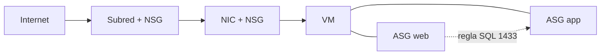

# Fase 10: Grupos de seguridad de red (NSG) y ASG

## Si solo recuerdas 3 cosas
- Un **NSG** filtra tráfico con reglas **allow/deny** por **prioridad** (100–4096; menor número = mayor prioridad); se asocia a **subred** o a **NIC** (máximo uno por cada).
- Hay **reglas predeterminadas** (3 de entrada y 3 de salida) que **no se pueden eliminar**, solo anular con una regla de mayor prioridad.
- Un **ASG** agrupa VMs por carga de trabajo para usarlas como origen/destino en reglas NSG, sin depender de IPs ni de subredes.

## Objetivo de repaso
Recordar las reglas de NSG, la evaluación efectiva y el uso de ASG.

## Comparaciones clave

| NSG asociado a… | Alcance | Máximo por objeto |
|---|---|---|
| Subred | Tráfico de todas las máquinas de la subred | 1 NSG por subred |
| NIC | Tráfico de esa interfaz de red | 1 NSG por NIC |

| Dirección | Orden de evaluación |
|---|---|
| Entrada (inbound) | Primero **subred**, luego **NIC** |
| Salida (outbound) | Primero **NIC**, luego **subred** |

| Campo de regla | Valores |
|---|---|
| Origen / Destino | Any, IP, My IP, Service Tag o ASG |
| Protocolo | TCP, UDP, ICMP, ESP, AH (o Any) |
| Acción | Allow / Deny |
| Prioridad | 100–4096 (única dentro del NSG) |

## Diagrama

## Requisitos y restricciones
- Los NSG de **subred** y de **NIC** se evalúan **independientemente** (ambos aplican).
- Prioridad: **100 a 4096**, única; menor número = mayor precedencia.
- Las **reglas predeterminadas** no se pueden eliminar; se anulan con una regla de mayor prioridad.
- Si asocias un NSG a un nivel, debes definir una regla **allow** en ese nivel, o el tráfico se **deniega**.
- Intra-subred: un NSG en la subred afecta el tráfico **entre VMs** de la misma subred (se puede denegar).
- Los **ASG** permiten reglas por carga de trabajo, sin gestionar IPs ni exigir subredes separadas.
- Las **service tags** representan grupos de IP de servicios de Azure; **no** confundir con ASG.

## Requisito → Consecuencia
| Si… | Entonces… | Si no… |
|---|---|---|
| Asocias un NSG a una subred | Se filtra el tráfico de todas las VMs de la subred | Solo aplican las reglas predeterminadas |
| Permites en subred pero no en NIC | El tráfico puede denegarse en el nivel NIC | Debes permitir en cada nivel con NSG |
| Usas ASG en reglas | No necesitas gestionar direcciones IP | Debes especificar IPs manualmente |

## Casos de uso típicos
- Crear una **DMZ / subred protegida** con NSG.
- Permitir HTTP/HTTPS a servidores web y SQL 1433 solo de web a app (con ASG).
- Denegar el acceso desde internet a los servidores de aplicación.
- Controlar el tráfico de una NIC concreta.

## Puntos críticos para el examen
- Reglas procesadas por **prioridad** (100–4096; menor = antes).
- **3 reglas de entrada + 3 de salida predeterminadas** (no eliminables); ej. `DenyAllInbound`, `AllowInternetOutbound`.
- Evaluación: **entrada** subred→NIC; **salida** NIC→subred.
- NSG de subred y de NIC se evalúan **independientemente**.
- Se puede denegar el tráfico **intra-subred**.
- ASG = agrupar VMs por carga de trabajo; se usa como origen/destino.
- Las **effective security rules** (y Network Watcher) muestran las reglas aplicadas; Network Watcher consolida NSG + security admin rules.
- Deja **huecos** en la numeración de prioridades (100, 200, 300…).

## Trampa típica del examen
- Confundir **NSG** (reglas de tráfico) con **ASG** (agrupación de VMs).
- Creer que se pueden eliminar las reglas predeterminadas (no; se anulan con prioridad).
- Invertir el orden de evaluación (entrada subred→NIC; salida NIC→subred).
- Creer que ASG y **service tag** son lo mismo.
- Creer que una subred puede tener varios NSG (máximo uno).

## Mini-escenario resuelto
**Escenario:** Quieres permitir que solo los servidores web accedan a los de aplicación por SQL 1433, agrupando las VMs por rol.
**Respuesta:** Crear un **ASG** por tier (web y app), asignar la NIC de cada VM a su ASG y crear una regla NSG que permita SQL 1433 desde el ASG web al ASG app.
**Por qué:** Las ASG permiten reglas por carga de trabajo sin gestionar direcciones IP.

## Productos relacionados
Productos nuevos → `docs/referencia/glosario-productos.md`: **Network Security Group (NSG)**, **Application Security Group (ASG)**.
Nuevo grupo comparativo → `docs/referencia/comparativa-productos.md`: *Seguridad de red (NSG vs ASG vs Azure Firewall vs Bastion)*.
Término nuevo → `docs/referencia/glosario.md`: **service tag**.

## Errores comunes / troubleshooting
- Tráfico bloqueado pese a una regla allow → falta la regla allow en el otro nivel o la prioridad es mayor.
- Revisar con **effective security rules** o Network Watcher.
