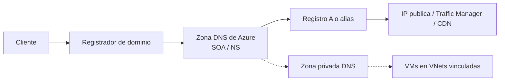

# Fase 11: Azure DNS

## Si solo recuerdas 3 cosas
- **Azure DNS** es un servicio de **hospedaje** de zonas DNS (no registra dominios); actúa como **SOA** del dominio y usa la infraestructura global de Microsoft.
- Registros comunes: **A** (nombre→IPv4), **AAAA** (IPv6), **CNAME** (alias), **MX** (correo), **TXT** (verificación), **NS** y **SOA** (creados automáticamente con la zona).
- Los **alias records** (A, AAAA, CNAME) apuntan a recursos de Azure (IP pública, Traffic Manager, CDN, Front Door) y **actualizan el registro automáticamente** cuando cambia la IP.

## Objetivo de repaso
Recordar los tipos de registro DNS, las zonas públicas y privadas y los alias records.

## Comparaciones clave

| Registro | Uso |
|---|---|
| A | Nombre → dirección IPv4 |
| AAAA | Nombre → dirección IPv6 |
| CNAME | Alias de un nombre a otro |
| MX | Enrutar el correo al servidor de correo |
| TXT | Asociar texto (verificación de dominio) |
| NS / SOA | Name servers / inicio de autoridad (auto-creados en la zona) |

| Zona | Característica |
|---|---|
| Pública | Visible en internet; requiere poseer/registrar el dominio |
| Privada | No visible en internet; resuelve nombres de VMs dentro de VNets vinculadas; admite split-horizon |

## Diagrama

## Requisitos y restricciones
- No puedes **registrar** dominios con Azure DNS; se registran en un registrador externo.
- Al delegar el dominio, usa **las 4** direcciones de name servers de Azure DNS.
- La verificación de la delegación (registro SOA) puede tardar desde **10 minutos** o más.
- **SOA y CNAME** no admiten **record sets**.
- Al crear la zona, **SOA y NS** se crean automáticamente.
- La zona privada requiere un **virtual network link** por cada VNet que deba resolverla.
- Azure DNS **no** admite DNSSEC.

## Requisito → Consecuencia
| Si… | Entonces… | Si no… |
|---|---|---|
| Quieres que internet resuelva tu dominio | Delega el dominio en el registrador con los NS de Azure | El dominio no apuntará a la zona |
| Necesitas resolver nombres de VMs solo dentro de VNets | Usa una **zona privada** y vincula la VNet | La resolución privada no funcionará |
| La IP del recurso puede cambiar | Usa un **alias record** | El registro puede quedar «colgado» (dangling) |

## Casos de uso típicos
- Hospedar el dominio público de una organización y sus registros.
- Verificar la propiedad de un dominio con registros TXT.
- Resolver nombres de VMs dentro de una VNet con zona privada.
- Enlazar el apex domain a un Load Balancer o IP pública con alias.
- Enrutar correo con registros MX.

## Puntos críticos para el examen
- Azure DNS = **hospedaje**, no registro de dominios.
- Registros: A, AAAA, CNAME, MX, TXT, NS, SOA, CAA, SPF, SRV y wildcards.
- **SOA y CNAME** no admiten record sets.
- Alias records soportan **A, AAAA, CNAME** y apuntan a **Traffic Manager, CDN, IP pública y Front Door**.
- La zona privada usa VNet links y admite split-horizon.
- Seguridad: **RBAC, activity logs y resource locking**.
- Sin soporte de **DNSSEC**.

## Trampa típica del examen
- Creer que Azure DNS registra dominios (no; solo hospeda).
- Usar CNAME en el **apex** (no permitido; usar **alias records**).
- Creer que se admite DNSSEC (no).
- Confundir zona pública con privada.
- Olvidar las 4 NS al delegar.

## Mini-escenario resuelto
**Escenario:** Quieres que wideworldimports.com (apex) apunte a tu Load Balancer sin romperse cuando cambie su IP.
**Respuesta:** Crear un **alias record** (A) en el apex que apunte al recurso (IP pública del LB).
**Por qué:** Los alias siguen el ciclo de vida del recurso y actualizan el registro cuando cambia la IP; el CNAME no se admite en el apex.

## Productos relacionados
Productos nuevos → `docs/referencia/glosario-productos.md`: **Azure DNS**, **Azure Private DNS zones**, **Azure Traffic Manager**, **Azure Front Door**, **Azure CDN**.
Nuevo grupo comparativo → `docs/referencia/comparativa-productos.md`: *DNS (zona pública vs zona privada)*.
Término nuevo → `docs/referencia/glosario.md`: **alias record**.

## Errores comunes / troubleshooting
- La delegación no surte efecto → esperar y verificar el SOA con `nslookup`.
- La resolución privada no funciona → falta el VNet link.
