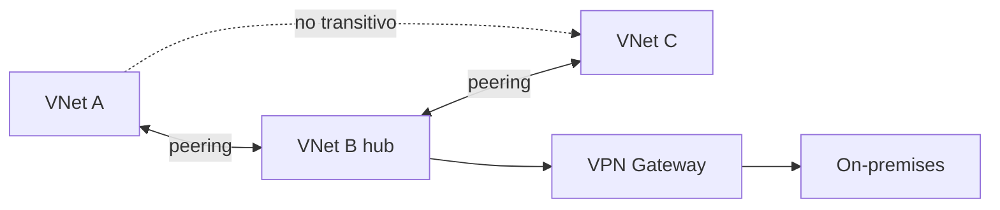

# Fase 12: Emparejamiento de redes virtuales (VNet peering)

## Si solo recuerdas 3 cosas
- El peering conecta dos VNets para que operen como **una sola red**, con tráfico **privado** sobre el backbone de Azure (sin internet, gateway ni cifrado).
- Puede ser **regional** (misma región) o **global** (distintas regiones); los **espacios de direcciones no deben solaparse**.
- El peering es **no transitivo**: si A↔B y B↔C, A **no** llega a C automáticamente.

## Objetivo de repaso
Recordar tipos de peering, requisitos, gateway transit y cómo extenderlo (hub-and-spoke, UDR, service chaining).

## Comparaciones clave

| Tipo de peering | Alcance |
|---|---|
| Regional | VNets en la **misma** región |
| Global | VNets en **distintas** regiones |

| Mecanismo de extensión | Qué hace |
|---|---|
| Hub-and-spoke | Los spokes se peeran al hub (con NVA o VPN gateway) |
| UDR (ruta definida por el usuario) | Cambia el next hop (VM peered o VPN gateway) |
| Service chaining | UDR que dirige tráfico a un appliance o gateway en otra VNet |
| Azure Virtual Network Manager | Gestión central de topologías hub-and-spoke o mesh a escala |

## Diagrama

## Requisitos y restricciones
- Espacios de direcciones **no solapados**; el peering **falla** si se solapan.
- Para cambiar el rango de direcciones de una VNet: **eliminar el peering**, cambiar el rango y volver a crearlo.
- **Basic Load Balancer**: las VNets peered **entre regiones** no pueden usar IP de Basic Internal LB → usar **Standard LB**.
- La **resolución de nombres** integrada de Azure **no** cruza VNets peered → usar **Private DNS zones** o DNS personalizado.
- Una VNet puede tener **un solo VPN gateway**; gateway transit se soporta en regional y global.
- Las VNets pueden estar en **distintas suscripciones y tenants**.
- El peering global **no** se permite entre regiones de Azure Government.

## Requisito → Consecuencia
| Si… | Entonces… | Si no… |
|---|---|---|
| Quieres cambiar el rango de direcciones de una VNet peered | Elimina el peering primero | No podrás cambiar el rango |
| Necesitas resolver nombres entre VNets peered | Configura Private DNS zones o DNS propio | La resolución no cruzará |
| Conectas VNets de regiones distintas con LB interno | Usa **Standard LB** | Basic LB no funciona cross-region |

## Casos de uso típicos
- Conectar dos VNets para que funcionen como una sola red.
- Topología hub-and-spoke con NVA o VPN gateway central.
- Compartir un VPN gateway con gateway transit (sin desplegar uno por VNet).
- Transferir datos entre suscripciones, regiones o modelos de despliegue.

## Puntos críticos para el examen
- Peering = red única, tráfico privado en el backbone de Azure.
- **Regional** vs **global**.
- **No solapamiento** de direcciones (obligatorio).
- **No transitivo**.
- Cambiar el rango de direcciones exige **rehacer el peering**.
- Gateway transit: permite compartir el VPN gateway entre VNets peered.
- El DNS de Azure **no** cruza VNets peered.
- Basic LB **no** sirve cross-region (usar Standard).
- Cuatro ajustes de peering: tráfico a la VNet remota, tráfico reenviado desde la remota, gateway/Route Server local y remoto.

## Trampa típica del examen
- Creer que el peering es **transitivo** (no lo es).
- Intentar peerar VNets con rangos solapados (falla).
- Creer que la resolución DNS cruza automáticamente (no).
- Usar un Basic Load Balancer en peering global (no funciona).
- Creer que se puede cambiar el rango sin rehacer el peering.

## Mini-escenario resuelto
**Escenario:** Tienes VNets A, B y C; A↔B y B↔C, pero A no llega a C. ¿Por qué?
**Respuesta:** Porque el peering es **no transitivo**; hay que peerar A↔C o usar hub-and-spoke con UDR/NVA.
**Por qué:** El peering solo conecta los pares directamente emparejados.

## Productos relacionados
Productos nuevos → `docs/referencia/glosario-productos.md`: **Azure Virtual Network Manager**. (VNet peering y VPN Gateway ya se tratan en otras fases.)
Sin grupo comparativo nuevo.

## Errores comunes / troubleshooting
- El peering falla → revisar solapamiento de direcciones.
- Falta conectividad → verificar el tránsito (no transitivo) y las reglas NSG.
