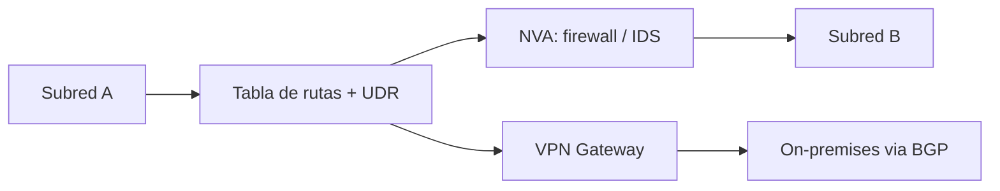

# Fase 13: Controlar el flujo de tráfico de red con rutas

## Si solo recuerdas 3 cosas
- Azure enruta el tráfico automáticamente con **rutas del sistema** (no se pueden crear ni eliminar); puedes **anularlas** con **rutas definidas por el usuario (UDR)**.
- Un **NVA (appliance virtual de red)** es una VM que controla el flujo de tráfico enrutándolo (firewall, WAF optimizer, router, IDS/IPS…); suele requerir **IP forwarding** habilitado.
- Si hay varias rutas, Azure usa el **prefijo más largo** (longest prefix match); ante **igual prefijo**, el orden de prioridad es **UDR > BGP > rutas del sistema**.

## Objetivo de repaso
Recordar las rutas del sistema, las UDR, el papel del NVA, BGP y la prioridad de selección de rutas.

## Comparaciones clave

| Prefijo | Tipo de próximo salto | Uso |
|---|---|---|
| Único de la VNet | Virtual network | Tráfico dentro de la VNet |
| 0.0.0.0/0 | Internet | Salida a internet (se puede anular) |
| 10.0.0.0/8, 172.16.0.0/12, 192.168.0.0/16, 100.64.0.0/10 | None | Se descartan (no enrutables globalmente) |

| Tipo de próximo salto (UDR) | Uso |
|---|---|
| Virtual appliance | Enviar a la IP privada de un NVA o LB interno |
| Virtual network gateway | Enviar a un VPN gateway (VPN) |
| Virtual network | Anular la ruta del sistema dentro de la VNet |
| Internet | Enrutar a internet |
| None | Descartar el tráfico |

| Origen de la ruta (mismo prefijo) | Prioridad |
|---|---|
| UDR (definida por el usuario) | 1.ª (más alta) |
| BGP | 2.ª |
| Ruta del sistema | 3.ª (más baja) |

## Diagrama

## Requisitos y restricciones
- Las **rutas del sistema no se crean ni se eliminan**; solo se anulan con UDR.
- Una **subred** se asocia a **una sola tabla de rutas**; una tabla puede asociarse a **varias** subredes.
- No puedes configurar **dos UDR con el mismo prefijo**.
- En UDR **no** puedes especificar el próximo salto `VirtualNetworkServiceEndpoint` (peering/endpoints).
- Para que un NVA reenvíe tráfico entre subredes hay que habilitar **IP forwarding** en su NIC.
- Se puede usar un **service tag** como prefijo de una UDR (Microsoft actualiza sus rangos).
- **BGP** se usa con ExpressRoute o VPN site-to-site para intercambiar rutas con on-premises.

## Requisito → Consecuencia
| Si… | Entonces… | Si no… |
|---|---|---|
| Quieres inspeccionar el tráfico con un firewall/NVA | Crea una UDR con próximo salto *virtual appliance* | El tráfico va directo entre subredes |
| El NVA debe reenviar paquetes | Habilita **IP forwarding** en su NIC | El NVA descarta el tráfico |
| Hay rutas con distintos prefijos | Azure elige el **prefijo más largo** | — |

## Casos de uso típicos
- Forzar el tráfico hacia un **NVA/firewall** (microsegmentación).
- Túnel forzado (forced tunneling): salir a internet a través de on-premises.
- Enrutar entre subredes a través de un appliance de seguridad.
- Intercambiar rutas con on-premises con **BGP** (ExpressRoute/VPN).

## Puntos críticos para el examen
- Rutas del sistema: **no creables ni eliminables**; se **anulan** con UDR.
- Ruta por defecto de internet: **0.0.0.0/0 → Internet**.
- Prefijos no enrutables (`10/8`, `172.16/12`, `192.168/16`, `100.64/10`) → próximo salto **None** (se descartan).
- UDR sobrescribe el enrutamiento del sistema para el próximo salto.
- Selección: **prefijo más largo**; en empate, **UDR > BGP > sistema**.
- Una subred = **una** tabla de rutas; una tabla = varias subredes.
- NVA requiere **IP forwarding** habilitado.

## Trampa típica del examen
- Creer que se pueden crear/eliminar rutas del sistema (no).
- Confundir el orden de prioridad (UDR > BGP > sistema).
- Creer que un NVA reenvía tráfico sin habilitar **IP forwarding**.
- Intentar usar `VirtualNetworkServiceEndpoint` como próximo salto de una UDR (no permitido).
- Creer que una tabla de rutas no puede compartirse entre subredes (sí puede).

## Mini-escenario resuelto
**Escenario:** Quieres que todo el tráfico entre dos subredes pase por un firewall (NVA) antes de llegar al destino.
**Respuesta:** Crear una tabla de rutas con una UDR de próximo salto *virtual appliance* (IP privada del NVA) y asociarla a la subred de origen.
**Por qué:** La UDR anula la ruta del sistema y dirige el tráfico a través del NVA, que lo inspecciona antes de reenviarlo.

## Productos relacionados
Productos nuevos → `docs/referencia/glosario-productos.md`: **Azure Route Table (UDR)**, **Network Virtual Appliance (NVA)**, **Azure VPN Gateway** (se menciona).
Nuevo grupo comparativo → `docs/referencia/comparativa-productos.md`: *Balanceadores de carga (Load Balancer, Application Gateway, Traffic Manager, Front Door)* (se completa en las fases 14–15).
Términos nuevos → `docs/referencia/glosario.md`: **ruta del sistema**, **UDR**, **IP forwarding**, **prefijo más largo**.

## Errores comunes / troubleshooting
- El tráfico no pasa por el NVA → falta la UDR en la subred correcta o falta IP forwarding.
- Pérdida de conectividad tras una UDR → próximo salto o prefijo mal definidos.
- Usar **Next hop** de Network Watcher para verificar hacia dónde se enruta.
