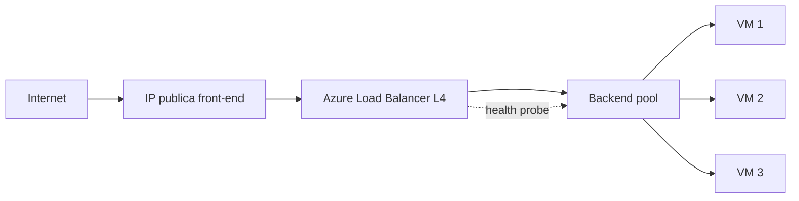

# Fase 14: Azure Load Balancer

## Si solo recuerdas 3 cosas
- Azure Load Balancer es un servicio de balanceo de **capa 4 (TCP/UDP)**, de **ultra baja latencia** y alto rendimiento, **regional** y **con redundancia de zona**.
- Puede ser **público** (equilibra tráfico de internet hacia las VMs; también da salida a internet) o **interno/privado** (tráfico dentro de la VNet o desde on-premises; su IP de front-end nunca se expone a internet).
- Trabaja con **reglas de balanceo** (cómo se reparte el tráfico) y **sondeos de estado (health probes)** (evitan enviar tráfico a instancias no sanas); incluye **reglas NAT de entrada** para administración (RDP/SSH).

## Objetivo de repaso
Recordar para qué sirve Load Balancer, sus tipos (público/interno), componentes y cuándo NO usarlo.

## Comparaciones clave

| Tipo | Front-end | Uso |
|---|---|---|
| Público | IP pública | Equilibrar tráfico de internet; salida a internet para las VMs |
| Interno (privado) | IP privada | LOB interno, multi-tier (web → app), desde on-premises |

| Componente | Función |
|---|---|
| Front-end IP | Dirección que recibe el tráfico |
| Backend pool | Conjunto de VMs / instancias de VMSS que reciben tráfico |
| Reglas de balanceo | Reparten el tráfico hacia el backend |
| Health probes | Verifican la salud del backend |
| Reglas NAT de entrada | Acceso RDP/SSH a una VM concreta |

| Servicio | Capa | Alcance | Cuándo |
|---|---|---|---|
| Load Balancer | L4 (TCP/UDP) | Regional | Ultra baja latencia, alto rendimiento |
| Application Gateway | L7 (HTTP/HTTPS) | Regional | WAF, terminación TLS, ruteo por URL |
| Traffic Manager | DNS | Global | Distribuir por dominio entre regiones |
| Front Door | L7 global | Global | Balanceo global + aceleración, WAF, caché |

Ver comparativa: **Balanceadores de carga** en `docs/referencia/comparativa-productos.md`.

## Diagrama

## Requisitos y restricciones
- Funciona hasta **millones de flujos TCP/UDP** y es **redundante de zona**.
- **Basic** vs **Standard**: el SKU **Standard** admite grupos de seguridad (secure by default), zonas, hasta 1,000 instancias de backend, y **no** es gratuito; el **Basic** es más limitado y sin SLA de producción.
- La **IP pública de SKU Standard es estática** y debe coincidir en SKU y tier con el LB.
- El **tier** (Regional/Global) de la IP y del LB deben coincidir.
- Un **Basic Internal LB** no sirve para peering **entre regiones** (usar Standard).
- Se configura sesión persistente (afinidad de origen o por IP de cliente).

## Requisito → Consecuencia
| Si… | Entonces… | Si no… |
|---|---|---|
| El front-end debe ser privado | Usa un **internal load balancer** | El front-end público se expone a internet |
| Conectas VNets peered entre regiones con LB interno | Usa **Standard LB** | Basic LB no funciona cross-region |
| El SKU del LB es Standard | La IP pública debe ser Standard y estática | No se pueden asociar |

## Casos de uso típicos
- Repartir tráfico web entrante entre varias VMs (front-end público).
- Equilibrar tráfico entre tiers internos (web → capa de datos/análisis) con LB interno.
- Dar acceso RDP/SSH a una instancia concreta mediante reglas NAT de entrada.
- Replicar la funcionalidad de un appliance de red on-premises al migrar a Azure.

## Cuándo NO usar esto
- Aplicación web en una **sola** instancia de IaaS con poco tráfico.
- Cuando necesitas **WAF**, terminación TLS o ruteo por URL → **Application Gateway**.
- Cuando necesitas balanceo **global** entre regiones → **Front Door** o **Traffic Manager**.

## Puntos críticos para el examen
- Load Balancer = **capa 4** (TCP/UDP), **regional**, **redundante de zona**.
- Dos tipos: **público** e **interno (privado)**.
- Componentes: front-end IP, backend pool, reglas de balanceo, health probes, reglas NAT de entrada.
- Los **health probes** evitan enviar tráfico a instancias no sanas.
- **SKU Standard** = IP estática, zonas, secure by default (sin SLA de producción en Basic).
- **Sin WAF** (eso es Application Gateway/Front Door).

## Trampa típica del examen
- Confundir Load Balancer (L4) con Application Gateway (L7).
- Creer que Load Balancer hace balanceo **global** (es **regional**).
- Buscar WAF en Load Balancer (no lo tiene).
- Creer que el front-end interno se expone a internet (no).
- Usar Basic LB en peering cross-region (no funciona).

## Mini-escenario resuelto
**Escenario:** Una aplicación de línea de negocio interna debe repartir tráfico desde la capa web hacia varias VMs de procesamiento, sin exponerse a internet.
**Respuesta:** Usar un **internal (privado) Azure Load Balancer** de capa 4.
**Por qué:** El LB interno equilibra tráfico entre VMs dentro de la VNet con una IP de front-end privada, nunca expuesta a internet.

## Productos relacionados
Productos nuevos → `docs/referencia/glosario-productos.md`: **Azure Load Balancer**.
Completa el grupo comparativo **Balanceadores de carga** en `docs/referencia/comparativa-productos.md`.
Términos nuevos → `docs/referencia/glosario.md`: **backend pool**, **health probe**, **regla de balanceo**.

## Errores comunes / troubleshooting
- Una VM no recibe tráfico → revisar el health probe y que esté en el backend pool.
- No se puede asociar la IP pública → SKU/tier distintos entre IP y LB.
- Tráfico cross-region no funciona con LB interno → cambiar a Standard.
