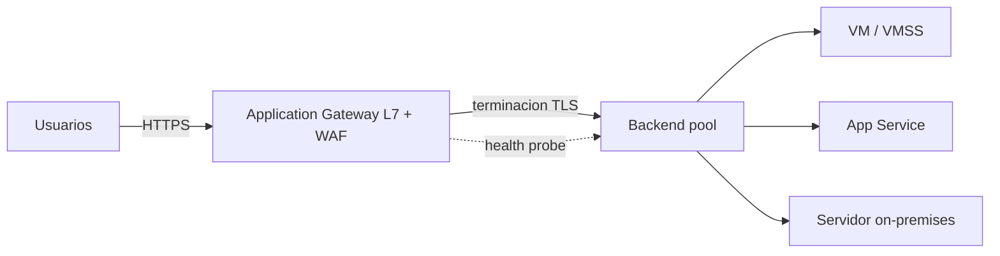

# Fase 15: Azure Application Gateway

## Si solo recuerdas 3 cosas
- Application Gateway es un **ADC (Application Delivery Controller) como servicio** que hace balanceo de **capa 7 (HTTP/HTTPS/HTTP2/WebSocket)** y es **regional**.
- Ofrece **terminación TLS/SSL**, **WAF** (contra inyección SQL y XSS), **autoscaling**, **connection draining** y **afinidad de sesión** (session stickiness).
- Equilibra en **round-robin** hacia los servidores del **backend pool** (VMs, VMSS, App Service, on-premises).

## Objetivo de repaso
Recordar las capacidades de capa 7 de Application Gateway, su WAF y cuándo usarlo o no.

## Comparaciones clave

| Capacidad | Detalle |
|---|---|
| Protocolos | HTTP, HTTPS, HTTP/2, WebSocket |
| WAF | Protege contra inyección SQL y cross-site scripting (XSS) |
| Terminación TLS | Descarga el cifrado/descifrado de los servidores backend |
| Cifrado de extremo a extremo | Entre usuario↔gateway y gateway↔servidores |
| Autoscaling | Ajusta la capacidad según la carga |
| Connection draining | Retira miembros del backend con gracia en mantenimientos |
| Afinidad de sesión | Manda las peticiones de una sesión al mismo servidor backend |

| Servicio | Capa | Alcance | Cuándo |
|---|---|---|---|
| Application Gateway | L7 (HTTP/HTTPS) | Regional | WAF, TLS, ruteo por URL |
| Front Door | L7 | Global | Balanceo global + aceleración, WAF, caché |
| Traffic Manager | DNS | Global | Distribuir por dominio entre regiones |
| Load Balancer | L4 (TCP/UDP) | Regional | Ultra baja latencia |

Ver comparativa: **Balanceadores de carga** en `docs/referencia/comparativa-productos.md`.

## Diagrama

## Requisitos y restricciones
- El backend pool admite **VMs, VMSS, App Service y servidores on-premises**.
- Requiere el **módulo WAF** para las funciones de firewall de aplicaciones web.
- Es **regional** (no es global; para global usar Front Door o Traffic Manager).
- La **afinidad de sesión** es clave en apps de comercio electrónico (no interrumpir transacciones).
- Necesita subred dedicada (a diferencia de un LB de L4).

## Requisito → Consecuencia
| Si… | Entonces… | Si no… |
|---|---|---|
| Necesitas proteger contra SQL injection/XSS | Usa **WAF** | Un LB de L4 no inspecciona HTTP |
| Quieres reducir CPU en los servidores | Descarga la **terminación TLS** al gateway | Los servidores cifran/descifran |
| La app guarda estado de sesión en el servidor | Configura **afinidad de sesión** | Las peticiones saltan entre servidores |
| Necesitas balanceo global | Usa Front Door / Traffic Manager | App Gateway es regional |

## Casos de uso típicos
- Publicar una granja web con **WAF** y terminación TLS.
- Enrutar tráfico de un endpoint de Azure a un backend **on-premises**.
- Balancear una app multi-tier donde el backend **no** está expuesto a internet.
- Aplicaciones que requieren **afinidad de sesión**.

## Cuándo NO usar esto
- Aplicación web sin necesidad de balanceo (una sola instancia con poco tráfico).
- Cuando basta un balanceo de **capa 4** (usar Load Balancer).
- Cuando se necesita balanceo **global** (usar Front Door / Traffic Manager).
- Cuando el único requisito es enrutar por dominio a nivel DNS.

## Puntos críticos para el examen
- Application Gateway = **capa 7**, **regional**, con **WAF** integrado.
- Protocolos: HTTP, HTTPS, HTTP/2, WebSocket.
- Funciones clave: **terminación TLS**, **WAF (SQL injection/XSS)**, **autoscaling**, **connection draining**, **afinidad de sesión**, **cifrado extremo a extremo**.
- Equilibra en **round-robin**.
- Backend pool: VMs, VMSS, **App Service** y on-premises.
- No es global (Front Door sí).

## Trampa típica del examen
- Confundir Application Gateway (L7, regional, con WAF) con Load Balancer (L4, regional, sin WAF).
- Creer que Application Gateway es **global** (es regional).
- Creer que hace ruteo **basado en DNS** como Traffic Manager (no).
- Olvidar que la **afinidad de sesión** es imprescindible en apps con estado.
- Asumir que un L4 balancea HTTP con WAF (no).

## Mini-escenario resuelto
**Escenario:** Una empresa necesita publicar su app web protegida contra inyección SQL y XSS, con terminación TLS y afinidad de sesión, servida por servidores on-premises y VMs en Azure.
**Respuesta:** Desplegar **Azure Application Gateway con WAF**.
**Por qué:** App Gateway hace capa 7, ofrece WAF, terminación TLS, afinidad de sesión y admite backend on-premises y en Azure.

## Productos relacionados
Productos nuevos → `docs/referencia/glosario-productos.md`: **Azure Application Gateway**, **WAF (Web Application Firewall)**.
Completa el grupo comparativo **Balanceadores de carga** en `docs/referencia/comparativa-productos.md`.
Términos nuevos → `docs/referencia/glosario.md`: **afinidad de sesión**, **terminación TLS**, **WAF**.

## Errores comunes / troubleshooting
- El WAF bloquea tráfico legítimo → revisar reglas del WAF (modo detección/prevención).
- El backend no recibe tráfico → revisar health probe.
- Pérdida de sesión en la app → configurar afinidad de sesión.
