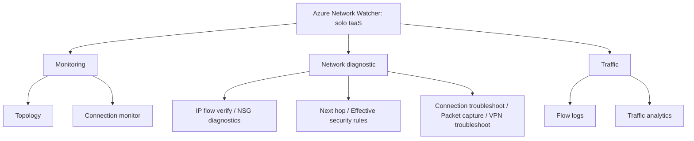

# Fase 16: Azure Network Watcher

## Si solo recuerdas 3 cosas
- Network Watcher es un conjunto de herramientas para **monitorizar, diagnosticar, ver métricas y habilitar/deshabilitar logs** de recursos de **IaaS** (no de PaaS ni analítica web).
- Se organiza en **tres grupos**: **Monitoring** (topología y connection monitor), **Network diagnostic** (7 herramientas) y **Traffic** (flow logs y traffic analytics).
- Diagnostica bloqueos con **IP flow verify / NSG diagnostics**, problemas de ruteo con **next hop**, y tráfico con **flow logs / traffic analytics**; **Connection monitor** comprueba conectividad extremo a extremo.

## Objetivo de repaso
Recordar los tres grupos de herramientas, qué hace cada una y cuándo usar Network Watcher (y cuándo no).

## Comparaciones clave

| Grupo | Herramientas |
|---|---|
| Monitoring | **Topology**, **Connection monitor** |
| Network diagnostic | IP flow verify, NSG diagnostics, Next hop, Effective security rules, Connection troubleshoot, Packet capture, VPN troubleshoot |
| Traffic | **Flow logs**, **Traffic analytics** |

| Herramienta | Resuelve |
|---|---|
| IP flow verify | ¿El paquete se permite/deniega y qué regla lo hace? (a nivel de VM) |
| NSG diagnostics | Igual que el anterior, ampliado a VMSS, App Gateway y service tags; permite añadir una regla de mayor prioridad |
| Next hop | ¿El tráfico va al destino correcto? (problemas de ruteo) |
| Effective security rules | Reglas efectivas aplicadas a una NIC (NIC + subred + agregado) |
| Connection troubleshoot | Prueba una conexión en un punto en el tiempo (puntual) |
| Packet capture | Captura remota de paquetes de una VM/VMSS |
| VPN troubleshoot | Diagnóstico de gateways de red virtual y sus conexiones |
| Topology | Visualización interactiva de recursos y relaciones |
| Connection monitor | Monitorización **continua** extremo a extremo (Azure híbrido) |
| Flow logs | Registra el tráfico IP (NSG o VNet) en Azure Storage |
| Traffic analytics | Visualizaciones enriquecidas a partir de flow logs |

## Diagrama

## Requisitos y restricciones
- Diseñado para recursos **IaaS** (VMs, VNets, Application Gateways, Load Balancers…).
- **No** sirve para monitoreo **PaaS** ni **analítica web** (usar el service health dashboard).
- Ofrece funciones de diagnóstico de nivel intermedio; para funciones avanzadas puede requerir herramientas de terceros.
- Se puede usar desde el **portal, PowerShell y Azure CLI**.
- **Flow logs** guarda los datos en **Azure Storage**.

## Requisito → Consecuencia
| Si… | Entonces… | Si no… |
|---|---|---|
| Una VM no puede comunicarse | Usa **IP flow verify** para saber qué regla NSG bloquea | No sabrás qué regla descarta el tráfico |
| El tráfico no llega al destino por ruteo | Usa **Next hop** | Diagnosticarías a ciegas el enrutamiento |
| Necesitas verificar conectividad continua | Usa **Connection monitor** | Solo tendrías pruebas puntuales (connection troubleshoot) |
| Necesitas analizar el tráfico IP de una NSG/VNet | Usa **Flow logs** + **Traffic analytics** | No tendrías visibilidad del tráfico |

## Casos de uso típicos
- Resolver problemas de conectividad entre IaaS VMs.
- Diagnosticar conexiones **VPN** site-to-site.
- Determinar latencia entre regiones para ubicar recursos.
- Visualizar la topología de una red compleja durante el troubleshooting.
- Auditar y visualizar el tráfico con flow logs y traffic analytics.

## Cuándo NO usar esto
- Problemas de conectividad de servicios **PaaS** (usa service health / status).
- Analítica **web** (Network Watcher no es para eso).
- Cuando necesitas funciones de diagnóstico **avanzadas** de terceros.

## Puntos críticos para el examen
- Network Watcher = herramientas para **IaaS**; **no** PaaS ni web analytics.
- Tres grupos: **Monitoring, Network diagnostic, Traffic**.
- **Dos** de monitoring: Topology y Connection monitor.
- **Siete** de diagnóstico: IP flow verify, NSG diagnostics, Next hop, Effective security rules, Connection troubleshoot, Packet capture, VPN troubleshoot.
- **Dos** de tráfico: Flow logs y Traffic analytics.
- **IP flow verify** vs **NSG diagnostics**: el primero a nivel de VM; el segundo abarca VMSS, App Gateway y service tags y permite añadir reglas.
- **Connection monitor** (continuo) vs **Connection troubleshoot** (puntual).
- Flow logs guarda en **Azure Storage**.

## Trampa típica del examen
- Creer que Network Watcher monitorea **PaaS** o hace analítica web (no).
- Confundir **Connection monitor** (continuo) con **Connection troubleshoot** (puntual).
- Confundir **IP flow verify** (a nivel VM) con **NSG diagnostics** (más amplio).
- Creer que Network Watcher sustituye herramientas avanzadas de terceros (no).
- Confundir **Next hop** (ruteo) con **Effective security rules** (reglas NSG).

## Mini-escenario resuelto
**Escenario:** Una VM Windows no acepta una sesión remota por PowerShell desde otra VM; sospechas de una regla NSG.
**Respuesta:** Usar **IP flow verify** indicando la IP local/remota, el puerto 5986 y el protocolo TCP.
**Por qué:** IP flow verify comprueba si el paquete se permite o se deniega y **qué regla NSG** es responsable.

## Productos relacionados
Productos nuevos → `docs/referencia/glosario-productos.md`: **Azure Network Watcher**, **Connection Monitor**.
Completa el grupo comparativo **Monitoreo** en `docs/referencia/comparativa-productos.md` (Azure Monitor vs Network Watcher vs Connection Monitor; se completará con las fases 26–28).
Términos nuevos → `docs/referencia/glosario.md`: **IP flow verify**, **NSG diagnostics**, **flow logs**, **traffic analytics**, **packet capture**.

## Errores comunes / troubleshooting
- «No sé qué regla bloquea el tráfico» → IP flow verify / NSG diagnostics.
- «El tráfico va a otro lado» → Next hop.
- «La conexión funciona a veces» → Connection monitor (continuo).
- «Necesito ver el tráfico real» → Packet capture o Flow logs.
