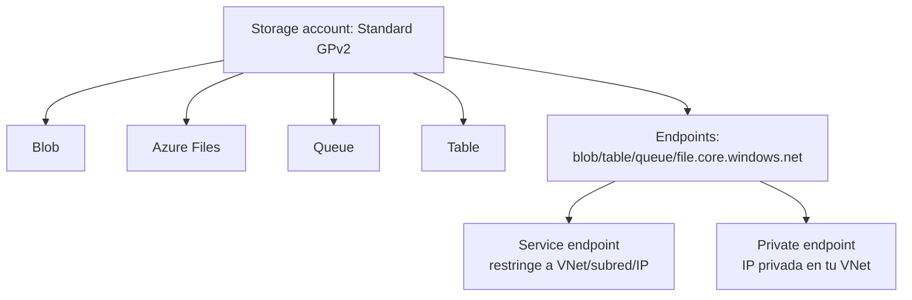

# Fase 17: Cuentas de almacenamiento

## Si solo recuerdas 3 cosas
- Azure Storage admite **tres categorías de datos**: estructurados (Table/Cosmos/SQL), no estructurados (Blob/Data Lake) y datos de VM (Managed Disks/Files).
- El tipo de cuenta recomendado es **Standard general-purpose v2 (GPv2)**; existen además **Premium block blobs**, **Premium file shares** y **Premium page blobs**. **No** se puede convertir Standard ↔ Premium.
- La replicación determina la durabilidad: **LRS < ZRS < GRS < RA-GRS**, y **GZRS/RA-GZRS** combinan zonas + región.

## Objetivo de repaso
Recordar los servicios de Azure Storage, los tipos de cuenta, las estrategias de replicación y los endpoints (incluidos service/private endpoints).

## Comparaciones clave

| Categoría de dato | Ejemplos de almacenamiento |
|---|---|
| Datos de VM | Azure Managed Disks (discos) y Azure Files (recursos compartidos) |
| No estructurados | Azure Blob Storage y Azure Data Lake Storage |
| Estructurados | Azure Table Storage, Azure Cosmos DB, Azure SQL Database |

| Servicio | Para qué |
|---|---|
| Blob Storage | Objetos no estructurados a gran escala (imágenes, vídeo, backup) |
| Azure Files | Recursos compartidos de red (SMB/NFS/REST); hasta 100 TiB por share |
| Queue Storage | Mensajes (hasta 64 KB cada uno, millones de mensajes) |
| Table Storage | Datos estructurados NoSQL sin esquema (clave/atributo) |

| Tipo de cuenta | Servicios | Redundancia |
|---|---|---|
| Standard general-purpose v2 | Blob, Queue, Table, Files, discos | LRS, GRS, RA-GRS, ZRS, GZRS, RA-GZRS |
| Premium block blobs | Blob | LRS, ZRS |
| Premium file shares | Azure Files | LRS, ZRS |
| Premium page blobs | Page blobs | Solo LRS |

| Replicación | Alcance |
|---|---|
| LRS | 3 réplicas en un **mismo datacenter** (misma zona) |
| ZRS | 3 zonas de disponibilidad en una **misma región** |
| GRS | LRS + copia **asíncrona** a una región secundaria (lectura solo tras failover) |
| RA-GRS | GRS + lectura desde la secundaria |
| GZRS | 3 zonas en la primaria + copia a región secundaria |
| RA-GZRS | GZRS + lectura desde la secundaria |

## Diagrama

## Requisitos y restricciones
- **No** se puede convertir una cuenta **Standard en Premium** ni viceversa; hay que crear una nueva y copiar datos.
- Todos los tipos usan **Storage Service Encryption (SSE)** en reposo.
- **ZRS** no está disponible en todas las regiones; pasar a ZRS requiere mover los datos físicamente.
- Los **endpoints** usan el nombre de la cuenta como subdominio: `<cuenta>.blob.core.windows.net`, `.table.`, `.queue.`, `.file.`.
- Para **SFTP** en Blob se necesita **hierarchical namespace (HNS)**; Blob también admite **NFSv3**.
- Los subredes/VNets de **service endpoint** deben estar en la misma región o región par que la cuenta.
- **Private endpoint**: usa una **IP privada de tu VNet** y todo el tráfico va por el backbone de Microsoft (recomendado para producción).

## Requisito → Consecuencia
| Si… | Entonces… | Si no… |
|---|---|---|
| Necesitas leer la región secundaria durante una caída regional | Usa **RA-GRS / RA-GZRS** | GRS solo permite lectura tras failover |
| Quieres aislamiento de red total para producción | Usa **private endpoint** | Service endpoint deja la cuenta en su endpoint público |
| Necesitas mover archivos por SFTP a Blob | Habilita **HNS** | No podrás usar SFTP |

## Casos de uso típicos
- Almacenar imágenes, vídeos o documentos servidos directamente al navegador (Blob).
- Compartir archivos entre varias VMs con SMB/NFS (Azure Files).
- Desacoplar trabajo asíncrono con colas (Queue).
- Almacenar datos NoSQL sin esquema (Table).
- Migrar apps on-premises que usan recursos compartidos (lift and shift con Azure Files).

## Puntos críticos para el examen
- Cuenta recomendada: **Standard GPv2** (cubre casi todos los escenarios).
- **Standard = HDD (magnetco)**; **Premium = SSD**; no se convierten entre sí.
- Replicación: **LRS, ZRS, GRS, RA-GRS, GZRS, RA-GZRS**.
- Durabilidad GRS/GZRS: **16 nueves (99.99999999999999%)**.
- Endpoints por servicio: blob/table/queue/file `.core.windows.net`.
- **Service endpoint** restringe acceso (cuenta sigue pública); **private endpoint** da IP privada y aísla (producción).
- SFTP requiere **HNS**; NFSv3 también si se necesita.

## Trampa típica del examen
- Creer que se puede convertir Standard ↔ Premium (no).
- Confundir **GRS** (sin lectura secundaria) con **RA-GRS** (con lectura).
- Creer que **ZRS** existe en todas las regiones (no).
- Confundir **service endpoint** (restringe) con **private endpoint** (IP privada/aislamiento).
- Olvidar que SFTP en Blob requiere **HNS**.

## Mini-escenario resuelto
**Escenario:** Una empresa necesita que, ante una caída de la región primaria, sus aplicaciones sigan **leyendo** los datos desde la región secundaria.
**Respuesta:** Crear una cuenta con **RA-GRS** (o RA-GZRS).
**Por qué:** Solo RA-GRS/RA-GZRS permiten lectura desde la región secundaria sin esperar a un failover.

## Productos relacionados
Productos nuevos → `docs/referencia/glosario-productos.md`: **Azure Storage**, **Azure Blob Storage**, **Azure Files**, **Azure Queue Storage**, **Azure Table Storage**, **Azure Data Lake Storage**, **Azure Managed Disks**, **Azure Storage Explorer**.
Nuevo grupo comparativo → `docs/referencia/comparativa-productos.md`: *Acceso a PaaS (Service Endpoint vs Private Endpoint)*.
Términos nuevos → `docs/referencia/glosario.md`: **LRS/ZRS/GRS/RA-GRS/GZRS/RA-GZRS**, **storage endpoint**, **SSE**, **HNS**.

## Errores comunes / troubleshooting
- No puedo cambiar de tipo de cuenta → hay que recrear la cuenta.
- No puedo habilitar SFTP → falta HNS.
- Restringí acceso pero un recurso no llega → revisar service/private endpoint y la región.
