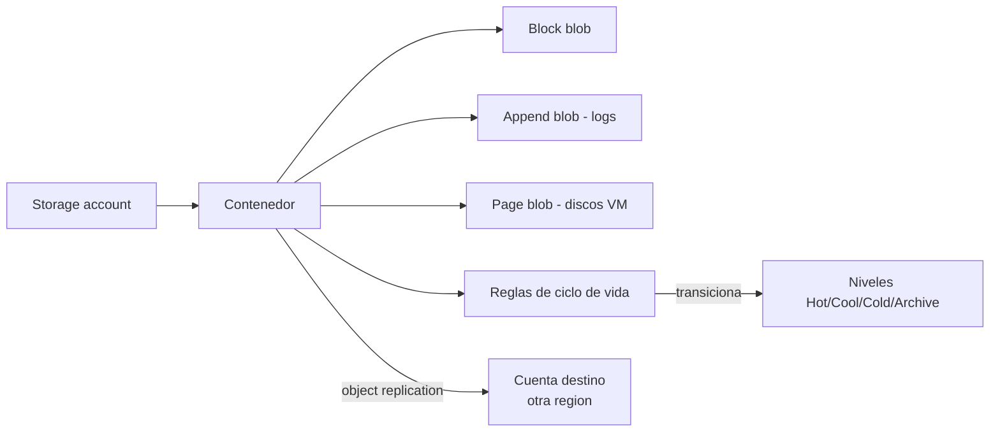

# Fase 18: Azure Blob Storage

## Si solo recuerdas 3 cosas
- Blob Storage almacena datos **no estructurados** como objetos; la jerarquía es **cuenta → contenedor → blob** (un blob **no** puede existir fuera de un contenedor).
- Los niveles de acceso son **Hot, Cool, Cold y Archive**; cuanto más «frío», menor coste de almacenamiento y mayor coste de acceso y latencia (Archive exige **rehidratar**).
- Hay **tres tipos de blob**: **block** (por defecto; archivos/imágenes/vídeo), **append** (logs) y **page** (discos de VM, hasta 8 TB).

## Objetivo de repaso
Recordar contenedores, niveles de acceso, reglas de ciclo de vida, replicación de objetos y tipos de blob.

## Comparaciones clave

| Nivel | Latencia | Duración mínima | Coste almacenamiento | Coste acceso |
|---|---|---|---|---|
| Hot | milisegundos | N/A | Más alto | Más bajo |
| Cool | milisegundos | 30 días | Menor | Mayor |
| Cold | milisegundos | 90 días | Menor que Cool | Mayor que Cool |
| Archive | **horas** | 180 días | Más bajo | Más alto |

| Tipo de blob | Uso |
|---|---|
| Block blob | Texto/datos binarios: archivos, imágenes, vídeo (**predeterminado**) |
| Append blob | Escenarios de **logging** (append optimizado) |
| Page blob | Discos de SO y datos de VM (hasta **8 TB**) |

| Herramienta | Uso |
|---|---|
| Azure Storage Explorer | GUI multiplataforma para todo el almacenamiento |
| AzCopy | Herramienta de línea de comandos para copiar datos |
| Azure Data Box Disk | Transferencia física de grandes volúmenes (SSD enviados) |

## Diagrama

## Requisitos y restricciones
- Nombre de contenedor: **3–63** caracteres, minúsculas, números y guiones; debe empezar por letra o número; **único** en la cuenta.
- Niveles de acceso público: **Private** (predeterminado), **Blob** (lectura anónima de blobs) y **Container** (lectura y listado anónimo); **Blob/Container no surten efecto** salvo que `Allow Blob anonymous access` esté habilitado en la cuenta.
- **No** se puede cambiar el tipo de un blob tras crearlo.
- **Archive**: offline; para leer hay que **rehidratar** con **Copy Blob** (recomendado) o **Set Blob Tier** (Standard: hasta **15 h**; High: ~**1 h** para objetos <10 GB, más caro).
- **Object replication**: requiere **blob versioning** en origen y destino; **no** replica snapshots; soporta Hot/Cool/Cold (origen y destino pueden diferir de nivel).
- **Ciclo de vida**: reglas `If/Then`; aplican a cuenta, contenedores o subconjunto por prefijo/etiqueta; permiten transicionar y **eliminar** versiones/snapshots.

## Requisito → Consecuencia
| Si… | Entonces… | Si no… |
|---|---|---|
| Quieres lectura anónima de blobs | Habilita *Allow Blob anonymous access* y pon el contenedor en Blob/Container | El contenedor permanece privado |
| Necesitas leer datos de Archive | **Rehidrata** el blob (Copy Blob o Set Blob Tier) | La lectura tarda horas o falla |
| Quieres replicar objetos entre regiones | Habilita **blob versioning** en origen y destino | La replicación no se configura |
| Los datos envejecen | Usa **reglas de ciclo de vida** | Pagarás de más por datos fríos |

## Casos de uso típicos
- Servir imágenes o documentos directamente al navegador.
- Almacenar archivos para acceso distribuido (instalaciones).
- Streaming de vídeo y audio.
- Backup, recuperación ante desastres y archivado.
- Datos para análisis desde on-premises o servicios en Azure.

## Puntos críticos para el examen
- Jerarquía **cuenta → contenedor → blob**; blob obligado a estar en contenedor.
- Niveles: **Hot, Cool, Cold, Archive** (mínimos: 30 / 90 / 180 días para Cool / Cold / Archive).
- **Archive** es offline y requiere **rehidratación**.
- Tipos de blob: **block (predeterminado), append (logs), page (discos VM, 8 TB)**; el tipo **no cambia** tras crearlo.
- **Object replication** exige **blob versioning** y **no** soporta snapshots.
- Herramientas: **Storage Explorer, AzCopy, Data Box Disk**.
- El coste depende de volumen, operaciones/transferencia y redundancia.

## Trampa típica del examen
- Confundir el nivel **Cold** (90 días) con **Cool** (30 días) o **Archive** (180 días).
- Creer que el blob de Archive se lee al instante (hay que **rehidratar**).
- Creer que se puede cambiar el **tipo** de un blob (no).
- Creer que las reglas de acceso público funcionan sin habilitar *Allow Blob anonymous access* (no).
- Confundir **page blob** (discos de VM) con **block blob** (por defecto).

## Mini-escenario resuelto
**Escenario:** Necesitas conservar datos de cumplimiento que casi nunca se leen, al menor coste posible, y poder recuperarlos en unas horas si hiciera falta.
**Respuesta:** Mover los blobs al nivel **Archive** (y **rehidratar** cuando se necesiten).
**Por qué:** Archive es el nivel más barato para datos rara vez accedidos; la recuperación exige rehidratación, que tolera horas de latencia.

## Productos relacionados
Productos nuevos → `docs/referencia/glosario-productos.md`: **AzCopy**, **Azure Data Box Disk**.
Sin grupo comparativo nuevo (se completa *Azure Files vs Blob* en la fase 20).
Términos nuevos → `docs/referencia/glosario.md`: **rehidratación**, **blob versioning**, **object replication**, **blob lifecycle rules**.

## Errores comunes / troubleshooting
- No puedo leer un blob de Archive → hay que **rehidratarlo**.
- La replicación no se configura → falta **blob versioning** en origen/destino.
- Acceso anónimo no funciona → la cuenta tiene deshabilitado el acceso anónimo a blobs.
