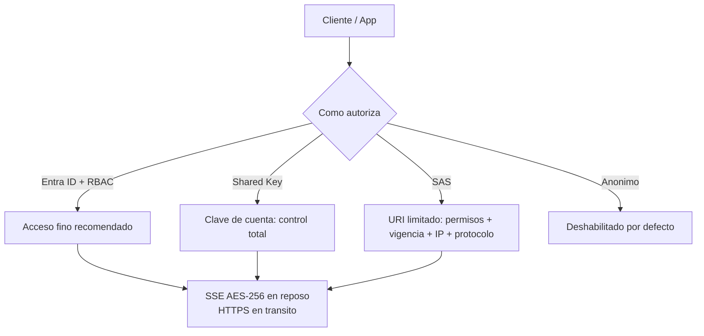

# Fase 19: Seguridad de Azure Storage

## Si solo recuerdas 3 cosas
- Todo lo escrito en Azure Storage se cifra con **SSE (AES-256)** en reposo, automáticamente y **no se puede deshabilitar**; en tránsito se exige **HTTPS** (propiedad *Secure transfer required*).
- Estrategias de autorización: **Microsoft Entra ID + RBAC** (recomendado), **Shared Key** (clave de cuenta), **SAS** (acceso delegado) y **acceso anónimo** (deshabilitado por defecto).
- Una **SAS** es un **URI** con permisos restringidos y tiempo limitado; existen **user delegation SAS** (Entra ID), **account-level**, **service-level** y **stored access policies**.

## Objetivo de repaso
Recordar cifrado, estrategias de autorización, tipos de SAS y claves gestionadas por el cliente.

## Comparaciones clave

| Estrategia de autorización | Detalle |
|---|---|
| Microsoft Entra ID (+ RBAC) | Recomendada; acceso fino a usuarios/grupos/apps |
| Shared Key | Clave de acceso de cuenta (primaria/secundaria); se puede **deshabilitar** |
| SAS | URI con permisos y vigencia especificados |
| Acceso anónimo | **Deshabilitado** por defecto; no recomendado con datos sensibles |

| Tipo de SAS | Alcance |
|---|---|
| User delegation SAS | Firmada con credenciales de Entra ID (Blob/Data Lake) |
| Account-level SAS | Todo lo que permite una service-level SAS + recursos/acciones extra |
| Service-level SAS | Recursos concretos de un servicio |
| Stored access policy | Control adicional del lado servidor para SAS de servicio |

| Modelo de clave | Cómo se gestiona |
|---|---|
| Platform-managed keys (PMK) | Azure genera/almacena/gestiona (predeterminado) |
| Customer-managed keys (CMK) | Las gestiona el cliente en **Key Vault** o **Managed HSM** |
| BYOK | Escenario CMK: importas tu propia clave |

## Diagrama

## Requisitos y restricciones
- **SSE** cifra todos los datos al escribirlos y los descifra al leerlos; **no se puede deshabilitar**.
- **Infrastructure encryption** cifra los datos **dos veces** (dos algoritmos y dos claves: servicio + infraestructura).
- Activa *Secure transfer required*; rechaza **TLS 1.0/1.1** (en desuso).
- **CMK**: la cuenta de almacenamiento y el **Key Vault deben estar en la misma región** (pueden estar en suscripciones distintas); Managed HSM ofrece **FIPS 140-2 Level 3**.
- **SAS**: usa HTTPS siempre; set start time al menos **15 min** en el pasado por *clock skew*; expiración cercana si no hay stored access policy; máxima duración de 1 h para API < 2012-02-12.
- La clave de firma de una SAS se calcula con **HMAC + SHA256** y se codifica en **Base64**.
- **Windows VHD** se cifran con **BitLocker** y las imágenes **Linux** con **dm-crypt** (Azure Disk Encryption).

## Requisito → Consecuencia
| Si… | Entonces… | Si no… |
|---|---|---|
| Quieres revocar SAS sin regenerar claves | Usa una **stored access policy** | Tendrás que rotar las claves |
| Necesitas el máximo aislamiento con tus claves | Usa **CMK** en Key Vault (misma región) | Azure gestiona las claves (PMK) |
| La cuenta contiene datos sensibles | Mantén el **acceso anónimo deshabilitado** | Los datos podrían exponerse |
| Quieres forzar solo conexiones seguras | Habilita *Secure transfer required* | Se aceptaría HTTP |

## Casos de uso típicos
- Dar acceso temporal a un cliente o servicio con **SAS** sin revelar la clave de cuenta.
- Gestionar el acceso de aplicaciones con **identidades administradas + RBAC** (mejor que claves).
- Cumplir requisitos de cifrado con **CMK/BYOK** y Managed HSM.
- Auditar y monitorizar el almacenamiento con **Storage Insights**.
- Detección proactiva de amenazas con **Microsoft Defender for Storage**.

## Puntos críticos para el examen
- **SSE AES-256** en reposo, automático e **irreversible** (no se deshabilita).
- Autorización: **Entra ID + RBAC** (recomendada), Shared Key, SAS, anónimo.
- **4 tipos de SAS**; la **user delegation SAS** usa Entra ID (Blob/Data Lake).
- **CMK** en Key Vault/Managed HSM; cuenta y vault en la **misma región**.
- **Infrastructure encryption** = doble cifrado.
- **Clock skew**: pon el inicio de la SAS ≥15 min en el pasado.
- **Storage Insights** = monitorización; **Defender for Storage** = detección proactiva (malware, PII, accesos anómalos).

## Trampa típica del examen
- Creer que el cifrado en reposo se puede deshabilitar (no).
- Confundir **Shared Key** (control total) con **SAS** (acceso limitado y temporal).
- Creer que se puede revocar una SAS sin stored access policy (hay que rotar claves).
- Olvidar que CMK y la cuenta deben estar en la **misma región**.
- Confundir **Storage Insights** (monitorización pasiva) con **Defender for Storage** (detección activa).

## Mini-escenario resuelto
**Escenario:** Necesitas que un socio externo suba archivos a un contenedor durante 2 horas, sin darle la clave de la cuenta y pudiendo revocar el acceso.
**Respuesta:** Emitir una **SAS** con permisos de escritura y vigencia de 2 h; preferiblemente usando una **stored access policy** para poder revocarla.
**Por qué:** La SAS limita permisos, IP/protocolo y tiempo sin exponer la clave; la stored access policy permite revocar sin rotar claves.

## Productos relacionados
Productos nuevos → `docs/referencia/glosario-productos.md`: **Azure Key Vault**, **Azure Key Vault Managed HSM**, **Microsoft Defender for Storage**, **Storage Insights**.
Completa el grupo **Acceso a PaaS (Service Endpoint vs Private Endpoint)** en `docs/referencia/comparativa-productos.md`.
Términos nuevos → `docs/referencia/glosario.md`: **SAS**, **stored access policy**, **Shared Key**, **CMK**, **PMK**, **BYOK**, **infrastructure encryption**, **clock skew** (SAS).

## Errores comunes / troubleshooting
- Una SAS «no funciona» en los primeros minutos → **clock skew** (ajustar start time).
- Un socio pierde acceso inesperadamente → expiró la SAS.
- El vault de CMK da error → región distinta a la de la cuenta.
