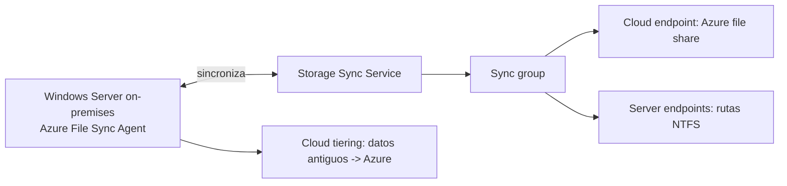

# Fase 20: Azure Files y Azure File Sync

## Si solo recuerdas 3 cosas
- Azure Files ofrece **recursos compartidos administrados** accesibles por **SMB, NFS y REST**; una misma compartición **no** puede usar SMB y NFS a la vez (aunque puede haber ambas en la misma cuenta).
- Los niveles de compartición son **Premium (SSD, aprovisionado)**, **Transaction Optimized, Hot y Cool** (HDD, pago por uso).
- **Azure File Sync** convierte un **Windows Server** en una **caché** de Azure Files, con **cloud tiering** para mover datos antiguos a Azure.

## Objetivo de repaso
Recordar Azure Files vs Blob, los niveles de recurso compartido, snapshots/soft delete y los componentes de Azure File Sync.

## Comparaciones clave

| | Azure Files (recursos compartidos) | Azure Blob Storage (blobs) |
|---|---|---|
| Protocolo | SMB, NFS, REST + librerías | REST + librerías (más SFTP/NFSv3 con HNS) |
| Espacio de nombres | Jerárquico (objetos de directorio reales) | Plano (dentro de un contenedor) |
| Acceso | Desde varias VMs por recurso compartido | Desde cualquier lugar, a gran escala |
| Ideal para | Lift and shift, compartir herramientas/datos | Streaming, acceso aleatorio, datos a gran escala |

| Nivel de Azure Files | Rendimiento | Cuenta | Facturación |
|---|---|---|---|
| Premium | SSD, baja latencia | FileStorage | Aprovisionado (capacidad reservada) |
| Transaction Optimized | HDD, estándar | GPv2 | Pago por uso |
| Hot | HDD, estándar | GPv2 | Pago por uso |
| Cool | HDD, estándar | GPv2 | Pago por uso |

## Diagrama

## Requisitos y restricciones
- Una compartición **no** admite SMB y NFS simultáneamente; sí puede haber shares SMB y NFS en la misma cuenta.
- SMB usa el puerto **445**; muchos ISP lo bloquean (problema común al montar desde on-premises).
- Autenticación: **identidad basada en SMB** (AD DS on-premises, Entra Domain Services, Entra Kerberos + RBAC), **access key** o **SAS** (en Azure Files, SAS solo para REST desde código).
- **Snapshots**: incrementales, de solo lectura, a nivel de compartición; hasta **200** por compartición; borrar la compartición borra los snapshots.
- **Soft delete**: se habilita a nivel de **cuenta**; retención de **1 a 365 días**; aplicable a nuevas o existentes.
- Azure File Sync: **Storage Sync Service** admite hasta **100 sync groups** y **99 servidores Windows** registrados; cada **sync group** admite **1 cloud endpoint** y hasta **50 server endpoints**.
- El server endpoint debe ser un volumen **NTFS** y **no** puede ser el volumen del sistema.

## Requisito → Consecuencia
| Si… | Entonces… | Si no… |
|---|---|---|
| Se requiere SMB **y** NFS en la misma compartición | No es posible; crea comparticiones separadas | Fallará la configuración |
| Quieres recuperar archivos borrados | Habilita **soft delete** (1–365 días) | La recuperación será manual/no posible |
| Necesitas versiones puntuales | Usa **snapshots** (hasta 200) | No tendrás puntos de recuperación |
| El volumen on-premises es el volumen del sistema | No puede ser server endpoint | La sincronización no se configura |

## Casos de uso típicos
- Reemplazar o complementar servidores de archivos on-premises y NAS.
- Acceder a archivos compartidos desde Windows, macOS y Linux en cualquier lugar.
- Lift and shift de aplicaciones que esperan un recurso compartido.
- Guardar herramientas, utilidades y datos de diagnóstico compartidos.
- Caché distribuida con Azure File Sync y archivado con cloud tiering.

## Puntos críticos para el examen
- Protocolos: **SMB, NFS, REST**; **no** SMB+NFS en el mismo share.
- Niveles: **Premium (SSD, provisioned)** y **Transaction Optimized/Hot/Cool (HDD, pay-as-you-go)**.
- Premium en cuentas **FileStorage**; estándar en **GPv2**.
- Snapshots: incrementales, readonly, máx **200**; soft delete **1–365 días** (a nivel de cuenta).
- Azure File Sync: **Storage Sync Service → sync group (1 cloud endpoint + hasta 50 server endpoints) → agent on Windows Server**.
- **Cloud tiering** mueve datos antiguos a Azure Files.
- SMB usa el puerto **445**.

## Trampa típica del examen
- Creer que un share puede usar SMB y NFS a la vez (no).
- Confundir snapshots (puntos en el tiempo, >1) con soft delete (recuperación de borrados, por cuenta).
- Creer que el server endpoint puede ser el volumen del sistema (no).
- Olvidar el límite de **50 server endpoints** por sync group / **100 sync groups** por Storage Sync Service.
- Confundir el **puerto 445** con otros puertos en problemas de montaje SMB.

## Mini-escenario resuelto
**Escenario:** Quieres centralizar los recursos compartidos en Azure Files pero mantener acceso local rápido en la oficina, dejando archivos antiguos en Azure.
**Respuesta:** Desplegar **Azure File Sync** en un Windows Server y habilitar **cloud tiering**.
**Por qué:** Azure File Sync convierte el servidor en caché de Azure Files y cloud tiering mueve los datos fríos a la nube.

## Productos relacionados
Productos nuevos → `docs/referencia/glosario-productos.md`: **Azure File Sync**, **Azure Storage Explorer** (si no estaba), **Storage Sync Service**.
Completa el grupo **Almacenamiento de archivos vs blobs** en `docs/referencia/comparativa-productos.md`.
Términos nuevos → `docs/referencia/glosario.md`: **cloud tiering**, **server endpoint**, **cloud endpoint**, **soft delete**, **share snapshot**.

## Errores comunes / troubleshooting
- No se monta el share desde on-premises → puerto **445** bloqueado por el ISP.
- No puedo recuperar un archivo borrado → habilitar/ajustar **soft delete**.
- El servidor no aparece como endpoint → volumen no NTFS o es el de sistema.
