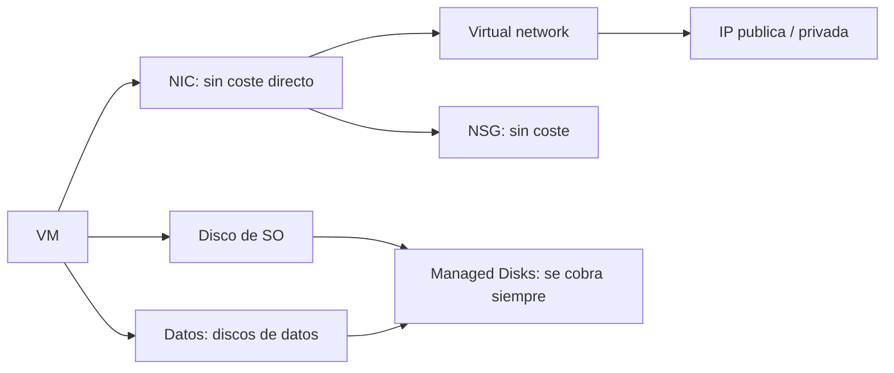

# Fase 21: Introducción a las máquinas virtuales de Azure

## Si solo recuerdas 3 cosas
- Una VM de Azure necesita varios **recursos de apoyo**: red virtual, NIC, NSG, direcciones IP (pública/privada) y discos (SO + datos).
- Antes de crear una VM conviene planificar: **red, nombre, región, tamaño, discos y sistema operativo**; el nombre (≤64 en Linux, ≤15 en Windows) es el nombre del equipo y no se cambia fácilmente.
- La facturación se separa en **cómputo** (se puede parar/desasignar) y **almacenamiento** (se cobra aunque la VM esté detenida); las **Reserved Instances** ahorran hasta un 72 %.

## Objetivo de repaso
Recordar los recursos de apoyo, la checklist de creación, los tamaños de VM, los discos y el modelo de precios.

## Comparaciones clave

| Tipo de tamaño | Optimizado para |
|---|---|
| General purpose | Equilibrio CPU/memoria (pruebas, bases pequeñas/medianas, web de tráfico bajo) |
| Compute optimized | Alta relación CPU/memoria (web de tráfico medio, appliances, batch) |
| Memory optimized | Alta memoria/CPU (BBDD relacionales, cachés, analítica en memoria) |
| Storage optimized | Alto rendimiento de disco (IO) y bases de datos |
| GPU | Renderizado, edición de vídeo, entrenamiento/inferencia de deep learning |
| High performance compute | CPU más rápidas y potentes; NIC de alto rendimiento |

| Disco | Escenario | ¿Disco de SO? |
|---|---|---|
| Ultra disk | Cargas intensivas de IO (SAP HANA, BBDD alta gama) | No |
| Premium SSD v2 | Producción sensible al rendimiento, baja latencia | No |
| Premium SSD | Producción y rendimiento | Sí |
| Standard SSD | Servidores web, apps ligeras, dev/test | Sí |
| Standard HDD | Backup, no crítico, acceso poco frecuente | Sí |

| Opción de pago | Característica |
|---|---|
| Pay-as-you-go | Por segundo, sin compromiso; para cargas cortas o impredecibles |
| Reserved Instances (1 o 3 años) | Hasta **72 %** de ahorro; para VMs continuas |

## Diagrama

## Requisitos y restricciones
- Recursos de apoyo: **VNet, NIC, NSG, IP (pública/privada), discos (SO y datos)**.
- Azure reserva las **primeras 4 direcciones y la última** de cada subred.
- Nombre de VM: hasta **64** caracteres (Linux) y **15** (Windows); identifica también el recurso.
- El **tamaño determina** CPU/memoria/coste y el máximo de discos de datos (normalmente 2 por vCPU).
- Cambiar de tamaño **reinicia** la VM; para elegir cualquier tamaño de la región hay que **parar y desasignar**.
- La **NIC no tiene coste** aparte, pero el tamaño limita cuántas NICs admite.
- El disco local (temporal) **no se cobra**; el disco de SO (~127 GiB) y los de datos sí.
- **Azure Hybrid Benefit** reduce el coste de licencia de Windows/Linux.

## Requisito → Consecuencia
| Si… | Entonces… | Si no… |
|---|---|---|
| Paras y **desasignas** la VM | No pagas cómputo | Si solo apagas, sigues pagando cómputo |
| La VM está detenida | Sigues pagando **almacenamiento** | — |
| Necesitas cambiar el tamaño | La VM **se reinicia** | No cambia el tamaño |
| Quieres cualquier tamaño de la región | Para y desasigna primero | Solo verás los disponibles en el clúster actual |

## Casos de uso típicos
- Migrar servidores on-premises a Azure (lift and shift).
- Alojar bases de datos, servidores web o appliances de red.
- Desarrollo y pruebas con tamaños general purpose.
- Cargas intensivas de GPU (IA/renderizado) o de IO (BBDD).

## Puntos críticos para el examen
- **6 familias** de tamaños: general, compute, memory, storage, GPU y HPC.
- Dos discos **mínimos**: SO y temporal (local, gratis); los datos van en discos separados.
- **5 tipos de disco**: Ultra, Premium SSD v2, Premium SSD, Standard SSD, Standard HDD.
- **Ultra y Premium SSD v2 no** se usan como disco de SO.
- Cómputo por segundo/minuto; **no** se cobra si se **desasigna**, pero el almacenamiento sí.
- Opciones de creación: portal, ARM, Azure CLI, PowerShell, Terraform, REST API, SDK, extensiones, Automation; **auto-shutdown** para ahorrar.

## Trampa típica del examen
- Creer que apagar la VM (sin desasignar) deja de cobrar (no; solo al **desasignar**).
- Olvidar que el **almacenamiento** se cobra aunque la VM esté detenida.
- Pensar que **Ultra / Premium SSD v2** sirven de disco de SO (no).
- Confundir el límite de nombre: **15** (Windows) vs **64** (Linux).
- Creer que se puede mover una VM de **availability set** tras crearla (no; hay que recrearla).

## Mini-escenario resuelto
**Escenario:** Quieres reducir el coste de una VM de desarrollo que solo se usa en horario laboral.
**Respuesta:** Configurar **auto-shutdown** (y desasignarla fuera de horario).
**Por qué:** Al desasignar, no se cobra el cómputo; auto-shutdown automatiza el apagado/desasignación por horario.

## Productos relacionados
Productos nuevos → `docs/referencia/glosario-productos.md`: **Azure Virtual Machines**, **Azure Managed Disks**, **Azure Compute Gallery**, **Azure Hybrid Benefit**, **Azure Automation**.
Términos nuevos → `docs/referencia/glosario.md`: **availability set**, **VM extension**, **Live Migration**.

## Errores comunes / troubleshooting
- El coste no baja tras apagar → hay que **desasignar**.
- No aparece el tamaño deseado → la VM está en un clúster sin ese hardware (parar/desasignar).
- No puedo cambiar el disco de SO a Ultra → no es válido como disco de SO.
