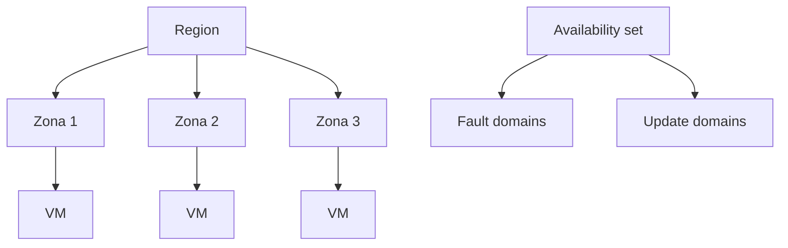

# Fase 22: Disponibilidad y escalado de máquinas virtuales

## Si solo recuerdas 3 cosas
- Un **availability set** distribuye las VMs entre **dominios de error (fault domains)** y **dominios de actualización (update domains)** para evitar un punto único de fallo; una VM **solo** entra al conjunto **al crearla**.
- Las **zonas de disponibilidad** (mínimo **3** por región habilitada) protegen contra el fallo de un **datacenter** completo, un nivel de protección mayor que un availability set.
- **Escalado vertical = cambiar el tamaño** de la VM (scale up/down); **escalado horizontal = cambiar el número de instancias** (scale out/in) con **VM Scale Sets** y **autoscale**.

## Objetivo de repaso
Recordar los tipos de mantenimiento, availability sets (UD/FD), zonas de disponibilidad, escalado vertical vs horizontal, VMSS y autoscale.

## Comparaciones clave

| Evento | Qué ocurre |
|---|---|
| Mantenimiento de hardware no planeado | Azure predice el fallo y hace **Live Migration** (pausa breve; el rendimiento puede bajar) |
| Tiempo de inactividad inesperado | Fallo de hardware/rack → se **cura** moviendo la VM (reinicio; posible pérdida del disco temporal) |
| Mantenimiento planeado | Actualizaciones periódicas de la plataforma (pueden reiniciar la VM) |

| Mecanismo | Protege contra | Nivel |
|---|---|---|
| Availability set | Fallo de hardware/rack dentro de un datacenter | Rack |
| Availability zone | Fallo de un **datacenter** | Zona (mín. 3) |
| VMSS + autoscale | Variación de carga | Instancias |

| Escalado | Qué cambia | Ejemplo |
|---|---|---|
| Vertical (scale up/down) | El **tamaño** de la VM | Más CPU/RAM |
| Horizontal (scale out/in) | El **número** de instancias | Más VMs |

## Diagrama

## Requisitos y restricciones
- En un availability set las VMs deben ser **idénticas** (mismo software y funcionalidad); admite **managed disks**.
- Las VMs de un set corren en servidores, racks, almacenamiento y switches **distintos**.
- **Update domains**: 1–20 (predeterminado **5**); en mantenimiento planeado se reinicia **un UD a la vez**; el número es **inmutable** tras crear el set.
- **Fault domains**: grupo que comparte un **punto único de fallo** (el mismo rack).
- Las VMs se añaden al availability set **solo al crearlas**; para cambiarlo hay que **eliminar y recrear** la VM.
- Zonas de disponibilidad: mínimo **3** por región habilitada; **no todas** las regiones las soportan.
- VMSS: orquestación **Uniform** (imágenes idénticas) o **Flexible** (imágenes/tamaños/config distintas; **predeterminado y recomendado**); se elige al crear.
- VMSS se integra con **Load Balancer** (L4) y **Application Gateway** (L7).
- Autoscale: define **mínimo, máximo y predeterminado**; reglas por **métrica** (CPU, etc.) o por **programación**.
- Reparto en VMSS: **max spreading** (recomendado) vs **fixed spreading** (exactamente 5 fault domains).

## Requisito → Consecuencia
| Si… | Entonces… | Si no… |
|---|---|---|
| Quieres protección ante el fallo de un datacenter | Usa **zonas de disponibilidad** | Un availability set solo protege a nivel de rack |
| Necesitas una VM en un availability set | Añádela **al crearla** | Tendrás que eliminarla y recrearla |
| La demanda varía | Usa **VMSS + autoscale** | Escalarías manualmente |
| Quieres que el escalado suba **y** baje | Define reglas **scale-out y scale-in** | Costes innecesarios o degradación |

## Casos de uso típicos
- Alta disponibilidad de un tier de aplicación (varias VMs idénticas).
- Resistir el fallo de un datacenter con 3+ VMs en zonas distintas.
- Cargas variables (web) con VMSS y autoscale.
- Reducir costes con scale-in o auto-shutdown fuera de horario.

## Puntos críticos para el examen
- Availability set = **fault domains + update domains**.
- Update domains: 1–20, predeterminado **5**, **inmutable**; se reinicia **uno a la vez**.
- Las VMs entran al set **solo al crearse**.
- Zonas: mínimo **3**, protegen de fallo de datacenter; no existen en todas las regiones.
- **Vertical** = tamaño; **horizontal** = número de instancias.
- VMSS: **Uniform** vs **Flexible** (Flexible predeterminado).
- Autoscale: métrica o tiempo; mín/máx/predeterminado; reglas de entrada y salida.
- El scale set **no tiene coste**; pagas por cada instancia.

## Trampa típica del examen
- Creer que una VM se puede mover entre availability sets (hay que recrearla).
- Confundir **fault domain** (fallo físico/rack) con **update domain** (actualizaciones).
- Creer que el availability set protege de fallos de **SO o aplicación** (no).
- Confundir zonas (datacenter) con availability sets (rack).
- Creer que Uniform admite imágenes distintas (eso es Flexible).
- Confundir «apagar» con «desasignar» al hablar de coste.

## Mini-escenario resuelto
**Escenario:** La aplicación debe sobrevivir al fallo completo de un datacenter y escalar con la demanda.
**Respuesta:** Desplegar las VMs en **zonas de disponibilidad** (3+) y usar **VM Scale Sets con autoscale**.
**Por qué:** Las zonas protegen ante el fallo de un datacenter y VMSS + autoscale ajusta el número de instancias según la carga.

## Productos relacionados
Productos nuevos → `docs/referencia/glosario-productos.md`: **Azure Virtual Machine Scale Sets**.
Nuevo grupo comparativo → `docs/referencia/comparativa-productos.md`: *Alta disponibilidad de VM (availability set vs availability zone vs VMSS)*.
Términos nuevos → `docs/referencia/glosario.md`: **fault domain**, **update domain**, **scale up/out**, **autoscale**, **orquestación Uniform/Flexible**.

## Errores comunes / troubleshooting
- La VM no está en el conjunto → hay que recrearla.
- Costes altos por escalado → faltan reglas de **scale-in**.
- El scale set falla al crear con fixed spreading → usar **max spreading**.
