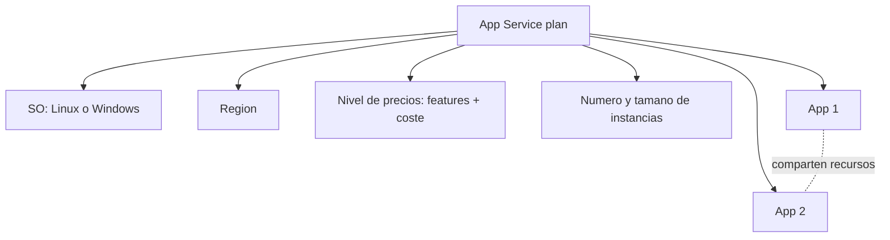

# Fase 23: Planes de Azure App Service

## Si solo recuerdas 3 cosas
- Un **App Service plan** define los **recursos de cómputo** (SO, región, nivel de precios, tamaño y número de instancias) donde corren una o varias aplicaciones; es la **unidad de escala**.
- Los niveles se agrupan en **Shared** (Free/Shared; sin SLA, solo dev/test), **Dedicated** (Basic/Standard/Premium/PremiumV2/PremiumV3) e **Isolated/IsolatedV2** (aislamiento de red).
- **Scale up (vertical)** = cambiar de **nivel de precios**; **scale out (horizontal)** = aumentar el **número de instancias** (manual o con autoscale; en Isolated hasta 100/200).

## Objetivo de repaso
Recordar qué es un plan, los niveles de precios, cómo escalar y el autoscale.

## Comparaciones clave

| Categoría | Niveles | Característica |
|---|---|---|
| Shared compute | Free, Shared | Comparten VM con otras apps/clientes; **sin SLA**; solo dev/test |
| Dedicated compute | Basic, Standard, Premium, PremiumV2, PremiumV3 | VMs dedicadas; más instancias al subir de nivel |
| Isolated | Isolated, IsolatedV2 | VMs en **VNet dedicada**; máximo scale-out y aislamiento de red |

| Nivel | Slots de staging | Autoscale | Instancias | Backups diarios |
|---|---|---|---|---|
| Free F1 | 0 | N/A | N/A | N/A |
| Basic B1 | 0 | Manual | 3 | N/A |
| Standard S1 | 5 | Reglas | 10 | 10 |
| Premium P1V3 | 20 | Reglas + elastic | 30 | 50 |
| Isolated V2 | 20 | Reglas | 200 | 50 |

| Escalado | Qué cambia |
|---|---|
| Scale up (vertical) | Nivel de precios (más CPU/memoria/disco y más features) |
| Scale out (horizontal) | Número de instancias |

## Diagrama

## Requisitos y restricciones
- El plan fija **SO, región, nivel de precios y número/tamaño de instancias**.
- Los niveles disponibles **dependen del SO** elegido al crear.
- Varias apps pueden compartir un plan (ahorro), pero **sobrecargarlo puede provocar caídas**.
- **Aísla** una app en su propio plan si es intensiva en recursos, requiere escalar de forma independiente o necesita otra región.
- El cambio de nivel (scale up/down) se aplica en **segundos**, sin redeploy, y afecta a **todas** las apps del plan.
- **Autoscale**: reglas de **métrica** o de **tiempo**; define mín/máx/predeterminado y combina scale-out + scale-in.
- **Automatic scaling (Elastic)**: solo en **PremiumV2/V3**; responde al tráfico HTTP, lo gestiona la plataforma y mantiene instancias «always-ready».

## Requisito → Consecuencia
| Si… | Entonces… | Si no… |
|---|---|---|
| Necesitas más features (dominio, SSL, slots) | **Scale up** (subir de nivel) | No tendrás esos features |
| La carga varía | **Scale out** + autoscale | Sobrecarga o coste innecesario |
| La app es intensiva en recursos | Aislarla en su **propio plan** | Puede afectar a otras apps del plan |
| Quieres escalado sin escribir reglas | **Automatic scaling** (PremiumV2/V3) | Necesitarás reglas (autoscale) |

## Casos de uso típicos
- Alojar varias apps pequeñas en un solo plan para ahorrar.
- Escalar un sitio de producción de Standard a Premium según demanda.
- Aislar una app crítica o intensiva en su propio plan o tier Isolated.
- Reducir costes bajando de nivel cuando ya no se necesitan features.

## Puntos críticos para el examen
- El plan es la **unidad de escala**; todas las apps del plan escalan juntas.
- Categorías: **Shared (Free/Shared), Dedicated (Basic→PremiumV3), Isolated/V2**.
- **Free/Shared**: solo dev/test, sin SLA.
- Scale up = nivel; scale out = instancias (máximo según tier; Isolated hasta 100/200).
- Autoscale: reglas de métrica/tiempo; mín/máx/predeterminado.
- **Automatic scaling (Elastic)**: PremiumV2/V3, por tráfico HTTP.
- IsolatedV2 = red aislada + máximo scale-out.

## Trampa típica del examen
- Confundir **scale up** (nivel) con **scale out** (instancias).
- Creer que las apps de un plan escalan por separado (escalan juntas).
- Creer que Free/Shared ofrecen SLA (no).
- Confundir **Autoscale** (reglas) con **Automatic scaling** (plataforma; PremiumV2/V3).
- Creer que un plan de una región admite apps de otra (deben ser de la misma región).

## Mini-escenario resuelto
**Escenario:** Tienes 3 micrositios con poco tráfico y quieres minimizar el coste.
**Respuesta:** Colocarlos en un **mismo App Service plan**.
**Por qué:** El plan comparte recursos de cómputo; varias apps en un plan reducen el coste (con cuidado de no sobrecargarlo).

## Productos relacionados
Productos nuevos → `docs/referencia/glosario-productos.md`: **Azure App Service**, **Azure App Service plan**, **Azure App Service Environment (Isolated)**.
Sin grupo comparativo nuevo (los niveles se comparan dentro de esta fase).

## Errores comunes / troubleshooting
- App lenta → plan sobrecargado o tier insuficiente.
- Un cambio de escalado afecta a todas las apps → recuerda que el plan es la unidad.
