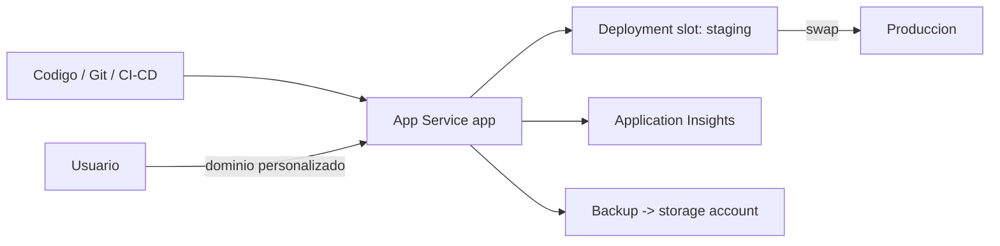

# Fase 24: Azure App Service

## Si solo recuerdas 3 cosas
- Azure App Service es una plataforma **PaaS** para hospedar apps web, backends móviles y API; admite **Windows y Linux** y lenguajes como ASP.NET, Java, Node.js, PHP y Python.
- Los **deployment slots** son apps activas con su propio hostname; se usan para **validar** y hacer **swap** a producción sin downtime (solo en **Standard, Premium e Isolated**).
- El acceso seguro usa un **módulo de autenticación integrado** (sin SDK), y la monitorización se hace con **Application Insights** (parte de Azure Monitor).

## Objetivo de repaso
Recordar creación, CI/CD, slots, seguridad, dominios personalizados, backup y Application Insights.

## Comparaciones clave

| Beneficio | Detalle |
|---|---|
| Multi-lenguaje | ASP.NET, Java, Node.js, PHP, Python (+ PowerShell/scripts) |
| DevOps | CI/CD con Azure DevOps, GitHub, Bitbucket, Docker Hub, ACR |
| Escalado | Scale up/out manual o automático |
| Seguridad | ISO/SOC/PCI; Entra ID o Google/Facebook/X/Microsoft; restricciones de IP |
| Plantillas | WordPress, Joomla, Drupal (Marketplace) |

| Método de despliegue | Tipo |
|---|---|
| GitHub (GitHub Actions o App Service Build Service) | Continuo |
| Bitbucket, Azure Repos, Local Git | Continuo |
| Remote Git | Manual |

| Acceso | Comportamiento |
|---|---|
| Allow anonymous (no action) | Pasa la info de autenticación por cabeceras; flexible |
| Allow only authenticated | Redirige a `/.auth/login/<provider>`; 401 para apps nativas |

## Diagrama

## Requisitos y restricciones
- El nombre debe ser **único** (queda como `*.azurewebsites.net`).
- Se requiere asociar un **App Service plan** (SO, región, tier, instancias).
- **Always On** es necesario para WebJobs continuos o por CRON.
- **Deployment slots**: solo **Standard, Premium e Isolated**; cada tier ofrece distinto número de slots.
- **Swap** intercambia contenido y configuración entre slots (incluida producción); **auto swap** automatiza el cambio.
- **Backup**: requiere una **storage account/container en la misma suscripción**; soportado en Basic, Standard, Premium e Isolated (en Basic solo el slot de producción); máx **10 GB**; un backup = **.zip + .xml (manifiesto)**.
- Si la storage account destino tiene **firewall**, no se puede usar como destino de backups.
- **Dominio personalizado**: registra el dominio, crea **A** o **CNAME** y habilita el dominio; App Service ofrece **certificados TLS administrados gratuitos** (se renuevan 30 días antes).

## Requisito → Consecuencia
| Si… | Entonces… | Si no… |
|---|---|---|
| Quieres desplegar sin downtime | Usa un **slot** y haz **swap** | Habría interrupción |
| Usas solo Basic | Solo puedes respaldar/restaurar el slot de **producción** | No podrás respaldar otros slots |
| La IP del destino cambia | Usa un **CNAME** | Un A record quedaría desactualizado |
| Necesitas TLS | Usa un **certificado administrado** de App Service | Tendrías que gestionarlo tú |

## Casos de uso típicos
- Hospedar sitios web, API y backends móviles.
- Añadir un dominio de marca propio con TLS administrado.
- Validar cambios en staging y hacer swap a producción.
- Monitorizar rendimiento y errores con Application Insights.
- Respaldar la app, su configuración y su base de datos.

## Puntos críticos para el examen
- Slots disponibles en **Standard, Premium e Isolated**; swap = cero downtime.
- **Auto swap** tras calentar el slot.
- CI/CD desde GitHub (Actions **predeterminado**), Bitbucket, Azure Repos, Local/Remote Git.
- **Always On** obligatorio para WebJobs continuos.
- Security module = **EasyAuthModule_32/64** en los traces.
- **Backup**: zip + xml; hasta **10 GB**; sin storage account con firewall.
- **Application Insights**: request rates, tiempos de respuesta, fallos, dependencias, excepciones, page views, usuarios/sesiones, contadores, custom events.

## Trampa típica del examen
- Creer que los slots existen en todos los tiers (solo Standard/Premium/Isolated).
- Creer que se puede respaldar cualquier slot en Basic (solo producción).
- Usar **A record** cuando la IP puede cambiar (mejor CNAME; pero el apex/root a veces exige A).
- Olvidar que la storage account de backup debe estar en la **misma suscripción** y sin firewall.
- Confundir **swap** (intercambio de slots) con **redeploy**.

## Mini-escenario resuelto
**Escenario:** Quieres publicar una nueva versión sin que los usuarios sufran interrupciones.
**Respuesta:** Desplegar en un **deployment slot** de staging, validar y hacer **swap** a producción.
**Por qué:** El swap intercambia contenido y configuración cuando las instancias ya están listas, evitando downtime.

## Productos relacionados
Productos nuevos → `docs/referencia/glosario-productos.md`: **Azure App Service**, **Application Insights**, **Azure Pipelines/Azure DevOps** (mencionados).
Términos nuevos → `docs/referencia/glosario.md`: **deployment slot**, **swap**, **CI/CD**, **Always On**, **EasyAuthModule**.
El grupo **Monitoreo** de `docs/referencia/comparativa-productos.md` se completa en la fase 28.

## Errores comunes / troubleshooting
- WebJob no se ejecuta → habilita **Always On**.
- No puedo hacer backup → storage account con firewall o en otra suscripción.
- El dominio no valida → DNS (A/CNAME) mal configurado o sin propagar.
