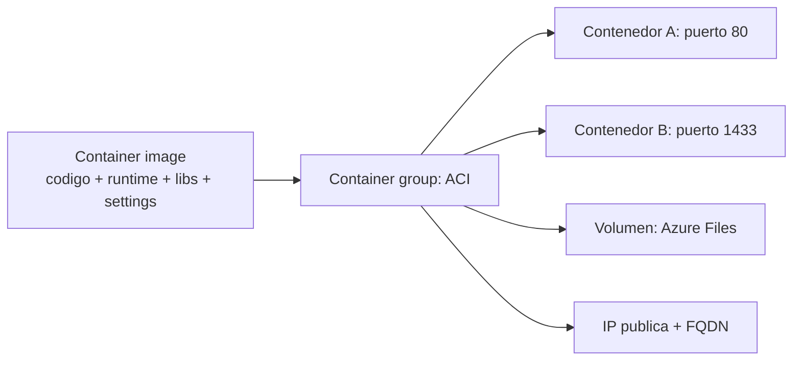

# Fase 25: Azure Container Instances (y el panorama de contenedores)

## Si solo recuerdas 3 cosas
- **ACI** es la forma **más rápida y simple** de ejecutar un contenedor en Azure, sin gestionar VMs ni adoptar un servicio mayor (PaaS ligero).
- El recurso de nivel superior es el **container group**: contenedores programados en el **mismo host**, que comparten ciclo de vida, recursos, red local y volúmenes (similar a un **pod** de Kubernetes).
- Azure ofrece varios servicios de contenedores: **ACI** (tareas aisladas y efímeras), **Azure Container Apps** (microservicios serverless) y **AKS** (control total de Kubernetes).

## Objetivo de repaso
Recordar contenedores vs VMs, ACI, los container groups y cuándo usar ACI, Container Apps o AKS.

## Comparaciones clave

| | Contenedores | Máquinas virtuales |
|---|---|---|
| Aislamiento | Ligero; **menos** fuerte como frontera de seguridad | **Completo** respecto al host y otras VMs |
| SO | Solo **modo usuario** (servicios justos); menos recursos | SO completo con kernel; más recursos |
| Despliegue | Docker CLI; orquestador (AKS) | Windows Admin Center/Hyper-V; PowerShell/SCVMM |
| Almacenamiento | Azure Disks (nodo único) o Azure Files (multi-nodo) | VHD (una máquina) o recurso compartido SMB (varias) |
| Tolerancia a fallos | El orquestador recrea contenedores en otro nodo | La VM conmuta a otro servidor del clúster |

| Servicio | Escenario | Control |
|---|---|---|
| ACI | Tareas **aisladas y de corta duración** | Mínimo (sin Kubernetes) |
| Azure Container Apps (ACA) | **Microservicios serverless**, jobs; scale to zero | PaaS (sin acceso a APIs de Kubernetes) |
| AKS | Aplicaciones complejas de larga duración | **Control total** de Kubernetes |

## Diagrama

## Requisitos y restricciones
- Imagen de contenedor = paquete autocontenido (código, runtime, herramientas del sistema, librerías, settings).
- **Recursos fijos** por el ciclo de vida del grupo: **0.1–4 vCPU** y **0.1–16 GB** por contenedor.
- Los contenedores pueden exponer **IP pública + FQDN** y montar **Azure Files**.
- **No** hay **port mapping** (los contenedores del grupo comparten el espacio de puertos).
- Los grupos pueden ser **Linux o Windows**; el SO se elige al crear.
- Grupos **co-programados** que comparten recursos del host.
- Los grupos Linux pueden desplegarse en una **VNet** (sin IP pública; solo comunicación privada/peerada).
- Al **eliminar** un grupo se liberan su **IP y FQDN**.
- Despliegue de grupos multi-contenedor: **ARM template, Bicep** (recomendado) o **YAML**.

## Requisito → Consecuencia
| Si… | Entonces… | Si no… |
|---|---|---|
| Necesitas dos contenedores en el mismo **puerto** | No es posible (no hay port mapping) | Rediseña los puertos |
| Quieres exponer el contenedor a internet | Expón el puerto en la IP y desde el contenedor | No habrá acceso externo |
| Necesitas comunicación privada entre contenedores | Despliega el grupo Linux en una **VNet** | Tendrá IP pública |
| Documentas el grupo como código | Usa **Bicep** (o ARM/YAML) | Despliegue manual |

## Casos de uso típicos
- Ejecutar una tarea puntual o aislada en un contenedor.
- Actualizaciones de web app (contenedor web + contenedor que trae contenido).
- Recolección de logs/métricas (contenedor de aplicación + contenedor de logging).
- Monitorización (contenedor que consulta periódicamente al de la app).
- Arquitecturas front-end / back-end en un grupo multi-contenedor.

## Puntos críticos para el examen
- ACI = forma **más rápida y simple**; contenedor aislado, sin gestionar VMs.
- **Container group** = pod de Kubernetes; comparte ciclo de vida, recursos, red y volúmenes.
- Tamaños: **0.1–4 vCPU**, **0.1–16 GB**; los recursos son **fijos** durante la vida del grupo.
- **Sin port mapping**; grupos Linux pueden ir a una **VNet** (sin IP pública).
- Orquestación: **ACI → ACA → AKS** según complejidad.
- **ACA**: serverless, escala por tráfico HTTP, eventos, CPU/memoria o KEDA; **scale to zero**; basado en Kubernetes + Dapr/KEDA/Envoy; **sin** acceso directo a las APIs de Kubernetes.
- **AKS**: control total de Kubernetes; autoscaling de pods y de clúster.

## Trampa típica del examen
- Creer que ACI hace **port mapping** (no lo soporta).
- Creer que ACI orquesta microservicios complejos (eso es ACA/AKS).
- Confundir **ACI** (aislado/efímero) con **ACA** (serverless) y **AKS** (Kubernetes completo).
- Creer que se puede acceder a las APIs de Kubernetes en **ACA** (no).
- Olvidar que los recursos del grupo son **fijos** durante su vida.

## Mini-escenario resuelto
**Escenario:** Quieres ejecutar rápidamente una tarea aislada en un contenedor, sin administrar VMs ni adoptar orquestación.
**Respuesta:** Desplegar el contenedor en **Azure Container Instances**.
**Por qué:** ACI es la vía más rápida y simple; arranca en segundos, sin gestionar infraestructura.

## Productos relacionados
Productos nuevos → `docs/referencia/glosario-productos.md`: **Azure Container Instances (ACI)**, **Azure Container Apps (ACA)**, **Azure Kubernetes Service (AKS)**, **Azure Container Registry (ACR)**.
Nuevo grupo comparativo → `docs/referencia/comparativa-productos.md`: *Servicios de contenedores (ACI vs ACA vs AKS)*.
Términos nuevos → `docs/referencia/glosario.md`: **container group**, **container image**, **port mapping**, **scale to zero**, **KEDA**.

## Errores comunes / troubleshooting
- Dos contenedores chocan de puerto → no hay port mapping; usa puertos distintos.
- El contenedor no recibe tráfico externo → faltó exponer el puerto.
- Se pierde la IP tras borrar el grupo → es el comportamiento esperado.
