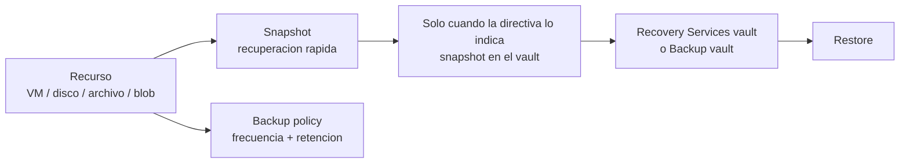

# Fase 26: Introducción a Azure Backup

## Si solo recuerdas 3 cosas
- Azure Backup es un servicio **sin infraestructura propia** que ofrece copias de seguridad **seguras, rentables y centralizadas** para recursos de Azure (VMs, discos, SQL/SAP, Azure Files, blobs).
- Usa **almacenes (vaults)** para organizar los datos: **Recovery Services vault** (VMs, SQL en VM, SAP HANA, Azure Files, blobs) y **Backup vault** (Azure Disks, blobs, PostgreSQL, etc. — SKU más reciente).
- El modelo es **basado en directivas (policy)** y **basado en instantáneas (snapshot)**, con **replicación a un vault** y **planes de retención** de corto y largo plazo.

## Objetivo de repaso
Recordar qué es Azure Backup, sus tipos de vault, cómo funciona (política, snapshots, retención) y cuándo usarlo.

## Comparaciones clave

| Vault | Protege | Notas |
|---|---|---|
| Recovery Services vault | VMs de Azure, SQL/SAP en VM, Azure Files, blobs | Vault clásico, ampliamente soportado |
| Backup vault | Azure Disks, blobs, PostgreSQL, y **más** tipos nuevos | Más reciente; gestión/RBAC distintos |

| Retención | Alcance |
|---|---|
| Corto plazo (snapshot) | Días: recuperación rápida desde la instantánea |
| Largo plazo (vault) | Semanas/meses/años: copia en el vault |

| Concepto | Qué es |
|---|---|
| Backup policy | Define **frecuencia** y **retención** (diaria/semanal/mensual/anual) |
| Snapshot | Copia puntual en el almacenamiento del recurso (recuperación rápida) |
| Vault tier | Copia enviada al vault (retención prolongada) |

## Diagrama

## Requisitos y restricciones
- No requiere desplegar ni administrar infraestructura propia (**zero-infrastructure**).
- El **Recovery Services vault** y el recurso protegido deben estar en la **misma región** (para VMs).
- La **retención** se define al crear la directiva (uso compartido de directivas entre recursos).
- El **almacenamiento** en el vault se factura aparte (según los datos protegidos y la retención).
- La información de backup es accesible/administrable de forma **centralizada** (portal, CLI, PowerShell, REST).
- Protectores: administradores de TI (cumplimiento) y administradores de aplicaciones (autoservicio de backup/restore).

## Requisito → Consecuencia
| Si… | Entonces… | Si no… |
|---|---|---|
| Necesitas proteger VMs de Azure | Usa un **Recovery Services vault** | Para discos/blobs usa Backup vault |
| Quieres definiciones de retención homogéneas | Reutiliza la misma **directiva** | Tendrás muchas políticas dispersas |
| Necesitas recuperación rápida | Apóyate en la **instantánea** | Solo tendrías la copia del vault (más lenta) |

## Casos de uso típicos
- Proteger datos frente a **corrupción** o escenarios de **administrador deshonesto** (rogue admin).
- Cumplir requisitos de **cumplimiento y auditoría** de la organización.
- Autoservicio de backup/restore para administradores de aplicaciones.
- Retención a largo plazo con copia en el vault.

## Puntos críticos para el examen
- Azure Backup = **zero-infrastructure**, seguro y rentable; interfaz **centralizada**.
- Dos tipos de vault: **Recovery Services vault** y **Backup vault**.
- Modelo **basado en directiva** y **basado en instantáneas**.
- **Snapshots** primero (recuperación rápida); luego copia al **vault** para retención larga.
- Administrable desde portal, **CLI, PowerShell, REST**.
- Protege VMs, discos, SQL/SAP, **Azure Files y blobs**.

## Trampa típica del examen
- Confundir **Recovery Services vault** (VMs/SQL/Azure Files) con **Backup vault** (discos, blobs, PostgreSQL…).
- Creer que Azure Backup necesita infraestructura propia (no; es sin infraestructura).
- Olvidar que la **retención** se define en la **directiva**.
- Creer que el vault y la VM pueden estar en regiones distintas (deben coincidir).

## Mini-escenario resuelto
**Escenario:** Necesitas una solución de backup para datos de Azure que no requiera administrar servidores de copia y que pueda gestionarse desde el portal, CLI o PowerShell.
**Respuesta:** Usar **Azure Backup** con un **Recovery Services vault** (o Backup vault según el recurso).
**Por qué:** Azure Backup es sin infraestructura, centralizado y administrable por portal/CLI/PowerShell/REST.

## Productos relacionados
Productos nuevos → `docs/referencia/glosario-productos.md`: **Azure Backup**, **Recovery Services vault**, **Backup vault**.
Nuevo grupo comparativo → `docs/referencia/comparativa-productos.md`: *Backup y DR (Recovery Services vault vs Backup vault; Azure Backup vs Site Recovery)*.
Términos nuevos → `docs/referencia/glosario.md`: **backup policy**, **retención de corto/largo plazo**, **snapshot**.

## Errores comunes / troubleshooting
- No aparece el recurso para proteger → vault y recurso en regiones distintas.
- El coste sube → revisar retención y datos retenidos en el vault.
