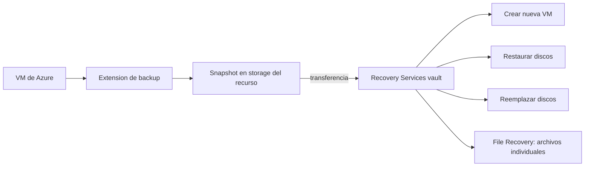

# Fase 27: Proteger máquinas virtuales con Azure Backup

## Si solo recuerdas 3 cosas
- Backup de VM de Azure guarda **instantáneas (snapshots)** en el almacenamiento del recurso y las **transfiere al vault** según la **directiva**; la recuperación puede ser rápida desde la instantánea.
- De forma predeterminada los backups son **independientes y no tienen conocimiento de la aplicación**, pero se puede **habilitar la coherencia de aplicaciones** (VSS en Windows / pre-post scripts en Linux) para bases de datos y apps.
- Existen varios **tipos de restauración**: crear una **nueva VM**, **restaurar discos**, **reemplazar discos existentes** y **restauración de archivos (File Recovery)**.

## Objetivo de repaso
Recordar las características de Azure Backup para VM, cómo crear/configurar el backup y cómo restaurar datos.

## Comparaciones clave

| Característica | Detalle |
|---|---|
| Backup independiente | Backups **sin** conocimiento de la app (predeterminado) |
| Coherencia de aplicaciones | VSS (Windows) / pre-post scripts (Linux) para SQL, Exchange… |
| Snapshots | Copias puntuales en el almacenamiento del recurso |
| Transferencia al vault | Según la directiva de retención |

| Restauración | Resultado |
|---|---|
| Crear una nueva VM | Restaura la VM completa en un punto de recuperación |
| Restaurar discos | Recupera los discos para montarlos/usarlos |
| Reemplazar discos | Sustituye discos de la VM existente |
| File Recovery | Recupera **archivos individuales** montando el punto de recuperación |

## Diagrama

## Requisitos y restricciones
- La VM y el **Recovery Services vault** deben estar en la **misma región**.
- Se instala una **extensión de backup** en la VM.
- El backup predeterminado es **independiente** (no consciente de la app); habilita **application consistency** para VSS/scripts.
- La **directiva** define la **frecuencia** (p. ej. diaria) y la **retención** (días/semanas/meses/años).
- Se puede **activar el backup al crear la VM** desde el portal, o después (más de una VM a la vez vía Recovery Services vault).
- Para restaurar en otro destino, la región/disponibilidad del destino debe cumplir las condiciones del vault.
- **File Recovery** monta el punto de recuperación en la máquina local y **desmonta al finalizar**.

## Requisito → Consecuencia
| Si… | Entonces… | Si no… |
|---|---|---|
| Necesitas coherencia de base de datos/datos | Habilita **application consistency** (VSS/scripts) | El backup será solo a nivel de archivo |
| Quieres recuperar un archivo suelto | Usa **File Recovery** | Tendrías que recrear/restaurar discos enteros |
| Quieres restaurar la VM completa | Elige **Crear nueva VM** | Tendrías que reconstruirla manualmente |
| La VM y el vault están en regiones distintas | No se podrá proteger | Mueve el vault o la VM a la misma región |

## Casos de uso típicos
- Proteger VMs de producción frente a borrado/corrupción.
- Restaurar una VM completa tras un fallo.
- Recuperar archivos individuales sin restaurar toda la máquina.
- Cumplir requisitos de cumplimiento con retención prolongada.

## Puntos críticos para el examen
- Instantánea primero (recuperación rápida) → **transferencia al vault** según la directiva.
- Backup predeterminado **independiente**; **application consistency** opcional.
- **Cuatro** modos de restauración (nueva VM, discos, reemplazar discos, File Recovery).
- **Misma región** para VM y vault.
- Se instala **extensión** en la VM.
- Debes **desmontar** el punto de recuperación tras File Recovery.

## Trampa típica del examen
- Creer que el backup es consciente de la aplicación por defecto (no; hay que habilitarlo).
- Confundir **restaurar discos** con **reemplazar discos**.
- Olvidar que VM y vault deben estar en la **misma región**.
- Confundir **File Recovery** (archivos) con restaurar la VM completa.
- Creer que la instantánea y la copia del vault son lo mismo.

## Mini-escenario resuelto
**Escenario:** Un usuario borró por error un archivo en una VM de producción y necesitas recuperarlo **sin** restaurar toda la máquina.
**Respuesta:** Usar la **restauración de archivos (File Recovery)** desde el punto de recuperación.
**Por qué:** File Recovery monta el punto de recuperación y permite extraer archivos individuales, sin restaurar discos completos.

## Productos relacionados
Productos nuevos → `docs/referencia/glosario-productos.md`: (ya registrados Azure Backup, Recovery Services vault).
Completa el grupo **Backup y DR** en `docs/referencia/comparativa-productos.md`.
Términos nuevos → `docs/referencia/glosario.md`: **application consistency**, **File Recovery**, **punto de recuperación**.

## Errores comunes / troubleshooting
- El backup falla → la extensión no está instalada o hay un problema de red/almacenamiento.
- El archivo recuperado no aparece → no olvides **desmontar** el punto de recuperación.
- La VM no aparece para proteger → región distinta a la del vault.
