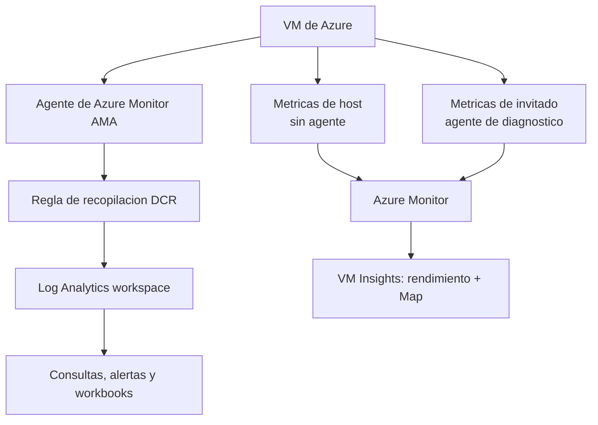

# Fase 28: Supervisar una VM de Azure con datos de diagnóstico

## Si solo recuerdas 3 cosas
- **Azure Monitor** es la solución integral (recursos de Azure y no Azure) con **dos características principales**: **métricas** (valores numéricos en intervalos, se conservan ~**93 días**) y **logs** (eventos con marca de tiempo).
- Se distinguen **métricas de host** (del host de la VM: CPU, red, disco, sin agente) y **métricas de invitado** (del sistema operativo, requieren **agente de diagnóstico**).
- **VM Insights** incorpora Azure Monitor para VM y **Map** (dependencias); los datos de **logs** se recopilan con el **agente (AMA) + regla de recopilación de datos (DCR)** hacia **Log Analytics**.

## Objetivo de repaso
Recordar las dos características de Azure Monitor, host vs invitado, VM Insights y la recopilación de logs.

## Comparaciones clave

| Característica | Qué es | Retención |
|---|---|---|
| Métricas | Valores numéricos en intervalos predefinidos | ~**93 días** |
| Logs | Eventos registrados con marca de tiempo | Según Log Analytics |

| Tipo de métrica | Origen | ¿Agente? |
|---|---|---|
| Host | Host físico de la VM (plataforma) | No |
| Invitado (guest) | Sistema operativo de la VM | Sí (agente de diagnóstico) |

| Componente | Función |
|---|---|
| Azure Monitor | Plataforma de métricas y logs |
| VM Insights | Rendimiento + **Map** (dependencias) |
| Log Analytics workspace | Almacén de logs consultable (KQL) |
| Agente de Azure Monitor (AMA) | Recopila logs del sistema operativo |
| Regla de recopilación de datos (DCR) | Define **qué** datos recopilar y **dónde** enviarlos |

## Diagrama

## Requisitos y restricciones
- Azure Monitor abarca recursos de Azure **y no Azure**, incluidas VMs.
- Las **métricas** de host se recopilan **sin** agente; las de **invitado** requieren el **agente de diagnóstico**.
- Los **logs** requieren el **agente de Azure Monitor (AMA)** y una **DCR** que apunte al espacio de **Log Analytics**.
- **VM Insights** depende de métricas y logs (rendimiento y **Map**).
- Los datos de diagnóstico se envían a **Log Analytics** para consultas y alertas.
- La retención por defecto de métricas es ~**93 días** (con algunas excepciones).

## Requisito → Consecuencia
| Si… | Entonces… | Si no… |
|---|---|---|
| Quieres ver uso de CPU ya, sin instalar nada | Consulta las **métricas de host** | Necesitarías el agente para métricas de invitado |
| Necesitas métricas del SO | Instala el **agente de diagnóstico** | Solo verás métricas de host |
| Quieres consultar logs | Envía datos a **Log Analytics** con AMA + DCR | No habría logs consultables |
| Necesitas ver dependencias entre máquinas | Habilita **VM Insights (Map)** | No verías el mapa de dependencias |

## Casos de uso típicos
- Detectar rápidamente problemas (p. ej. arranque lento) revisando métricas de la VM.
- Ver el **rendimiento** y las **dependencias** de la VM con VM Insights.
- Recopilar logs del SO y analizarlos en Log Analytics.
- Crear consultas, alertas y workbooks sobre métricas y logs.
- Análisis posterior a una incidencia con datos históricos.

## Puntos críticos para el examen
- Azure Monitor = **métricas + logs** (dos características principales).
- **Métricas de host** (sin agente) vs **métricas de invitado** (agente).
- **Métricas**: retención ~**93 días**.
- **VM Insights** = rendimiento + **Map** (dependencias).
- Logs → **AMA + DCR** hacia **Log Analytics workspace**.
- Azure Monitor cubre recursos de Azure y **no Azure**.

## Trampa típica del examen
- Confundir **métricas de host** (plataforma, sin agente) con **métricas de invitado** (SO, con agente).
- Creer que las métricas y los logs son lo mismo.
- Olvidar que los logs requieren **AMA + DCR** y van a **Log Analytics**.
- Confundir **VM Insights** con el simple visor de métricas.
- Creer que la retención de métricas es ilimitada (por defecto ~93 días).

## Mini-escenario resuelto
**Escenario:** Necesitas investigar por qué una VM tarda en arrancar y además consultar los eventos del sistema operativo de la última semana.
**Respuesta:** Revisar las **métricas** de la VM en Azure Monitor y habilitar la recopilación de **logs** con **AMA + DCR** hacia **Log Analytics** (VM Insights para el rendimiento).
**Por qué:** Las métricas muestran CPU/rendimiento (host e invitado) y los logs del SO se consultan en Log Analytics; VM Insights aporta rendimiento y dependencias.

## Productos relacionados
Productos nuevos → `docs/referencia/glosario-productos.md`: **Azure Monitor**, **Log Analytics**, **VM Insights**, **Azure Monitor Agent (AMA)**.
Completa el grupo **Monitoreo** en `docs/referencia/comparativa-productos.md` (Azure Monitor vs Network Watcher vs Connection Monitor).
Términos nuevos → `docs/referencia/glosario.md`: **métrica de host/invitado**, **DCR**, **Log Analytics workspace**, **KQL**.

## Errores comunes / troubleshooting
- No veo métricas del SO → falta el **agente de diagnóstico**.
- No hay logs → falta **AMA + DCR** o el espacio de Log Analytics.
- Me faltan datos históricos → superé la **retención** de métricas (~93 días).
